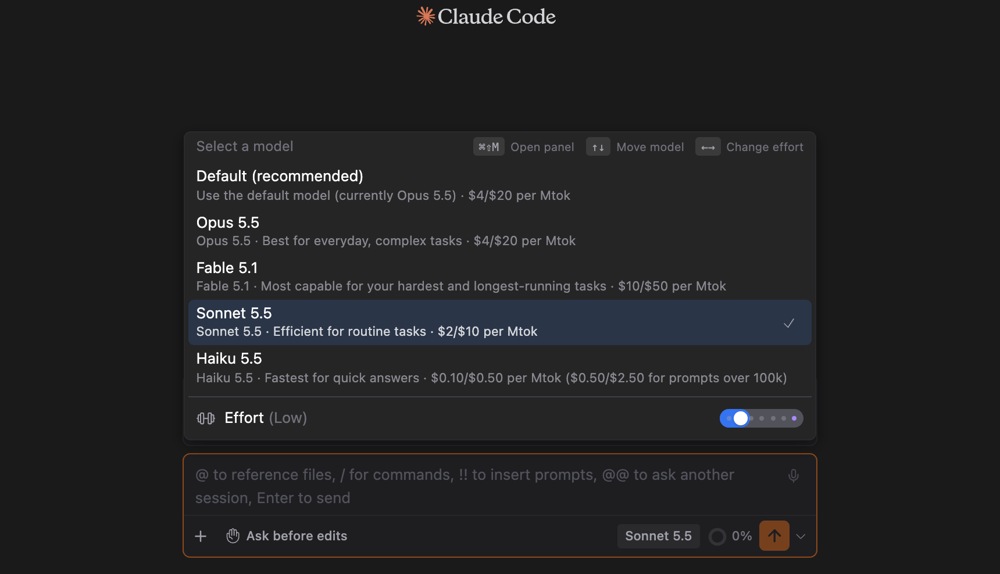

# Effort & Fast Mode

> 언어: [English](./en.md) · **한국어**
>
> 관련: [#121](https://github.com/Swttch/swttch/issues/121), [#152](https://github.com/Swttch/swttch/issues/152), [#474](https://github.com/Swttch/swttch/issues/474), [#604](https://github.com/Swttch/swttch/issues/604)

**Model** 섹션의 두 컨트롤 **Effort**와 **Fast mode**는 모델별로 속도와 깊이를 조절하게 해줍니다. 둘 다 Claude Code CLI에서 이미 설정할 수 있는 것을, 채팅을 벗어나지 않고 바로 조작할 수 있도록 인라인 컨트롤로 꺼내온 것입니다.

## Effort

**Effort**는 Claude가 응답에 얼마나 공을 들이는지 — 추론에 쓰는 예산 — 를 뜻합니다. 높을수록 더 깊이 생각하고(느리고 토큰을 더 씀), 낮을수록 더 빠르고 저렴하게 답합니다. CLI가 모델별로 노출하는 바로 그 설정입니다.

### 슬라이더

Effort는 목록이 아니라 **슬라이더**입니다. 각 눈금은 현재 모델이 지원하는 단계 하나입니다:

| 단계 | 표시 |
|------|------|
| `low` | Low |
| `medium` | Medium |
| `high` | High |
| `xhigh` | Extra high |
| `max` | Max |

- **Auto**는 Low 왼쪽의 첫 번째 눈금입니다. "이 모델의 단계를 내가 고르지 않았으니 CLI가 정하게 한다"는 뜻입니다. CLI는 그 모델에 대해 `modelSettings`에 적어 둔 단계가 있으면 그것을, 없으면 모델 자체의 기본값을 씁니다. 고른 단계를 되돌리려면 슬라이더를 Auto로 옮기면 됩니다. ([#604](https://github.com/Swttch/swttch/issues/604) 이전에는 Auto가 첫 선택 전에만 보이는 라벨이었고, 한 번 고르면 `settings.json`을 직접 고치지 않는 한 돌아갈 방법이 없었습니다.)

Ultracode를 쓸 수 있으면 슬라이더에는 Auto, Low, Medium, High, Extra high, Max, Ultracode의 일곱 눈금이 있습니다. 위 그림은 Auto에 놓인 모습입니다.

- 슬라이더를 **클릭하거나 드래그**하면 해당 단계로 이동합니다. **행을 클릭**(또는 Enter)하면 다음 단계로 순환하며, 마지막에서 첫 단계로 돌아옵니다.

### Ultracode (최상단 스텝)

모델이 `xhigh` 단계를 지원하면, 슬라이더에 Max를 지나 한 칸이 더 생기고 **보라색**으로 표시됩니다 — **Ultracode**입니다. 여기에 놓으면 `xhigh` effort에 더해 상시 워크플로우 오케스트레이션까지 켜지는, 최대 성능 설정이 됩니다. 모델이 `xhigh`를 지원하고 Workflows가 비활성이 아닐 때만 제공됩니다.

### 어디서 찾나요

- **모델 패널** — 입력창 아래줄의 모델 이름을 누르거나 **⌘⇧M**(Windows와 Linux는 **Ctrl + Shift + M**)을 누릅니다. **Effort** 행은 모델 목록 아래에 구분선을 두고 있습니다.
- **슬래시 커맨드 패널**(`/` 입력) → **Model** 섹션 → **Effort** 행. 라벨 옆에 현재 단계가 표시됩니다(예: *Effort (Extra high)*).

Effort는 예전에 모드 팝업(**Shift + Tab**) 아래쪽에 있었습니다. 지금은 모델 패널로 옮겨 갔고, 모드 팝업에서는 권한 모드만 고릅니다.

### 키보드로 조작하기

모델 패널을 열면 키보드 포커스가 패널 안으로 들어가므로, 마우스 없이 모두 조작할 수 있습니다. 패널 오른쪽 위에 받는 키가 적혀 있습니다.

| 키 | 동작 |
|-----|------|
| **⌘⇧M** / **Ctrl + Shift + M** | 패널을 엽니다 |
| **↑** / **↓** | 모델 사이로 강조를 옮깁니다(마우스를 올린 것처럼 보입니다) |
| **Enter** | 강조된 모델을 고릅니다. 클릭과 같습니다 |
| **←** / **→** | Effort를 낮추거나 올립니다 |
| **Esc** | 패널을 닫습니다 |

- 모델을 골라도 패널이 **닫히지 않으므로**, 한 번 열어 모델을 고르고 이어서 Effort까지 정할 수 있습니다. 패널은 **Esc**를 누르거나 바깥을 눌러 닫습니다. 키보드 포커스와 입력창의 커서 위치는 열기 전 자리로 돌아옵니다.
- **←**와 **→**를 누르는 즉시 슬라이더가 움직입니다. 실제 변경은 마지막으로 키를 누른 뒤 0.5초 후에 한 번 보내므로, 세 단계를 연달아 옮겨도 변경은 세 번이 아니라 한 번 갑니다.

### 다음 응답이 실제로 쓰는 값

- 변경은 **실행 중인 채팅**에 적용됩니다. 다시 시작하지 않으며, 다음 응답부터 반영됩니다.
- 응답이 끝나면 CLI가 실제로 쓴 effort를 기록하고, 패널은 그 **적용된** 값을 보여 줍니다. 내가 정한 값과 다르면, 슬라이더를 다시 움직일 때까지 실제로 쓰인 값을 보여 줍니다.
- 단계는 **그 단계를 고른 모델**에 속합니다. 슬라이더는 지금 선택된 모델의 단계를 보여 주므로, Opus와 Sonnet이 각자의 단계를 따로 가질 수 있고, 모델을 바꾸면 슬라이더도 그 모델의 값으로 바뀝니다.
- 저장 위치는 Claude Code CLI가 쓰는 곳과 같은 Claude 사용자 설정이고, `modelSettings.<모델>.effortLevel`입니다(예: `modelSettings.claude-sonnet-5-5.effortLevel`). 새 채팅이나 터미널의 `claude`도 여기서 읽습니다. Auto를 고르면 그 항목이 지워집니다.
- 이 파일에는 CLI가 `low`, `medium`, `high`, `xhigh`만 받습니다. 그래서 **Max**는 고른 그 채팅에서만 유지되고 저장되지 않습니다.
- **채팅이 열려 있을 때 Auto를 고르면** 다음 메시지를 보낼 때 반영됩니다. 그 채팅의 CLI가 단계를 강제하지 않은 채 한 번 다시 시작하고, 대화는 이어서 진행됩니다.
- 슬라이더를 움직이지 않은 채팅에서는 Swttch가 CLI에 단계를 전혀 강제하지 않으므로, `~/.claude/settings.json`에 모델별로 적어 둔 단계가 터미널에서와 똑같이 적용됩니다.

### 모델마다 다른 단계

한 모델은 깊게, 다른 모델은 가볍게 쓸 수 있습니다. 예를 들어 Opus는 **High**, Sonnet은 **Low**로 둘 수 있습니다. 모델을 고르고 슬라이더를 옮긴 뒤, 다른 모델을 고르고 슬라이더를 다시 옮기면 됩니다. 각 선택은 그 모델에만 저장됩니다.

- [#604](https://github.com/Swttch/swttch/issues/604) 이전에 슬라이더만 쓰던 분의 `settings.json`에는 최상위 `effortLevel` 하나가 있고, 예전에는 모든 채팅이 그 값을 CLI에 넘겼습니다. 어느 모델에서든 슬라이더를 움직이기 전까지는 달라지는 것이 없습니다. 움직이는 순간 예전 단계가 나머지 모델의 개별 단계로 옮겨 적혀서, 어느 모델도 조용히 기본값으로 떨어지지 않습니다.
- **`opusplan`**(Opus가 계획하고 Sonnet이 실행): 슬라이더는 모델 선택창에 보이는 모델을 따릅니다. Claude Code CLI 2.1.310에서 재 보니, `opusplan`으로 시작한 채팅은 계획 단계와 실행 단계를 모두 시작한 모델의 단계로 실행합니다. 계획을 다른 모델에 넘길 때 CLI가 단계를 바꾸지 않습니다. 이것은 CLI의 동작이며 이 슬라이더가 바꾸는 것이 아닙니다.

### 오래된 Claude Code CLI 버전

- **2.1.38 미만**: CLI가 effort 옵션 자체를 모릅니다. 슬라이더는 움직이지만 효과가 없습니다. 쓰려면 CLI를 업데이트하세요.
- **2.1.38 ~ 2.1.49**: CLI가 채팅 도중의 변경을 받지 못하므로, **다음 메시지를 보낼 때 그 채팅의 CLI 프로세스를 새 단계로 다시 시작합니다**. 대화는 이어서 진행됩니다. 이 버전들은 적용된 effort를 알려 주지 않을 수 있고, 그러면 패널은 내가 고른 값을 계속 보여 줍니다.
- **2.1.50 이상**: 위에서 설명한 대로 실행 중인 채팅에 바로 적용됩니다.

## Fast mode

**Fast mode**는 더 빠른 출력을 우선합니다. **Opus** 모델에서만 사용할 수 있으며, **Model** 섹션의 **Toggle fast mode** 스위치에서 켤 수 있습니다.

## 모델별 지원 한눈에 보기

어떤 컨트롤이 적용되는지는 사용 중인 모델에 따라 다릅니다. CLI가 각 모델의 지원 여부를 알려주고, GUI는 그것을 그대로 따릅니다:

| 모델 | Effort | 단계 | Ultracode | Fast mode |
|------|:---:|---|:---:|:---:|
| **Opus** | ✅ | Low · Medium · High · Extra high · Max | ✅ | ✅ |
| **Sonnet** | ✅ | Low · Medium · High · Max *(Extra high 없음)* | ❌ | ❌ |
| **Haiku** | ❌ | — | ❌ | ❌ |

알아두면 좋은 점 두 가지:

- **Sonnet에는 Extra high가 없어서** **Ultracode 스텝도 없습니다** — 버그가 아니라 모델의 지원 범위입니다.
- **Fast mode는 Opus 전용**이라, Sonnet과 Haiku에서는 토글이 비활성입니다.

## 지원하지 않는 모델에서의 동작

지원하지 않는 모델에서 컨트롤을 아예 숨기는 대신, 행은 그대로 보이되 **비활성(회색)** 으로 표시되고, 마우스를 올리면 이유를 짧은 툴팁으로 알려줍니다 — 예를 들어 *"This model doesn't support effort levels"* 또는 *"Fast mode is only available on Opus models"*. 이렇게 하면 어떤 모델에서든 Model 섹션이 일관되게 보여서, 컨트롤이 없어졌다고 고장으로 오해하지 않게 됩니다 ([#152](https://github.com/Swttch/swttch/issues/152)).

## 참고

- 이 컨트롤들은 **현재 실행 중인 세션 모델**을 반영합니다 — 모델을 바꾸면 사용 가능한 effort 단계, Ultracode 스텝, Fast mode 지원 여부가 그에 맞춰 갱신됩니다.
- 여기 있는 모든 것은 CLI가 이미 지원하는 것과 대응됩니다. GUI는 그저 플래그 대신 클릭으로 바꿔줄 뿐입니다.
