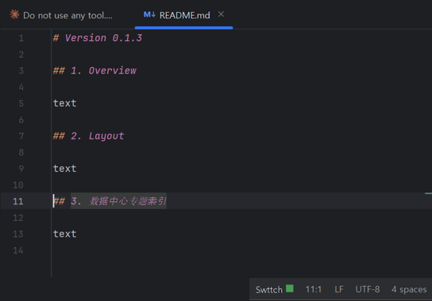
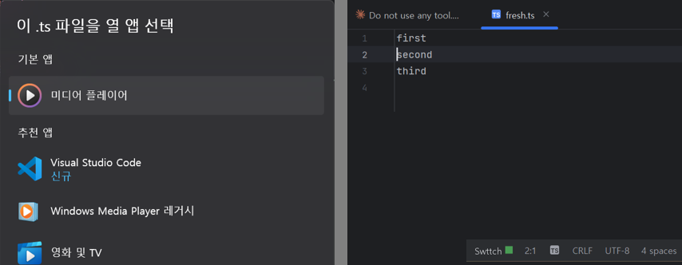

# Clickable jump-to-line file references in chat

> Languages: **English** · [한국어](./ko.md)
>
> Related: [#183](https://github.com/Swttch/swttch/issues/183), [#209](https://github.com/Swttch/swttch/issues/209), [#210](https://github.com/Swttch/swttch/pull/210), [#708](https://github.com/Swttch/swttch/issues/708)

## What's new

When Claude points at a file in its answer — while explaining code, reviewing a
change, or saying where a bug lives — that reference is now **clickable**.
Clicking it opens the file in the JetBrains editor and moves the caret straight
to the referenced line (and column, when given).

Previously these references were dead: a Markdown file link even opened an empty
`localhost:<port>/…` browser tab instead of the file (#209).

## What you see

Two kinds of references become clickable:

- **Markdown file links** that Claude writes, e.g.
  `[ExampleService.java:120-135](./src/main/java/.../ExampleService.java#L120-L135)`.
  Clicking opens the file at line 120. Regular web links
  (`https://…`) stay normal links and still open in your browser.
- **Bare plain-text references** written inline in a sentence, e.g.
  `src/example/File.java:10`, `src/example/File.java:10:5` (line **and column**),
  or `src/example/File.java#L10-L25`. These are detected and turned into the same
  clickable reference.
- **`@`-mention chips** (`@src/file.ts#L42`) now also carry the line: clicking
  one jumps to line 42 instead of the top of the file.

There's also a **"Open files with"** setting (Settings → General). When your
chat is connected to a JetBrains IDE, it's fixed to that IDE and shows its
product badge — files always open in the editor. In a standalone browser with no
IDE attached, you can pick a detected editor (or a custom program); the default
is the operating system's default opener.

Relative paths are resolved against the project's working directory, so
`./src/x.ts` and `src/x.ts` both open the right file.

## Every way a path is written

A reference opens however Claude or the CLI happens to spell it:

| Written as | Example |
|------------|---------|
| A link to a heading of a document, which opens at that heading's line | `[Index](docs/README.md#3-index)` |
| Windows paths, with either separator | `C:\proj\src\app.ts:2`, `src\app.ts` |
| Git Bash, Cygwin, WSL and WSL share paths | `/c/proj/a.ts`, `/mnt/c/proj/a.ts`, `\\wsl$\Ubuntu\home\me\a.ts` |
| Home and `file:` paths, and `vscode://file/…` links | `~/notes/a.md` |
| Folder names in any language | `数据中心/说明.md`, `문서/설계.md` |
| Route folders in brackets or parentheses | `app/(group)/[id]/page.tsx` |
| Names with spaces, in a link or an `@"…"` mention | `[notes](docs/my%20file.md)`, `@"docs/my file.md"` |
| Positions and ranges | `a.ts:10`, `a.ts:10:5`, `a.ts:10-20`, `a.ts#L10C5` |

What is on disk decides: a `#` or a `:` that is part of a file name is never cut off.

A file Claude has just written opens in the IDE editor right away, before the IDE has noticed it on its own.

If a clicked reference points at a path that isn't on disk (a stale or made-up
path), the open no longer fails silently — a short toast tells you the file
couldn't be opened.

## What is deliberately left alone

Plain-text detection is intentionally conservative, so ordinary prose is never
turned into a broken link:

- A reference must contain a **path separator** (`/` or `\`) and end in a file
  name with an extension. A bare `App.java:10` or a host like `example.com:8080`
  is **not** linkified.
- A name written with backslashes alone, such as `DOMAIN\john.doe`, is only taken
  for a file when it starts like a path or names a line.
- Anything inside a **fenced code block**, inside an **existing link**, or inside a
  **URL** is never rewritten. Inline code becomes a link only when it holds nothing
  but a path.

## How it works

- A reference is rendered as a clickable element that calls the IDE bridge's
  `openFile(path, line, column)` — the same bridge the editor-context and
  `@`-mention features already use, so no new backend protocol is involved. Line
  and column are 1-based; the IDE opens at the top when no line is given.
- When you open the chat in a **browser tab from an IDE session**, clicking a
  reference still opens the file in that **IDE** (at its line/column), not in the
  OS default app — the backend routes the open to the connected IDE whenever one
  is attached. A standalone browser with no IDE falls back to the OS opener.
- Plain-text references are linkified in a webview-only preprocessing step that
  masks code spans, existing links, and URLs before scanning, then hands the
  result to the same Markdown-link renderer — so both kinds of reference share
  one code path.
- Windows drive paths (`C:\proj\File.java`) are carried safely through Markdown
  sanitization and restored when the file is opened.

Existing installs gain it by updating the plugin.
