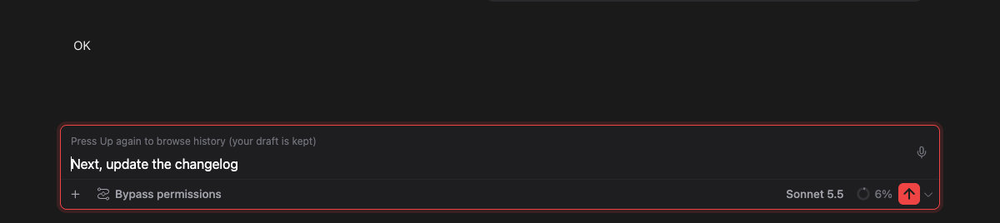
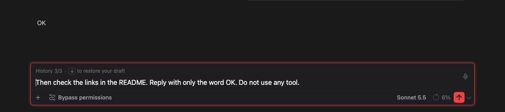
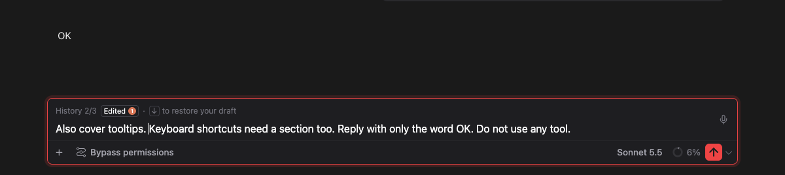
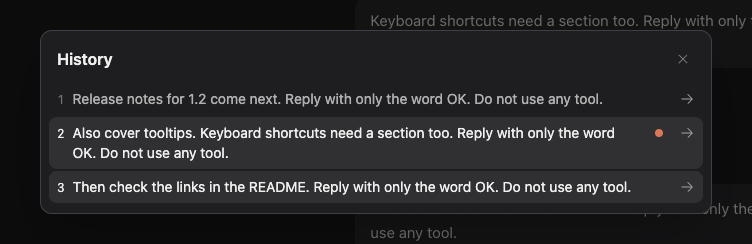

# 위·아래 방향키로 보낸 메시지를 거슬러 올라갑니다

> Language: [English](./en.md) · **한국어**

메시지 입력칸에서 위 방향키를 누르면 터미널처럼 이전에 보낸 메시지가 나오고, 아래 방향키로 돌아옵니다. 둘러보는 동안 작성하던 글은 그대로 보관되고, 맨 아래로 내려오면 다시 나타납니다.

다시 연 대화에서도 동작하게 만든 것은 [#395](https://github.com/Swttch/swttch/pull/395)이고, 초안 보관과 안내, 위치 표시, 초안 공유, 히스토리 창은 [#735](https://github.com/Swttch/swttch/issues/735)에서 추가했습니다.

## 먼저 커서를 옮기고, 그다음 히스토리로 갑니다

**방향키는 먼저 커서를 옮깁니다.** 위 방향키는 글의 줄(자동으로 접힌 줄 포함)을 올라간 뒤 맨 첫 글자 앞까지 갑니다. 아래 방향키는 맨 끝까지 같은 방식으로 갑니다. macOS, Linux, Windows에서 같게 동작합니다. Shift를 누른 채로는 글을 선택하며, 이전 메시지를 불러오지 않습니다.

**작성 중인 글을 벗어나려면 한 번 더 눌러야 합니다.** 글의 맨 앞에서 위 방향키를 누르면 먼저 글 위에 안내가 나타납니다.

> 한 번 더 위로 올려 히스토리 탐색 (초안은 유지됩니다)

한 번 더 누르면 가장 최근에 보낸 메시지로 갑니다. 다른 키를 누르거나 클릭하면 안내가 사라집니다. 히스토리 안에서는 안내 없이 바로 넘어갑니다.

**둘러보는 동안 입력칸이 위치를 알려 줍니다.** 예를 들면 `히스토리 19/19`입니다. 가장 최근 메시지가 가장 큰 번호이고, 가장 오래된 메시지가 1이며, 작성 중인 초안에는 번호가 없습니다. 전체 수는 [전송 목차](../071-send_index/ko.md)의 눈금 수와 같습니다. 둘이 같은 목록을 보여 주기 때문입니다.

작성 중인 초안이 기다리고 있으면 위치 옆에 **↓로 임시 저장 내용 복원** 안내가 함께 보입니다. 안내 줄이 나타나고 사라질 때 입력칸의 높이는 부드럽게 늘고 줄어듭니다.

위 방향키로 불러온 메시지는 커서가 맨 앞에 놓여 바로 다음으로 넘어갈 수 있습니다. 아래 방향키로 불러온 메시지는 커서가 맨 끝에 놓입니다.

## 수정본을 한눈에 보고 정리합니다

수정본이 하나라도 있으면 입력칸의 안내 줄에 개수가 적힌 뱃지가 나타납니다. 지금 보고 있는 메시지가 수정본이면 **수정됨**, 아니면 흐린 **수정 내역**입니다. 작성 중인 초안에서도 보입니다.

뱃지를 누르면 **히스토리** 창이 열립니다.

- 보낸 메시지가 보낸 순서대로(1번이 맨 위) 번호와 한 줄 미리보기로 나열됩니다.
- 수정본에는 주황색 점이 붙고, 처음부터 펼쳐져 있습니다.
- 어느 줄이든 누르면 그 자리에서 펼쳐져 내용 전체(그림 포함)가 보입니다. 수정본은 수정한 내용이 보입니다.
- 오른쪽 화살표 아이콘(**입력칸에 불러오기**)을 누르면 창이 닫히고 해당 메시지가 입력칸에 올라옵니다.
- 주황색 점에 마우스를 올리면 X 버튼(**수정 취소**)으로 바뀌고, 누르면 수정한 내용이 바로 지워집니다. 휴대폰에는 처음부터 X 버튼이 보입니다.

## 보낸 모습 그대로 돌아옵니다

그림은 첨부 영역으로, 답글·발췌 카드는 글 위로 돌아오고, `@@`로 다른 세션에 보낸 메시지는 받는 세션도 다시 지정됩니다.

**불러온 메시지를 고치면 고친 내용이 그 자리에 남습니다.** 다른 곳에 갔다가 돌아오면 고친 모습이 **수정됨** 표시와 함께 보입니다. 작성 중인 초안은 바뀌지 않습니다. 어느 메시지든 보내면 고쳐 둔 내용은 모두 지워지고, 불러온 메시지를 보냈다면 초안이 입력칸에 다시 나타납니다. 대화에 이미 있는 메시지는 바뀌지 않습니다.

## 무엇이 보낸 메시지인가

대화의 말풍선, 전송 목차의 눈금, 이 히스토리가 같은 기준을 씁니다.

- 포함: 직접 입력한 글, Claude가 작업하는 중에 보낸 메시지, 내 메시지로 표시되는 슬래시 명령(`/rename 새 이름` 등), 그림만 보낸 메시지
- 제외: 기능만 실행하고 메시지를 남기지 않는 명령(`/clear`, `/usage` 등), 모델 변경, 다른 세션이 보낸 메시지와 앱이 Claude에게 남기는 알림, 끝난 백그라운드 작업, 중단 표시, 답이 끊겼거나 비었을 때 `claude` 프로그램이 Claude에게 다시 하라고 남기는 요청(대화 화면에도 보이지 않습니다)

## 작성 중인 초안은 보관됩니다

초안은 입력칸에 담긴 모든 것입니다. 글, 첨부한 그림과 파일, 답글·발췌 카드, 고른 화면 요소, `@@` 받는 세션이 포함됩니다. 세션마다 따로 보관합니다.

- 세션을 바꾸거나, 탭을 닫았다 열거나, IDE를 다시 켜도 남습니다.
- 같은 세션을 연 다른 창에도 곧바로 반영됩니다. 지금 입력 중인 창은 더 오래된 내용으로 덮이지 않습니다.
- 같은 플러그인 백엔드에 접속한 다른 기기(원격 터널로 접속한 휴대폰 등)에서도 보입니다.
- 첫 메시지를 보내기 전의 새 세션 초안은 그 창에만 보관됩니다.

플러그인 백엔드는 데이터 폴더(`~/.claude-code-gui`)에 그림을 포함한 초안을 보관하고, 초안이 비면 지웁니다.

## 조합 중인 글자

한글, 일본어, 중국어처럼 조합을 거쳐 입력하는 글자는 확정되기 전까지 밑줄로 표시됩니다. 불러온 메시지를 고치는 중이라면 조합 중인 첫 글자부터 **수정됨** 표시가 바로 나타납니다.

## 한계

- 히스토리는 지금 보고 있는 대화만 다룹니다. 같은 프로젝트의 다른 대화는 포함하지 않습니다.
- 화면 요소를 고른 메시지를 불러오면 글은 돌아오지만 요소 칩은 돌아오지 않습니다.
