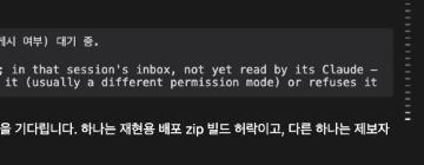
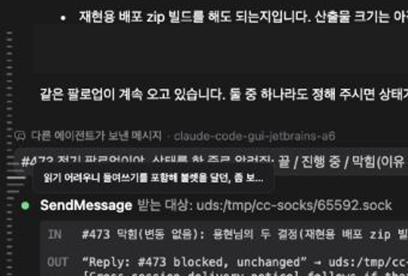
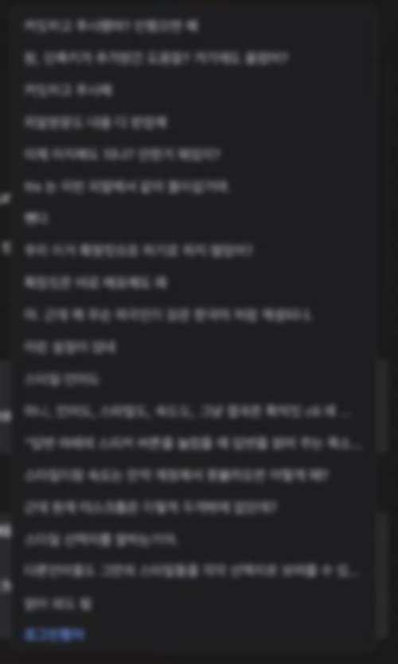

> [한국어](./ko.md)

# Send Index — a ruler of every prompt you sent

A long session is dozens of prompts, and each one is followed by a reply full of
tool calls, diffs and command output. Finding the place where you asked about
something means scrolling, and it is easy to lose the spot you were reading.

The **send index** is a strip of thin ticks down the end edge of the chat. One
tick per prompt you sent, for the whole session. Hover a tick to read that
prompt, click it to go there.

Requested in [#427](https://github.com/Swttch/swttch/issues/427). Bounded to the free space and fixed to list every prompt in [#657](https://github.com/Swttch/swttch/issues/657).

## What the rail tells you

The rail answers two questions at once, and uses a different channel for each so
the two never get confused.

| Channel | Question it answers |
|---|---|
| **Length** | Where is my pointer? |
| **Brightness** | Where am I reading? |

**Length follows your pointer.** Hovering a tick raises a wave centred on it:
the tick under the cursor grows to its longest, and the ones above and below it
taper back down over four rows. The wave is a shape rather than a single
highlight, so the pointer's position reads at a glance without having to compare
one tick against its neighbours.

**Brightness follows your reading position.** The prompt whose reply fills the
screen is drawn white, its immediate neighbours dimmer, and the rest of the
session dimmer still. Scroll the chat and the bright tick travels with you.

Giving both jobs to length does not work, which is why they are split. A long
tick would then mean either "your mouse is here" or "you are reading this", and
the moment the two coincide there is no way to tell them apart.

## Reading a prompt without going there

Hover any tick and a card opens toward the transcript with the first four lines
of that prompt.

Four lines rather than one, because prompts in a working session tend to open
with the same words — "fix the", "now make it" — and a single truncated line
leaves several entries looking identical.

**The card is reachable with the mouse.** You can move onto it and select the
text to copy it. A click inside the card does not move the transcript; only a
click on the tick does.

## Every prompt in one list

Hovering a tick shows that one prompt. **Hold a tick** (about half a second) and a
list of every prompt in the session opens beside the rail, one line each, with the
prompt you are reading in blue. A short press is still a click and goes to that
prompt.

- The list opens scrolled to the prompt you are reading. Scroll it to look further;
  the chat behind it and the rail's marker stay where they are.
- Click a row to go there, the same way a tick click does, including prompts from
  further back than the chat has loaded.
- `Esc` or a click anywhere outside closes it.
- From the keyboard, focus the rail and press `Enter` to open or close it.
- Only the rows on screen are drawn, so a session with hundreds of prompts opens
  as quickly as a short one.
- The hover card ends with a small hint, "Hold to see every prompt", since holding
  is not something you would find by chance.

## Going to a prompt

**Click a tick** and the chat scrolls to that prompt, landing it near the top of
the screen with a little of the preceding reply still visible.

**Keyboard**, once the rail has focus:

| Key | What it does |
|---|---|
| `Alt+F` | Show the rail and put the keyboard on it. Press again to leave. |
| `Shift+K` / `↑` | Move the pointer to the previous prompt |
| `Shift+J` / `↓` | Move the pointer to the next prompt |
| `Esc` | Leave the rail |

Holding a jump key **walks the pointer** up or down the rail, previewing each
prompt's card on the way, without moving the chat. **Releasing the key** is what
scrolls, once, to wherever the pointer ended up.

This split is deliberate. Scrolling on every key press meant a held key started
a new smooth scroll before the last one finished, and the transcript lurched a
prompt at a time. Walking first and going once is both faster to read and faster
to arrive.

There is no separate "confirm" step, and `Enter` does nothing on the rail: by
the time you could press it, you are already there.

## The whole session, not just what is on screen

The chat loads in pages, so at any moment the transcript holds only part of a
long session. The rail does not.

Every prompt in the session gets a tick from the moment you open it, including
the ones far enough back that the chat has not fetched them. **Clicking one of
those works the same way** — the chat loads back to that prompt and then scrolls
to it. The rail marks your destination immediately, so the click never looks
like it missed while the loading happens.

Loaded and not-yet-loaded prompts are drawn **identically**, on purpose. Which
parts we have fetched is a detail of how the chat loads, not a property of your
conversation, and a dimmer tick would read as a lesser or deleted message.

## The prompt above a reply that starts mid-page

When a page of the chat begins in the middle of a reply, the pinned header at
the top of the screen used to be blank — the prompt it belonged to had not been
loaded, so there was nothing to show.

The send index knows that prompt, so it is now drawn there. What appears is the
index's copy of the text, cut at 400 characters; loading the earlier messages
replaces it with the real message, unabridged.

## Limits

- **The preview is 400 characters.** Anything longer is cut with an ellipsis.
  The full text is always in the chat itself — click the tick to go and read it.
- **Images pasted into a prompt do not appear in the card.** The card carries
  text only. A session's attachments are what the [Assets](../059-assets/en.md)
  screen is for.
- **A message typed while a turn was running** is rebuilt by the chat from the
  CLI's queue records, and has no id of its own to jump to. It still gets a tick
  once the chat has loaded that far.
- **The rail is not shown in a session with nothing sent yet**, since there is
  nothing to index.

## How much room it takes

The rail runs from under the top bar to just above the input box, so it never
runs down behind the input. The bottom edge is measured again when the input box
grows or the window changes size, so a taller window shows more ticks and a
shorter one fewer. There is no fixed number of ticks.

**More ticks than fit are scrolled, not squeezed.** Scroll the wheel over the
rail to move through them; the scrollbar is hidden. An edge with more ticks
behind it fades out, which is how the rail says "this goes on" without taking
room for an arrow. The tick you are reading, or the one the keyboard walked to,
is kept in view.

**Only a tick answers the mouse.** Hovering the empty strip around the ticks does
nothing; the wave and the card appear when the pointer is on a tick itself.

## What counts as a prompt

The rail lists what you typed. Text the app or the CLI wrote into the
conversation is left out: the reminders wrapped around a message, finished
background tasks, interrupt markers, another session's message, and the note the
desktop app writes about sessions this one started. A message that has a
reminder in front of what you typed is listed by what you typed.

A prompt that opens with an `@@` mention shows the mention's name, and one made
of reply cards shows each quote and its comment, as the chat bubble does, rather
than the markup around them.

## Scrollbars

Shipped alongside: scrollbars across the app are now half as wide, their track
is fully transparent, and in dark themes the thumb is darker than the surface it
sits on rather than lighter. A pale bar down the edge of a dark transcript pulls
the eye away from the conversation, and the rail now shares that edge.

## The input box is not pushed aside

The rail keeps clear of the conversation by leaving a 24 pixel strip at the end
edge of the transcript. The input box is not held to that strip: it reaches over
it, so it sits centred, with the same space on its start side and its end side.

Earlier the input box gave up the same 24 pixels along with the transcript, so
it sat a little off-centre with more space on its end side. Nothing else about
it changed: it still floats over the bottom of the chat, and the conversation
still runs on behind it and shows around it.
