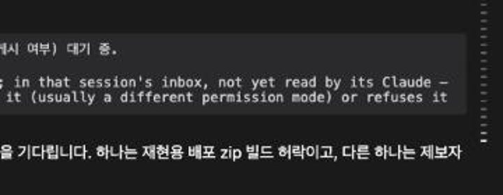
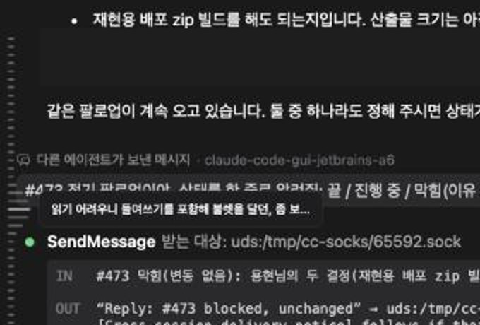
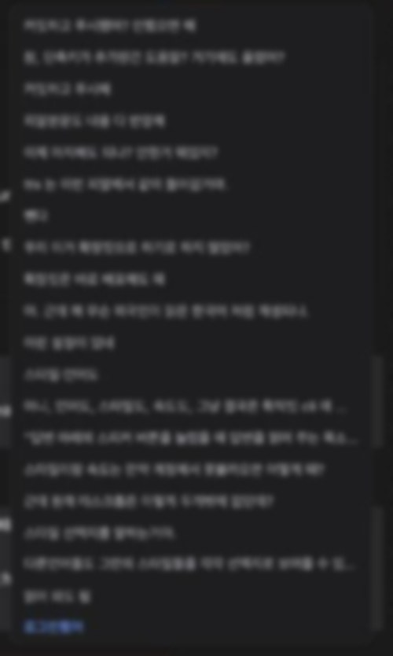
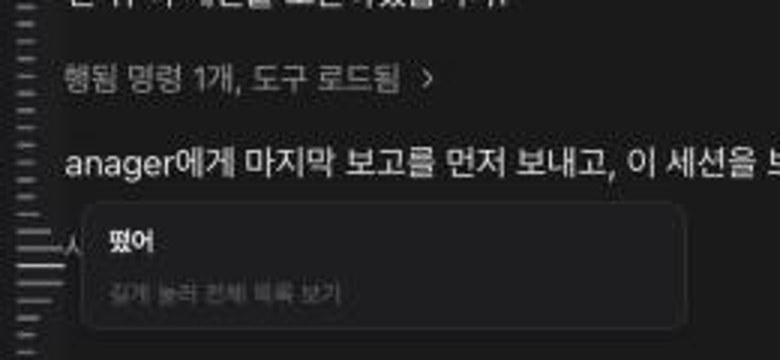

> [English](./en.md)

# 전송 목차 — 내가 보낸 프롬프트를 훑는 눈금자

긴 세션에는 프롬프트가 수십 개 있고, 하나하나 뒤에 도구 호출과 diff와 명령 출력으로 가득 찬 답변이 따라옵니다. 무언가를 물어봤던 자리를 찾으려면 한참 스크롤해야 하고, 그러다 보던 자리를 놓치기 쉽습니다.

**전송 목차**는 채팅 오른쪽 가장자리에 서 있는 가느다란 눈금 띠입니다. 세션에서 보낸 프롬프트 하나당 눈금 하나가 서고, 세션 전체를 담습니다. 눈금에 마우스를 올리면 그 프롬프트를 읽을 수 있고, 클릭하면 그리로 이동합니다.

[#427](https://github.com/Swttch/swttch/issues/427)에서 요청받았습니다.

## 눈금이 알려주는 것

레일은 두 가지 질문에 동시에 답하되, 각각 다른 수단을 씁니다. 그래서 둘이 섞이지 않습니다.

| 수단 | 답하는 질문 |
|---|---|
| **길이** | 내 포인터가 어디에 있나 |
| **밝기** | 내가 어디를 읽고 있나 |

**길이는 포인터를 따라갑니다.** 눈금에 마우스를 올리면 그 자리를 정점으로 파형이 솟습니다. 커서 아래 눈금이 가장 길어지고, 위아래 네 줄에 걸쳐 원래 길이로 가라앉습니다. 하나만 강조하는 대신 형태가 만들어지므로, 옆 눈금과 비교하지 않아도 포인터 위치가 한눈에 읽힙니다.

**밝기는 읽고 있는 위치를 따라갑니다.** 지금 화면을 채우고 있는 답변의 프롬프트가 흰색으로 그려지고, 바로 위아래는 그보다 어둡고, 나머지는 더 어둡습니다. 채팅을 스크롤하면 밝은 눈금이 함께 움직입니다.

두 가지를 모두 길이에 맡기면 동작하지 않기 때문에 나눈 것입니다. 그렇게 하면 긴 눈금이 "여기 마우스가 있다"와 "여기를 읽고 있다" 중 어느 쪽인지 알 수 없고, 두 위치가 겹치는 순간 구분할 방법이 사라집니다.

## 가지 않고 프롬프트 읽기

아무 눈금에나 마우스를 올리면 본문 쪽으로 카드가 열리고, 그 프롬프트의 앞 네 줄이 보입니다.

한 줄이 아니라 네 줄인 이유가 있습니다. 작업 중인 세션의 프롬프트는 같은 말로 시작하는 경우가 많아서("고쳐줘", "이번엔"), 한 줄만 잘라 보여주면 여러 항목이 똑같아 보입니다.

**카드에는 마우스를 올릴 수 있습니다.** 카드 위로 옮겨가 글자를 선택해 복사할 수 있습니다. 카드 안을 클릭해도 본문은 움직이지 않습니다. 눈금을 클릭했을 때만 이동합니다.

## 모든 프롬프트를 한 목록으로

눈금에 마우스를 올리면 그 프롬프트 하나가 보입니다. **눈금을 길게 누르면**(약 0.5초) 세션의 모든 프롬프트가 한 줄씩 쌓인 목록이 레일 옆에 열리고, 지금 읽고 있는 프롬프트가 파란색으로 표시됩니다. 짧게 누르는 것은 지금처럼 클릭이라 그 프롬프트로 이동합니다.

- 목록은 지금 읽고 있는 프롬프트가 보이는 위치로 스크롤되어 열립니다. 더 멀리 보려면 목록 안에서 스크롤하면 되고, 뒤의 채팅과 레일의 표시는 그대로입니다.
- 행을 누르면 눈금을 누른 것과 같은 방식으로 이동합니다. 채팅이 아직 불러오지 않은 먼 과거의 프롬프트도 마찬가지입니다.
- `Esc`나 바깥 클릭으로 닫힙니다.
- 키보드에서는 레일에 포커스를 두고 `Enter`로 열고 닫습니다.
- 화면에 보이는 행만 그리므로 프롬프트가 수백 개인 세션도 짧은 세션처럼 빠르게 열립니다.
- 길게 누르는 동작은 우연히 찾기 어려워서, 마우스를 올렸을 때 뜨는 카드 맨 아래에 "길게 눌러 전체 목록 보기"라는 작은 안내가 있습니다.

## 프롬프트로 이동하기

**눈금을 클릭하면** 채팅이 그 프롬프트로 스크롤합니다. 화면 위쪽에 자리를 잡되, 바로 앞 답변이 조금 보이는 위치에 내려앉습니다.

**키보드**는 레일에 포커스가 있을 때 동작합니다.

| 키 | 하는 일 |
|---|---|
| `Alt+F` | 레일을 띄우고 키보드를 그리로 옮깁니다. 다시 누르면 빠져나옵니다. |
| `Shift+K` / `↑` | 포인터를 이전 프롬프트로 옮깁니다 |
| `Shift+J` / `↓` | 포인터를 다음 프롬프트로 옮깁니다 |
| `Esc` | 레일에서 빠져나옵니다 |

이동 키를 누르고 있으면 **포인터가 레일을 걸어 올라가거나 내려갑니다.** 지나가는 프롬프트의 카드가 차례로 보이고, 채팅은 움직이지 않습니다. **키를 떼는 순간** 포인터가 멈춘 자리로 한 번만 스크롤합니다.

이렇게 나눈 데에는 이유가 있습니다. 키를 누를 때마다 스크롤하면, 누르고 있는 동안 앞선 스크롤이 끝나기 전에 다음 스크롤이 시작되어 본문이 프롬프트 하나씩 덜컥거리며 움직입니다. 먼저 걸어가 놓고 한 번에 가는 편이 읽기에도 빠르고 도착도 빠릅니다.

따로 확정하는 단계는 없고, 레일에서 `Enter`는 아무 일도 하지 않습니다. 누를 수 있게 될 때쯤이면 이미 도착해 있기 때문입니다.

## 화면에 있는 것이 아니라 세션 전체

채팅은 페이지 단위로 불러오기 때문에, 긴 세션이라면 어느 순간에도 본문에는 일부만 들어 있습니다. 레일은 그렇지 않습니다.

세션을 여는 순간 **모든 프롬프트가 눈금을 갖습니다.** 채팅이 아직 불러오지 않은 옛날 프롬프트도 포함됩니다. **그중 하나를 클릭해도 똑같이 동작합니다.** 채팅이 그 프롬프트까지 거슬러 불러온 뒤 그리로 스크롤합니다. 불러오는 동안 레일이 먼저 목적지를 표시하므로, 클릭이 씹힌 것처럼 보이지 않습니다.

불러온 프롬프트와 아직 불러오지 않은 프롬프트는 **똑같이 그려집니다.** 일부러 그렇게 했습니다. 어디까지 가져왔는지는 채팅이 내부적으로 불러오는 방식일 뿐 대화의 성질이 아니고, 흐린 눈금은 덜 중요하거나 지워진 메시지처럼 읽히기 때문입니다.

## 페이지 중간에서 시작하는 답변 위의 프롬프트

채팅의 한 페이지가 답변 중간에서 시작하면, 화면 위에 고정되는 자리가 비어 있었습니다. 그 답변이 딸린 프롬프트를 불러오지 않아서 보여줄 것이 없었기 때문입니다.

전송 목차는 그 프롬프트를 알고 있으므로 이제 그 자리에 그립니다. 나타나는 것은 목차가 가진 사본이고 400자에서 잘려 있습니다. 이전 메시지를 더 불러오면 잘리지 않은 진짜 메시지로 바뀝니다.

## 한계

- **미리보기는 400자입니다.** 그보다 길면 말줄임표로 잘립니다. 전문은 언제나 채팅 본문에 있으니, 눈금을 눌러 가서 읽으시면 됩니다.
- **프롬프트에 붙여넣은 이미지는 카드에 나오지 않습니다.** 카드는 글자만 담습니다. 세션의 첨부물은 [에셋](../059-assets/ko.md) 화면이 다룹니다.
- **턴이 도는 중에 입력한 메시지**는 채팅이 CLI의 큐 기록에서 복원하는 것이라 이동할 고유 식별자가 없습니다. 채팅이 그 범위까지 불러오면 눈금은 생깁니다.
- **아직 아무것도 보내지 않은 세션에는 레일이 뜨지 않습니다.** 목차로 만들 것이 없기 때문입니다.

## 어느 가장자리에 서는가

클래식 채팅에서는 레일이 **끝 쪽 가장자리**에, 채팅이 비워 둔 띠 안에 섭니다. 내 메시지가 끝 쪽에 놓이는 대화 보기 모드(일반, 사고 과정, 자세히)에서는 레일이 **시작 쪽 가장자리**로 옮겨 가 채팅 위에 얹혀 그려집니다. 따로 비워 두는 공간은 없고, 이 모드의 블록은 좌우에 같은 패딩을 각자 갖고 있습니다. 어느 쪽에서든 호버 카드와 전체 프롬프트 목록은 채팅 쪽으로 열립니다. 보기 모드를 바꾸면 레일도 바로 옮겨 갑니다.

## 차지하는 공간

레일은 상단바 아래에서 입력창 바로 위까지 이어지므로 입력창 뒤로 내려가지 않습니다. 아래쪽 경계는 입력창이 커지거나 창 크기가 바뀔 때 다시 재므로, 창이 높으면 눈금이 더 많이 보이고 낮으면 적게 보입니다. 눈금 개수는 정해져 있지 않습니다.

**들어가지 않는 눈금은 줄이지 않고 스크롤합니다.** 레일 위에서 휠을 굴리면 나머지 눈금으로 넘어갑니다. 스크롤바는 숨겨져 있습니다. 뒤에 눈금이 더 남은 쪽 끝은 흐려지는데, 화살표가 자리를 차지하지 않고도 "더 있다"를 알리는 방법입니다. 지금 읽고 있는 눈금이나 키보드로 옮긴 눈금은 보이는 범위 안에 머뭅니다.

**눈금 자체에만 마우스가 반응합니다.** 눈금 둘레의 빈 띠에 올려서는 아무 일도 일어나지 않습니다. 눈금이 길어지는 파동과 미리보기 카드는 마우스가 눈금 위에 있을 때만 나옵니다.

## 프롬프트로 세는 것

레일에는 직접 입력한 것만 나옵니다. 앱이나 CLI가 대화에 써 넣은 것은 뺍니다. 메시지 앞에 붙는 리마인더, 끝난 백그라운드 작업, 중단 표시, 다른 세션이 보낸 메시지, 데스크탑 앱이 이 세션이 시작한 세션들에 대해 남기는 알림이 그렇습니다. 입력한 글 앞에 리마인더가 붙은 메시지는 입력한 글로 올라갑니다.

`@@` 멘션으로 시작하는 프롬프트는 멘션의 이름으로, 답글 카드로 이루어진 프롬프트는 인용과 댓글로, 마크업 대신 대화 말풍선과 같이 보입니다.

## 스크롤바

함께 나갑니다. 앱 전체의 스크롤바 폭이 절반으로 줄고, 레일 배경은 완전히 투명해지고, 어두운 테마에서는 핸들이 배경보다 밝은 대신 어두워집니다. 어두운 본문 가장자리에 밝은 막대가 서 있으면 시선이 대화에서 떨어지는데, 이제 그 가장자리를 레일이 함께 쓰기 때문입니다.

## 입력창은 옆으로 밀리지 않습니다

클래식 채팅에서 레일은 대화 본문의 끝 가장자리에 24픽셀 띠를 비워 두는 것으로 본문과 겹치지 않습니다(대화 보기 모드에서는 이 띠를 비우지 않습니다. 블록이 좌우 패딩을 각자 갖고 있기 때문입니다). 입력창은 그 띠에 묶이지 않고 띠 위까지 넓어지므로, 시작 쪽과 끝 쪽의 여백이 같은 한가운데에 놓입니다.

전에는 입력창도 본문과 함께 같은 24픽셀을 내줬고, 그 때문에 끝 쪽 여백이 더 넓은 채로 약간 왼쪽으로 치우쳐 있었습니다. 그 밖의 것은 달라지지 않았습니다. 입력창은 여전히 채팅의 아래쪽에 떠 있고, 대화는 입력창 뒤로도 이어져서 입력창 둘레에 보입니다.
