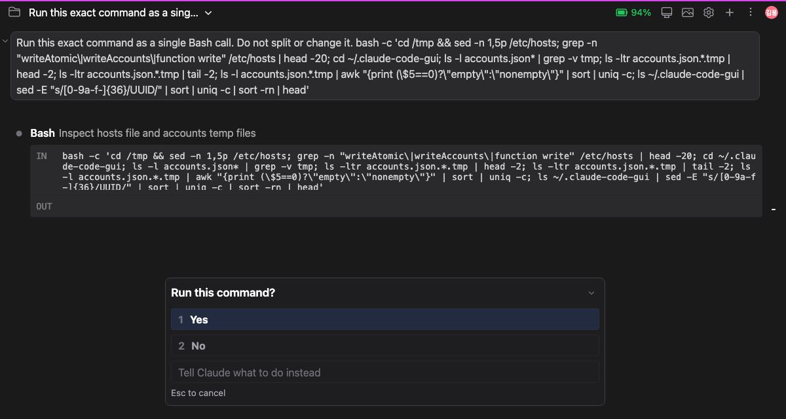
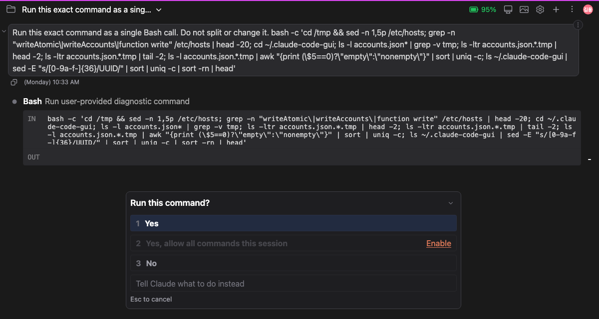
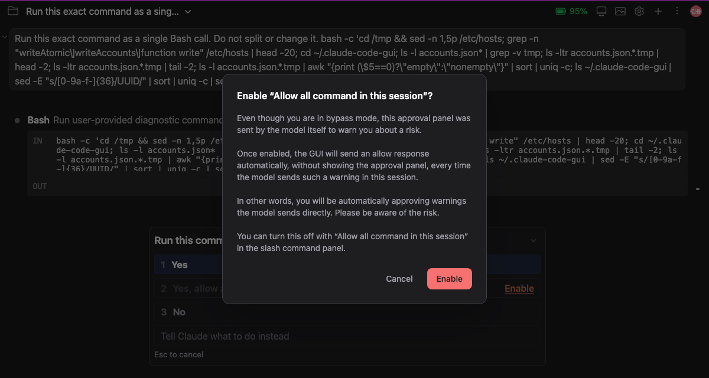
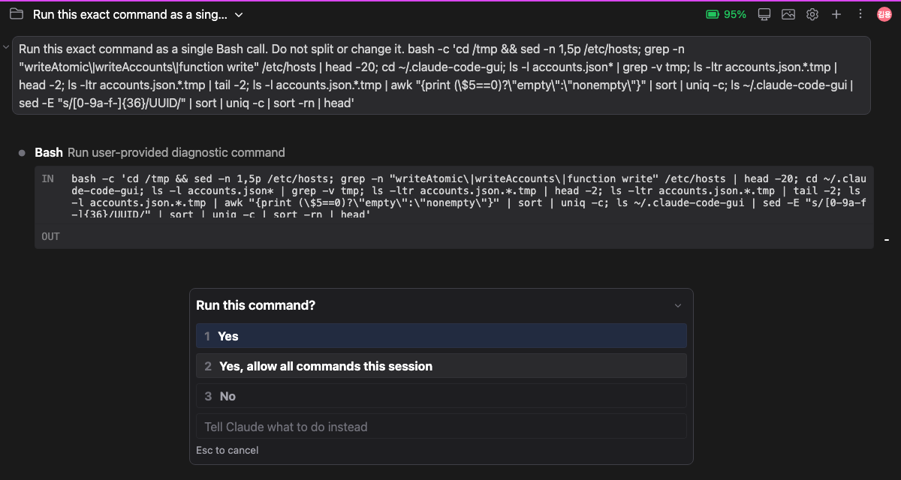
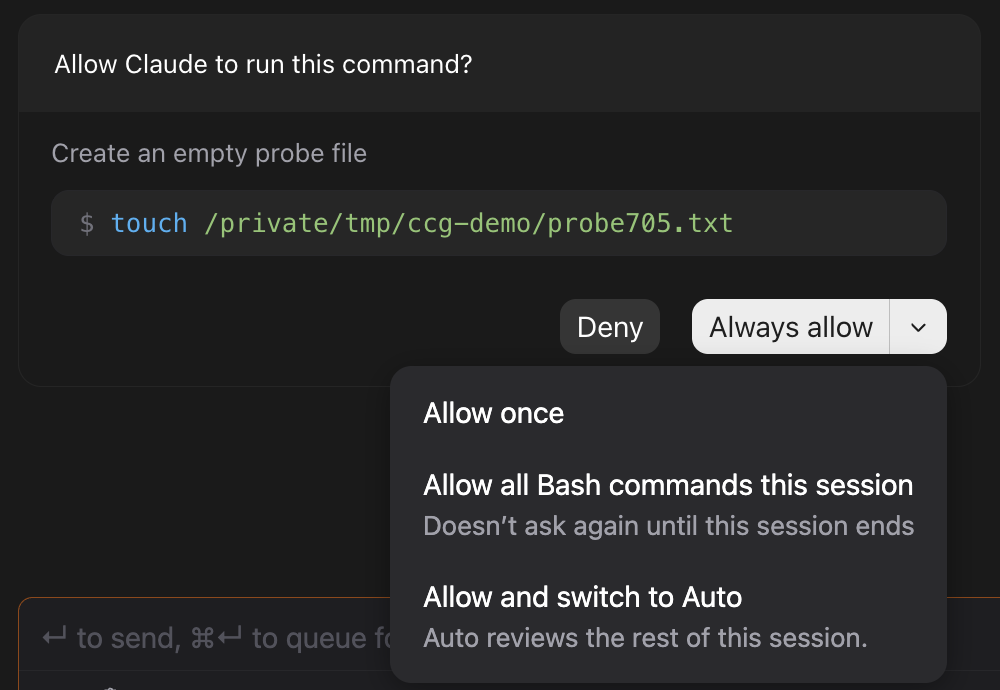
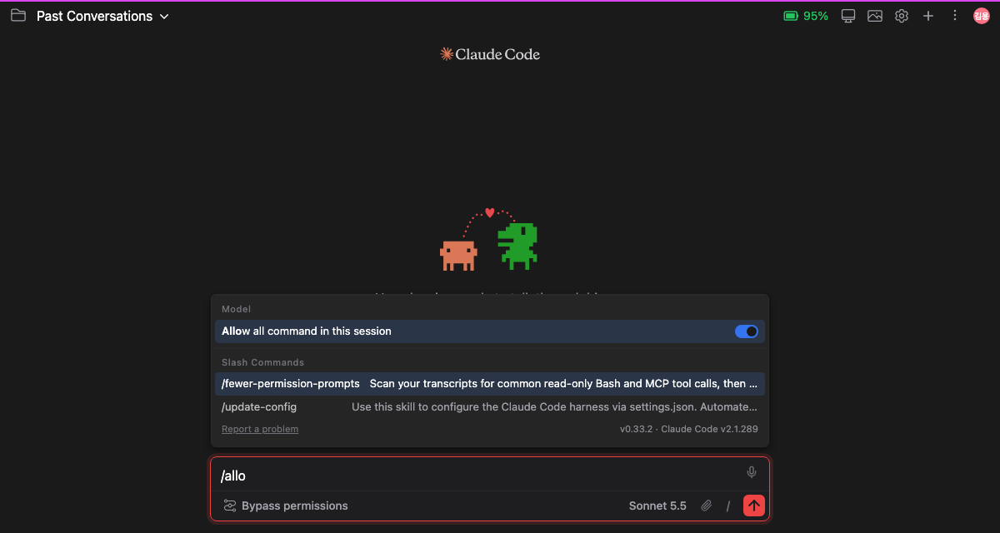

# 이번 세션에서 모든 명령어 허용

> 언어: [English](./en.md) · **한국어**

어떤 승인 패널은 "예, 이번 세션에서 모든 명령어 허용"을 눌러도 잠잠해지지 않습니다. 그 항목을 골라 명령이 실행되었는데, 바로 다음 명령에서 같은 패널이 다시 뜹니다. 이 기능은 왜 그런지 설명하고, 소용없는 선택지를 더는 보여 주지 않으며, 그런 패널을 대신 답해 주었으면 하는 경우를 위한 스위치를 제공합니다.

## 패널이 계속 돌아오는 이유

Claude Code는 명령을 실행하기 전에 사용자에게 물을지 스스로 정합니다. **Bypass permissions** 모드에서는 보통 아무것도 묻지 않습니다. 예외가 하나 있습니다. Claude Code가 **명령이 무슨 일을 하는지 알아낼 수 없을 때**는 안전 확인으로 물어봅니다. 따옴표 안에 따옴표가 겹쳐 들어간 긴 `bash -c '...'` 명령이 대표적입니다. 안쪽 내용을 확신을 갖고 읽을 수 없기 때문입니다.

이런 안전 확인에는 별도의 규칙이 있습니다. **Claude Code는 이 질문의 답을 기억하지 않습니다.** "이번 세션에서 모든 명령어 허용"은 원래 Claude Code에게 더 묻지 말라고 알리는 선택입니다. 안전 확인에서는 Claude Code가 그 알림을 무시하고, 읽을 수 없는 명령이 다시 올 때마다 또 묻습니다. 한 턴 안에서 패널이 여러 번 연달아 뜨기도 하며, 두 번째 항목을 고른 적이 없는 것과 똑같이 보입니다.

헷갈리는 지점은 바로 그것이었습니다. 두 번째 항목이 화면에 있고 될 것처럼 보이는데, 되지 않았습니다.

## 이제 패널이 보여 주는 것

Claude Code가 답을 기억하지 않겠다고 알려 오면, 패널은 더는 될 것처럼 보이게 하지 않습니다.

**Bypass permissions가 아닌 모드**(예: Plan mode, Ask before edits, Edit automatically)에서는 두 번째 항목을 뺍니다. 답은 **예**와 **아니요** 두 가지이고, **아니요**가 2번이 됩니다. 키보드 **2**를 누르면 **아니요**로 답합니다.

**Bypass permissions 모드**에서는 두 번째 항목이 제자리에 남지만 회색으로 흐려지고, 그 줄의 오른쪽 끝에 Claude 로고와 같은 색의 링크 **활성화**(영어 화면에서는 "Enable")가 놓입니다. 번호는 바뀌지 않아서 **아니요**는 그대로 3번입니다.

바이패스 모드에서 항목을 남겨 두는 이유는, 사용자가 이미 묻지 말라고 앱에 알려 둔 상태이기 때문입니다. 활성화는 자연스러운 다음 단계이지만 선택은 사용자의 몫이라서 경고를 거치게 했습니다.

흐려진 줄 자체를 눌러도 아무 일이 일어나지 않습니다. 살아 있는 것은 **활성화** 링크뿐입니다. 줄이 흐려져 있는 동안은 키보드 **2**도 아무 일을 하지 않습니다.

## 활성화하기

**활성화**를 누르면 경고창이 열리고 세 가지를 알려 줍니다.

- 바이패스 모드인데도 이 승인 패널이 뜬 것은, 모델이 위험을 경고하려고 직접 보낸 승인 요청이기 때문입니다.
- 활성화하면 이번 세션에서 모델이 이런 경고를 보낼 때마다 GUI가 승인 패널을 띄우지 않고 허용 응답을 자동으로 보냅니다.
- 즉, 모델이 직접 보내는 경고를 자동으로 승인하게 되는 것이므로 위험을 알고 사용해야 합니다.

마지막 줄은 끄는 곳을 알려 줍니다. 슬래시 커맨드 패널의 **이번 세션에서 모든 명령어 허용**(영어 화면에서는 "Allow all command in this session") 스위치입니다.

켜려면 **활성화**를, 그대로 두려면 **취소**를 고르거나 Esc를 누릅니다. 경고창이 열려 있는 동안에는 그 아래의 승인 패널이 키보드에 반응하지 않으므로, Enter나 숫자 키로 패널에 실수로 답할 수 없습니다.

확인하면 두 번째 항목이 곧바로 살아납니다. 그 항목을 고르면 이번 명령을 승인하며, 이는 같은 항목이 늘 하던 일입니다.

그 뒤로는 이번 세션에서 이런 안전 확인이 올 때마다 패널 없이 허용으로 답해 집니다. 중간에 질문 없이 명령이 실행되고 결과가 나오는 것을 보게 됩니다.

## 새 권한 카드에서

일반·생각·자세히 보기에서는 명령, 읽기, 편집 같은 요청이 **카드**로 나옵니다. 카드에는 **거부**와 허용 버튼이 있고, 허용 버튼 오른쪽 화살표(▾)를 누르면 허용하는 다른 방법이 목록으로 열립니다. 클래식 보기의 승인 패널에서 두 번째 줄이던 "이번 세션에서 모든 명령어 허용"은 이 목록에 있습니다.

**Claude Code가 답을 기억해 주는 요청**에서는 목록에 도구 이름이 적힌 줄이 하나 있습니다. 명령이면 **이번 세션에서 모든 Bash 명령어 허용**, 읽기면 **이번 세션에서 모든 읽기 허용**, MCP 도구나 웹 가져오기 같은 나머지는 그 도구의 이름입니다. 줄 아래에는 "이 세션이 끝날 때까지 다시 묻지 않습니다"라고 적혀 있습니다.

이 줄을 고르면 지금 요청이 허용되고, 이 세션에서는 같은 도구의 요청이 더는 묻지 않습니다. 명령 하나가 아니라 **그 도구의 모든 요청**입니다. 명령이라면 어떤 Bash 명령이든 묻지 않고 실행되므로 Claude가 하는 일을 믿을 수 있는 세션에서만 고르십시오. 세션이 끝나면 사라지고, 새 대화에서는 다시 묻습니다.

허용 버튼 옆에 이미 "항상 허용"이 있다면 그것은 이 줄과 다른 것입니다. "항상 허용"은 Claude Code가 제안한 **좁은 규칙**(예: 특정 명령 하나)을 카드가 안내하는 곳에 저장합니다.

- **파일 변경**은 Ask before edits 모드에서 "항상 허용"이 이 세션을 편집 수락 모드로 바꿉니다. 같은 일을 하는 줄을 하나 더 만들지 않으므로 이 줄은 편집 수락 모드를 쓸 수 없을 때(예: Plan mode)에만 나옵니다.
- **Claude Code가 답을 기억하지 않는 안전 확인**에서는 Bypass permissions가 아닌 모드면 이 줄이 없습니다. 클래식 승인 패널이 두 번째 줄을 빼는 것과 같은 이유입니다. Bypass permissions 모드에서는 같은 이름의 줄이 나오고 아래에 "먼저 경고가 표시됩니다"라고 적힙니다. 고르면 위의 [경고창](#활성화하기)이 열리고, 확인하면 이번 요청이 허용되며 이 세션의 같은 안전 확인에는 앱이 대신 답합니다. 경고창이 열려 있는 동안 카드는 Esc와 Cmd(Ctrl)+Enter에 반응하지 않습니다.
- **여러 세션에서 켜 두는 것**은 여기에 없습니다. 후원자 전용이며 경고창의 상자와 설정에서만 켭니다. [모든 세션에서 모든 명령어 허용](../086-allow_all_commands_in_all_sessions/ko.md)을 보세요.

## 슬래시 커맨드 패널의 스위치

채팅 입력창에 `/`를 치면 슬래시 커맨드 패널이 열립니다. **Model** 구역의 맨 아래에 **Allow all command in this session** 스위치가 있습니다.

- **켜면** **활성화** 링크와 같은 경고창이 뜹니다. 확인하기 전에는 켜지지 않습니다.
- **끄는 데**는 확인이 필요 없습니다. 다음 안전 확인부터 패널이 다시 돌아옵니다.
- **활성화** 링크와 스위치는 같은 설정입니다. 한쪽에서 켜면 다른 쪽에도 반영됩니다.
- 다른 패널 항목과 같은 키를 씁니다. 그 줄에서 Enter를 누르면 켜고 끕니다.
- 찾으려면 몇 글자만 치면 됩니다. 예를 들어 `/allow`입니다.

### 첫 메시지를 보내기 전에 켜기

빈 대화에서, 첫 메시지를 보내기 전에도 스위치를 켤 수 있습니다. 대화는 첫 메시지를 보내는 순간 비로소 세션이 되므로, 그 선택은 앞으로 시작할 대화의 것으로 보관되었다가 첫 메시지가 만드는 세션에 넘겨집니다.

반대로 빈 화면의 스위치가 켜진 채로 세션 목록에서 **기존** 세션을 열면, 그 세션은 선택을 **물려받지 않습니다**. 그 선택은 새 대화에 대한 것이었으므로 기존 세션은 꺼진 채 시작하고, 그다음 새 대화도 꺼진 채 시작합니다.

## 어디까지 해당하고 어디는 해당하지 않는가

- **Claude Code가 기억하지 않는 안전 확인만 해당합니다.** 그 밖의 승인 패널은 전과 똑같이 뜨며, "이번 세션에서 모든 명령어 허용"이 통하는 패널도 포함됩니다. 평범한 패널에서 그 항목을 고르면 Claude Code는 늘 그랬듯 기억합니다.
- **이번 세션만 해당합니다.** 설정은 열려 있는 대화에 대해 메모리에만 보관됩니다. 새 대화를 시작하거나, 패널을 새로고침하거나, IDE를 다시 켜면 꺼진 채로 시작합니다. 후원자는 대신 모든 세션에서 켜 둘 수 있습니다. [모든 세션에서 모든 명령어 허용](../086-allow_all_commands_in_all_sessions/ko.md)을 보세요.
- **세션마다 따로입니다.** 한 대화에서 켜도 다른 대화는 바뀌지 않으며, 다른 탭에 열린 대화도 마찬가지입니다.
- **묻는 대상 명령을 이 앱이 검사하지는 않습니다.** 켜면 그런 명령이 사용자가 보지 않는 채로 실행됩니다. Claude가 하는 일을 믿을 수 있는 세션에서만 쓰십시오.
- **오래된 Claude Code 버전에서는** 항목 숨김과 활성화 링크가 동작하지 않을 수 있습니다. 둘 다 Claude Code가 답을 기억하지 않겠다고 앱에 알려 줄 때만 동작하기 때문입니다. 사용 중인 버전이 알려 주지 않으면 패널은 이 기능이 생기기 전과 똑같이 보이며 두 번째 항목이 항상 선택 가능합니다.

## 자주 묻는 질문

**"이번 세션에서 모든 명령어 허용"을 골랐는데 패널이 다시 떴습니다. 버그인가요?**
평범한 승인이라면 버그가 맞습니다. 위에서 설명한 안전 확인이라면 예상된 동작이고, 이 기능이 그 부분을 다룹니다. 바이패스 모드라면 이제 스위치를 켤 수 있습니다. 다른 모드에서는 그런 패널에 두 번째 항목을 더는 보여 주지 않습니다. 될 수 없는 항목이었기 때문입니다.

**바이패스 모드인데 왜 패널이 뜨나요?**
바이패스 모드는 Claude Code가 스스로 답할 수 있는 질문을 없앱니다. 읽을 수 없는 명령은 거기에 해당하지 않습니다. 패널은 이 앱이 아니라 Claude Code가 묻는 것입니다.

**흐려진 항목을 활성화하지 않고 쓸 수는 없나요?**
없습니다. Claude Code가 무시할 것이기 때문에 흐려져 있는 것입니다. 패널을 멈추는 유일한 방법은 이 앱이 대신 답하게 만드는 스위치입니다.

**어떻게 끄나요?**
`/`로 슬래시 커맨드 패널을 열고 **Allow all command in this session**을 찾아 끄면 됩니다. 새 대화를 시작해도 꺼집니다.

**첫 메시지를 보내기 전에 켠 뒤 예전 세션을 열었더니 꺼져 있습니다. 왜 그런가요?**
그 선택은 새 대화의 것이었습니다. 목록에서 여는 기존 세션은 그 선택을 물려받지 않습니다. 그 세션에서 쓰려면 그 안에서 다시 켜십시오.

**권한 모드가 바뀌나요?**
아니요. 모드는 그대로입니다. 이 스위치는 그 특정 안전 확인에 어떻게 답할지에만 영향을 줍니다.
