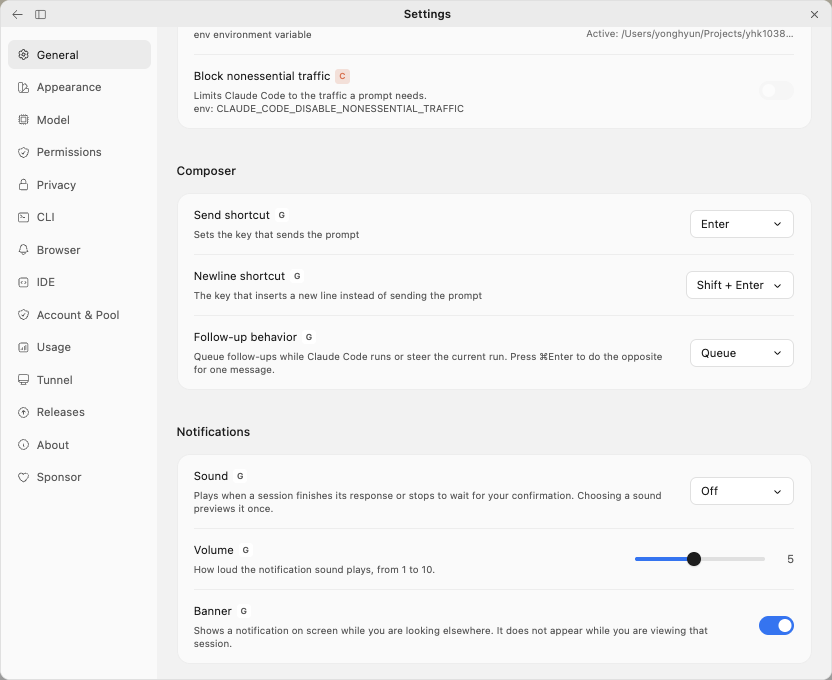
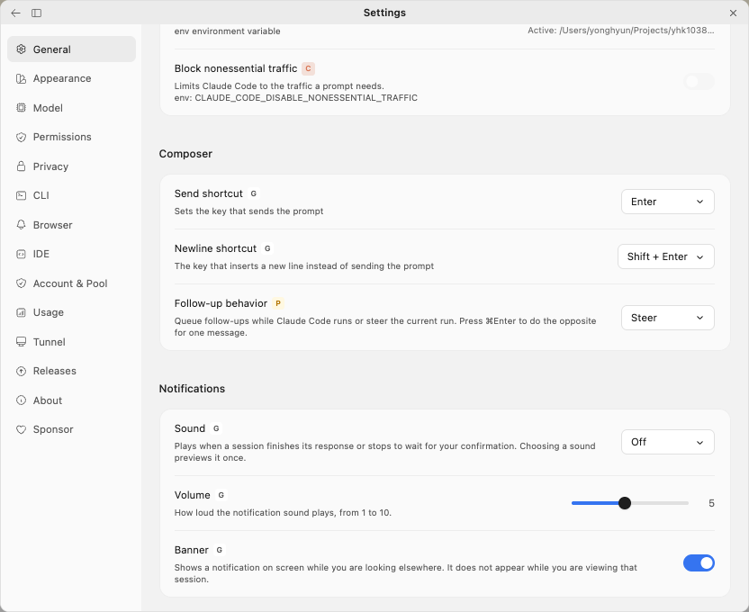
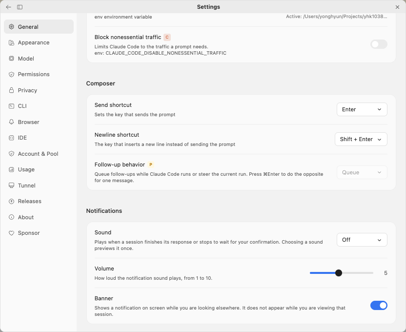
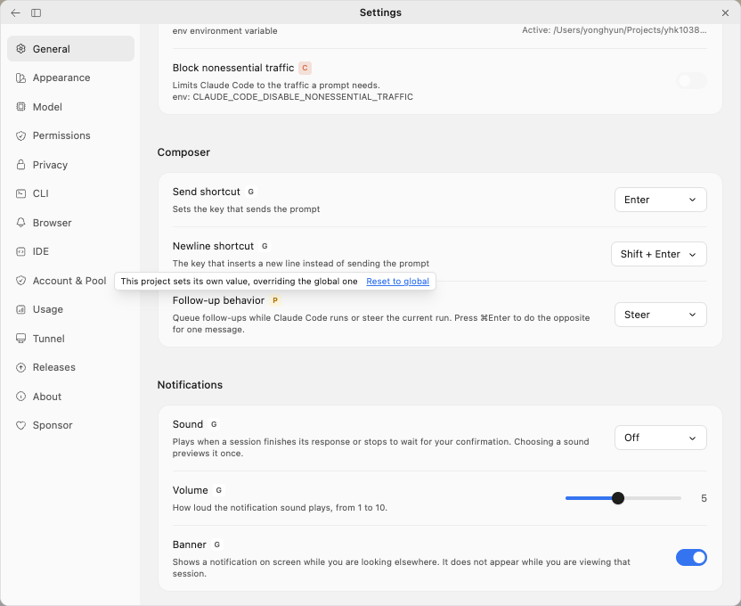
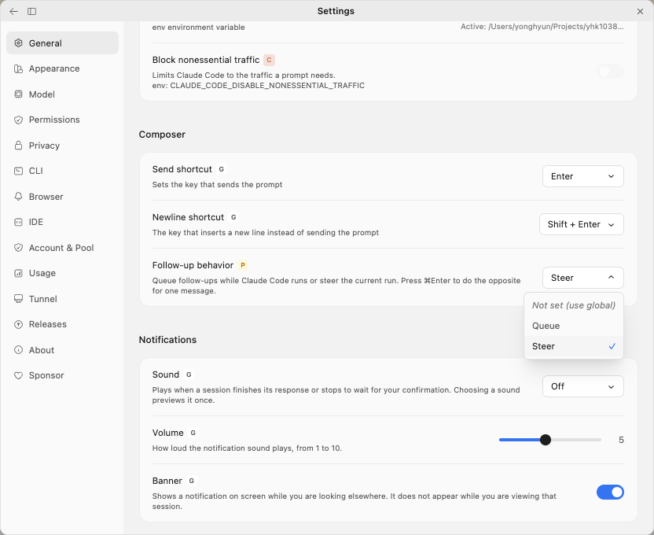

# 프로젝트 탭이 실제로 적용되는 설정을 보여줍니다

> 언어: [English](./en.md) · **한국어**

## 제보된 내용

[#547](https://github.com/Swttch/swttch/issues/547)에서 한 사용자가 이렇게 알려주셨습니다. Claude가 작업하는 동안 입력한 메시지가 예전에는 바로 전달됐는데, 새 버전에서는 한 턴이 다 끝날 때까지 대기열에서 기다린다는 내용입니다.

서로 다른 문제가 둘 있었고, 둘 다 고쳤습니다.

1. **"후속 메시지 처리 방식"의 기본값이 대기열(Queue)로 바뀌어 있었습니다.** v0.33.0부터 Queue는 메시지를 정말로 붙잡아 두는 동작이 되었고, 이 설정을 한 번도 열어 보지 않은 모든 사용자가 갑자기 그 동작을 쓰게 됐습니다. 기본값을 다시 Steer로 돌렸습니다.
2. **설정 화면의 프로젝트 탭이 틀린 값을 그렸습니다.** 프로젝트 탭은 프로젝트 자기 파일의 내용을 보여주는데, 프로젝트 파일에는 그 프로젝트가 바꾼 설정만 들어 있습니다. 프로젝트가 건드리지 않은 설정은 "없음"으로 읽혔고, 각 행이 전역 값 대신 자기 코드에 적힌 기본값을 채워 그렸습니다. 전역에서 Steer로 정했는데도 프로젝트 탭에는 Queue가 보이고, 실제 적용되는 값을 읽는 입력창은 Steer로 동작하는 일이 생길 수 있었습니다.

## 후속 메시지 처리 방식

**설정 > General > Composer > Follow-up behavior**는 Claude가 일하는 중에 보낸 메시지를 어떻게 다룰지 정합니다.

| 선택지 | 보낸 메시지가 하는 일 |
| --- | --- |
| **Steer** (현재 작업 조정) | Claude에게 바로 전달됩니다. Claude는 입력을 받을 수 있는 다음 지점에서 그 메시지를 집습니다. 터미널에서 CLI가 일하는 중에 입력하는 것과 같습니다. 기본값입니다. |
| **Queue** (대기열에 추가) | 입력창 위에서 기다렸다가 지금 턴이 끝나면 전송됩니다. 대기 중인 메시지는 보내기 전에 하나씩 취소할 수 있습니다. |

한 번도 고르지 않았다면 이 행은 Steer를 보여줍니다. 턴이 도는 동안 입력창의 안내 문구가 지금 어느 쪽인지 알려줍니다. "Steer the current run..." 또는 "Queue another message..."입니다.

## 탭 두 개, 규칙 하나

대부분의 설정 페이지 위에는 **User Settings (Global)** 과 **Project Settings (Local)** 스위치가 있습니다. 프로젝트에 적용되는 값은 이 순서로 정해집니다.

1. 프로젝트가 정한 값
2. 없으면 전역에서 정한 값
3. 그것도 없으면 내장 기본값

**User Settings (Global)** 탭은 전역 파일을 내장 기본값 위에 얹어 보여줍니다. **Project Settings (Local)** 탭은 위 셋 중 어디서 왔든 지금 열린 프로젝트에 적용되는 값을 보여줍니다.

*전역에서 Queue를 고르고 프로젝트에서는 아무것도 고르지 않은 프로젝트 탭입니다. 행은 Queue를 보여주고, 라벨 옆의 작은 **G**가 이 값을 프로젝트가 정하지 않았다고 알려줍니다.*

## 배지

| 배지 | 위치 | 의미 |
| --- | --- | --- |
| **G** | 프로젝트 탭 | 프로젝트가 정하지 않은 값입니다. 화면의 값은 전역 설정에서 오고, 전역에서도 정하지 않았다면 내장 기본값입니다. 툴팁: "이 프로젝트에는 설정되어 있지 않습니다. 전역 설정의 값을 사용합니다". |
| **P** | 프로젝트 탭 | 프로젝트가 이 값을 자기 것으로 정해서 전역 값을 덮어쓰고 있습니다. 툴팁: "이 프로젝트가 자기 값을 정해 전역 설정을 덮어쓰고 있습니다". 툴팁 오른쪽 끝에 **초기화** 링크가 있습니다. [프로젝트 값 되돌리기](#프로젝트-값-되돌리기)를 참고하세요. |
| **P** | 전역 탭 | 열린 프로젝트도 이 값을 정했으므로 행이 흐려지고 여기서는 고칠 수 없습니다. 적용되는 값은 프로젝트의 값입니다. 툴팁: "프로젝트 설정이 이 값을 덮어씁니다. 여기서 바꿔도 적용되지 않습니다". |
| 배지 없음 | 양쪽 탭 | 지금 보고 있는 탭의 값이 그대로 적용되고 덮어쓰는 것이 없습니다. |

**C**(Claude Code 네이티브 설정)와 **S**(후원 기능) 배지는 그대로입니다. [Settings Badges](../017-settings_badges/ko.md)를 참고하세요.

*프로젝트가 자기 값을 고르면 그 행의 **G** 배지가 **P** 배지로 바뀝니다. 프로젝트가 건드리지 않은 행은 **G**를 그대로 가집니다.*

*프로젝트가 자기 후속 메시지 처리 방식을 가진 상태의 전역 탭입니다. 흐려진 행에 **P** 배지가 붙습니다.*

## 프로젝트 탭에서 값 고르기

프로젝트 탭에서 값을 고르면, 상속받는 값과 같은 값이어도 프로젝트에 저장됩니다. 프로젝트가 값을 못 박아서, 나중에 전역 설정을 바꿔도 그 프로젝트에는 닿지 않게 하는 방법입니다.

## 프로젝트 값 되돌리기

프로젝트 탭에서 프로젝트가 자기 값을 가진 행은 라벨 옆에 **P** 배지를 보여줍니다. 배지에 마우스를 올리면 프로젝트가 전역 값을 덮어쓰고 있다는 툴팁이 뜨고, 툴팁 오른쪽 끝에 **초기화** 링크가 있습니다. 링크를 누르면 프로젝트의 값이 지워지고, **P** 배지는 다시 **G**로 바뀌며, 행은 전역에서 정한 값을 보여줍니다.

*현재 화면의 문구는 영어 UI 기준 "Reset to global"입니다. 한국어 UI에서는 "초기화"로 보입니다.*

이 링크는 스위치, 텍스트 칸, 드롭다운, 숫자 칸, 단축키 입력 칸까지 모든 종류의 행에서 똑같이 동작합니다.

프로젝트별로 정할 수 있는 드롭다운은 프로젝트에 자기 값이 있을 때만 목록 맨 위에 **Not set (use global)** (설정 안 함, 전역 설정 사용)도 보여줍니다. 링크와 하는 일이 같습니다.

*프로젝트가 자기 값을 가진 행의 드롭다운을 열면 첫 항목이 **Not set (use global)** 입니다.*

Follow-up behavior, Log level, Color theme, Interface language, Default permission mode에서 이 항목이 나옵니다. 숫자 칸(글자 크기, 줄 간격, 스크롤 임계값)은 비우면 전역 값으로 돌아갑니다.

## 프로젝트 파일 때문에 생기는 한계

- **알림음은 프로젝트 하나만 Off로 둘 수 없습니다.** 프로젝트 파일에서 빈 값은 "내 덮어쓰기를 지워라"는 뜻이라, 프로젝트 탭에서 Off를 고르면 "끔"이 저장되지 않고 프로젝트의 값이 지워집니다.
- **음성 설정은 한 덩어리로 저장됩니다.** 말하는 언어, 대기 시간, 단축키가 한 블록에 들어 있습니다. 프로젝트가 그중 하나를 바꾸면 세 값을 그 순간 화면에 보이던 대로 모두 저장해서 나머지가 조용히 바뀌지 않게 합니다. 이후 전역 음성 설정을 바꿔도 그 프로젝트에는 닿지 않습니다. 같은 이유로 음성 행 하나의 **초기화**는 블록 전체를 되돌리고, 음성 행이 모두 함께 전역 값으로 돌아갑니다.
- **단축키와 녹음한 조합은 함께 움직입니다.** 보내기나 줄바꿈 단축키의 **초기화**는 프로젝트가 옆에 저장해 둔 "custom" 조합도 같이 지웁니다.

## 전역에만 있는 행

일부 설정은 앱 전체에 적용되며 언제나 전역 파일에 저장됩니다. **Enable RTL(Right-to-left)**, **Preferred Location**, **Open Settings as**, **Paginate chat history**, **Block nonessential traffic**, **Allow all command in all sessions**입니다. 프로젝트 탭에서는 이 행들이 흐리게 잠기고 적용 중인 값을 보여줍니다. 전에는 이 중 일부가 프로젝트 탭에서 고칠 수 있는 것처럼 보이면서 실제로는 전역 파일에 저장됐습니다.

## 스위치가 없는 페이지

IDE, Privacy, Account & Pool, Usage, Tunnel, Releases, Browser, About, Sponsor 페이지에는 Global/Project 스위치가 없고 언제나 전역 설정을 씁니다. 전에는 IDE 같은 페이지가 General에서 고른 "Project"를 그대로 물려받아, 스위치가 화면에 없는데도 프로젝트 파일을 읽고 저장할 수 있었습니다. 이제 이런 페이지로 나가면 설정이 Global로 돌아가고, 스위치가 있는 다음 페이지도 Global에서 시작합니다.

## 참고

- 이슈: [#547](https://github.com/Swttch/swttch/issues/547), **P** 배지는 [#344](https://github.com/Swttch/swttch/issues/344).
- 관련 문서: [후속 메시지 처리 방식 설정](../070-composer_send_and_newline_keys/ko.md), [전역 설정을 바꿔도 그대로이던 문제](../040-project_override_lock/ko.md), [Settings Badges](../017-settings_badges/ko.md).
