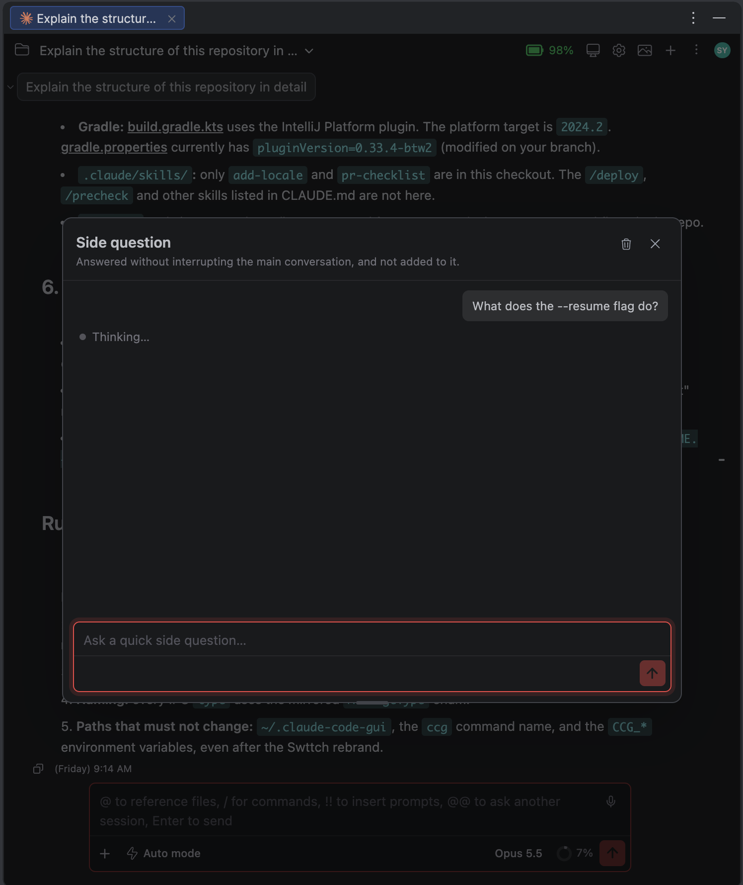

# The /btw side question window

> Languages: **English** · [한국어](./ko.md)
>
> Related: [/reload-plugins and /btw in the GUI](../028-cli_only_slash_commands/en.md) · [#543](https://github.com/Swttch/swttch/issues/543)

## What's new

`/btw` side questions no longer land in the chat. They open in **their own window floating above the chat**, titled **By the way** (what `/btw` stands for). The window does not dim or block the chat, so you keep working in the chat while it is open. The question and its answer stay in that window, **nothing is echoed into the main chat**, and the main agent keeps working on whatever it was doing, so a side answer can no longer show up in the middle of its reply.

## Asking a side question

Type `/btw` followed by your question in the message box:

```
/btw what does this flag do?
```

The window opens, shows your question with a "Thinking…" line, and then the answer. The main conversation is left exactly where it was: not interrupted, and the question is not added to it.




If you type a **bare `/btw`**, the window just opens, empty, with the hint "Ask anything about what is going on — the main agent keeps working." The CLI would only answer an empty side question with its usage line, so nothing is sent.


The window has **its own message box**. Whatever you type there is sent as a side question, so you do not need to type `/btw` again. A slash command typed there is a question **about** that command, not a command that runs.

## Opening and closing it

| Action | How |
|--------|-----|
| Open | Type `/btw` (with or without a question), or pick **By the way** in the ⋮ menu. The eye toggle on its row in the ⋮ menu pulls it out into the header dock, like any other dock item |
| Toggle from anywhere | **Cmd+Shift+B** on macOS, **Ctrl+Shift+B** on Windows and Linux. Also listed in the shortcuts help. While the window is parked as the corner button it brings the window back instead of closing it |
| Close | The **close** button, or **Escape** while the window has focus. Escape pressed anywhere else still belongs to the chat |
| Minimize | The **minus** button parks the window as a small round speech-bubble button in the bottom-right corner, just above the chat input. Hover it and a tooltip names it "By the way" and a small **X** appears at its top-right corner, which closes the window for good. Click the button to open the window again, where it was. A pulsing dot on the button means a question is still being answered, and a coloured dot means an answer arrived while it was parked (the X takes the dot's place while you hover) |
| Maximize | The **expand** button (or a double-click on the title bar) fills the window, leaving 1rem on every side. The same button, or another double-click, goes back to the previous size and place |
| Move | Drag the **title bar** |
| Resize | Drag any of the **four edges or four corners** |
| Clear | The **trash** button in the header empties the list |

Minimizing and maximizing glide instead of jumping, and while you drag the window it sits exactly under the pointer, also when the interface is zoomed. Closing the window does not lose any question: reopen it and they are still there (the window itself opens at its default size and place again).

## What is kept, and for how long

- Side questions are kept **per session**: switching to another session shows that session's side questions.
- They are kept **in memory only**. Reloading the GUI, restarting the IDE or closing the tab empties them. The CLI does not write side questions to the session transcript either, so there is nothing to restore them from.
- Clearing with the trash button removes them for good.

## If the question cannot reach Claude

If the request cannot reach the CLI, or the CLI stops before it answers (it crashed, or could not start), the question **fails in the window**: it shows "Couldn't get an answer from Claude for this side question. Try again." Ask it again once Claude is running.

The question is **never sent to the main chat instead**. Sending `/btw …` there as plain text would put the side question into the very conversation it is meant to stay out of, and the CLI refuses it there anyway ([#270](https://github.com/Swttch/swttch/issues/270)).

A side question also **never restarts the main agent**. When a CLI exists for the session but is not ready to take input at that moment (it is still starting, for example), the question fails rather than having the GUI start Claude again under it.

### Asking first thing in a reopened session

When you open a session from history and `/btw` is the first thing you do, the GUI now **starts the CLI for that session** to answer it. Before, there was no running CLI yet, so the question fell back to text in the main chat. The same applies to a new chat where `/btw` is the first message.

## Limits

- Side questions are not saved: they disappear when the GUI reloads.
- They are not added to the conversation, so Claude's main thread does not know about them.
- A slash command typed in the window is asked about, never executed.
