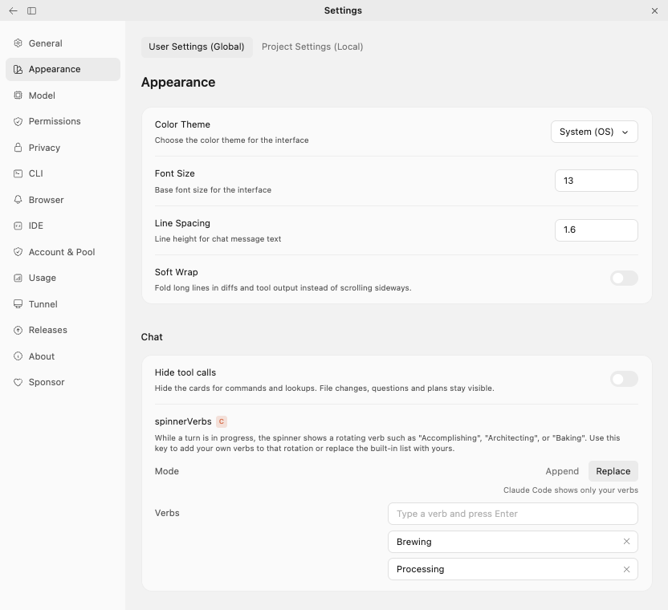
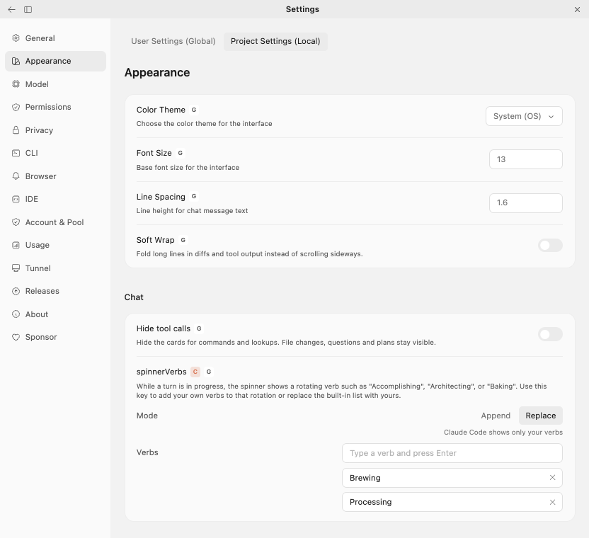

# Choose the words the spinner shows while Claude works

> Language: **English** · [한국어](./ko.md)

## What was reported

In [#548](https://github.com/Swttch/swttch/issues/548) a user wrote that the line under Claude's answer, the one that reads "Deliberating...", "Perusing..." and so on while a turn runs, always cycled through the built-in words. They had set `spinnerVerbs` in `~/.claude/settings.json` to show only "Processing", and the terminal did exactly that. This app ignored it.

The chat now follows `spinnerVerbs` the way Claude Code does, and **Settings > Appearance > Chat** has a row to change it without opening the file.

## What `spinnerVerbs` is

`spinnerVerbs` is a setting of Claude Code itself, described in [its settings reference](https://code.claude.com/docs/en/settings-reference#spinnerverbs). While a turn is in progress, the spinner shows a rotating word such as "Accomplishing", "Architecting" or "Baking". The setting adds your own words to that rotation or replaces the built-in list with yours.

It is stored in `settings.json` as an object with a `mode` and a list of `verbs`:

```json
{
  "spinnerVerbs": {
    "mode": "replace",
    "verbs": ["Processing"]
  }
}
```

Because it is Claude Code's own setting, a value you set here also applies in the terminal, and a value you already set in the terminal shows up here.

## The chat spinner

While Claude works, the line under the answer shows one of the words, followed by "...".


*The spinner line with a word from the setting. Here the list holds "Brewing" and "Processing", and the mode is Replace, so only those two ever appear.*

The word changes a couple of seconds after the turn starts, then every few seconds for as long as the turn runs. The next word is picked at random from the list and is never the same as the one just shown, unless the list holds a single word.

## The settings row

Open **Settings > Appearance** and scroll to the **Chat** section. The `spinnerVerbs` row carries the orange **C** badge, which marks a Claude Code setting, and links to Claude's documentation.

![The Appearance settings page on the User Settings (Global) tab, scrolled to the Chat section. Under "Hide tool calls" is the "spinnerVerbs" row with a C badge. Its description reads "While a turn is in progress, the spinner shows a rotating verb such as "Accomplishing", "Architecting", or "Baking". Use this key to add your own verbs to that rotation or replace the built-in list with yours." Below it a Mode switch has Append selected, with the line "Claude Code adds your verbs to the built-in set". A Verbs list has an empty text box on top with the hint "Type a verb and press Enter", and the words "Brewing" and "Processing" under it, each with an x button.](./assets/settings-append.png)

*The row with two words added. The empty box on top is where the next word goes.*

The description under the name is Claude's own wording, in the language of your interface.

### Mode

| Mode | What the spinner shows | The sentence under the switch |
| --- | --- | --- |
| **Append** | The built-in words plus yours. This is what the row starts on. | "Claude Code adds your verbs to the built-in set" |
| **Replace** | Only yours. | "Claude Code shows only your verbs" |



*Replace selected. The sentence under the switch follows the choice.*

Two things follow from how the built-in list works. It holds about eighty words, so in **Append** mode a single word of yours turns up once in many changes. If you want to see your words and nothing else, choose **Replace**. And **Replace** with an empty list does nothing: Claude Code keeps its built-in words, so the app does too.

### Verbs

The list is one word per line.

- **Add.** Type a word in the empty box at the top and press **Enter**, or click anywhere else. The box empties and keeps focus, so you can type the next word straight away. Each new word lands directly under the box.
- **Edit.** Click a word, change it, and press **Enter** or click away.
- **Remove.** Click the **x** at the end of the line, or empty the box of that word and click away.
- Blank entries and spaces around a word are dropped.

Every change is saved the moment you make it, with no Save button. Removing the last word removes `spinnerVerbs` from the file altogether, because an empty list would do nothing anyway.

If you type Korean, Japanese or Chinese with an input method, the first **Enter** after typing only ends the composition of the last character, as it does everywhere else. Press **Enter** again to add the word.

A word is shown exactly as you typed it. Your words are not translated, while the built-in words are shown in the language of your interface.

## Global and project settings

The row follows the **User Settings (Global)** and **Project Settings (Local)** tabs at the top of the settings page, like the rest of the page. See [The project tab shows the setting that actually applies](../089-project_tab_shows_inherited_settings/en.md) for how the two tabs relate.

| Tab | What you see and change |
| --- | --- |
| **User Settings (Global)** | Your own file, `~/.claude/settings.json`. This applies to every project that does not set its own. |
| **Project Settings (Local)** | The project's `.claude/settings.json`, or `.claude/settings.local.json` if the setting already lives there. |



*The project tab, where the project has not set `spinnerVerbs`. The **G** badge says the global value is in use, and the row shows it.*

- A project that says nothing about `spinnerVerbs` uses your global value, and its tab shows that value with the **G** badge.
- Changing the row on the project tab stores the setting in the project. The row then carries a **P** badge, and hovering it offers **Reset to global**.
- A project's list **replaces** the global list. The two are not combined.
- On the global tab, a project that sets its own value dims the row and marks it with a **P** badge: a change made there would have no effect for that project.

## Editing the file by hand

You can also write `spinnerVerbs` yourself in any of the settings files Claude Code reads. The settings screen and the chat spinner follow the file, including while a turn is running. The spinner takes up the change at its next word, which is at most a few seconds away.

A hand-written value does not have to be perfect for the app to cope with it:

- If `verbs` is not a list, it counts as no setting.
- Entries in `verbs` that are not text are skipped.
- A `mode` other than `"replace"` is read as `"append"`.
- If the file as a whole cannot be read as JSON, the app treats it as empty rather than failing. Fix the file and the setting is back.

## What this does not do

- It changes the words only. The spinner's icon and its timing are not settings.
- It does not touch the tip that some spinners show under the line. That is a separate Claude Code setting, `spinnerTipsEnabled`.
- The app does not check that a word is "a verb". Anything you type is shown.

## If your word never shows

- **Is the mode Append?** Then your word competes with about eighty built-in ones. Choose **Replace**.
- **Did the project set its own list?** On the global tab the row is dimmed and marked **P**. The project's list wins, so change it on the project tab or use **Reset to global**.
- **Did you edit the right file?** The global tab reads `~/.claude/settings.json`. If you set `CLAUDE_CONFIG_DIR`, it reads that folder instead.
- **Is the file valid JSON?** A file that cannot be read counts as empty, so its settings do not apply.
