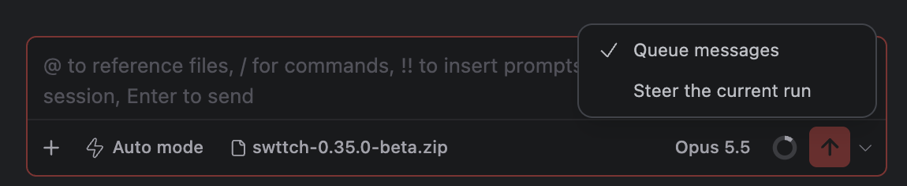
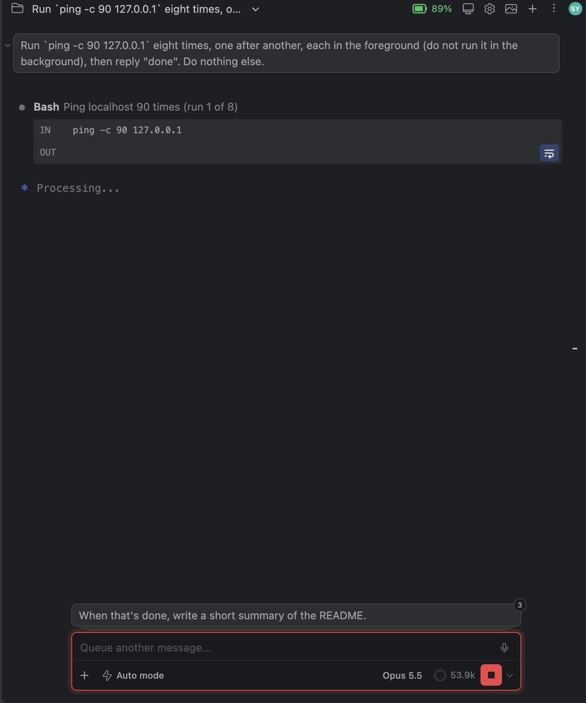
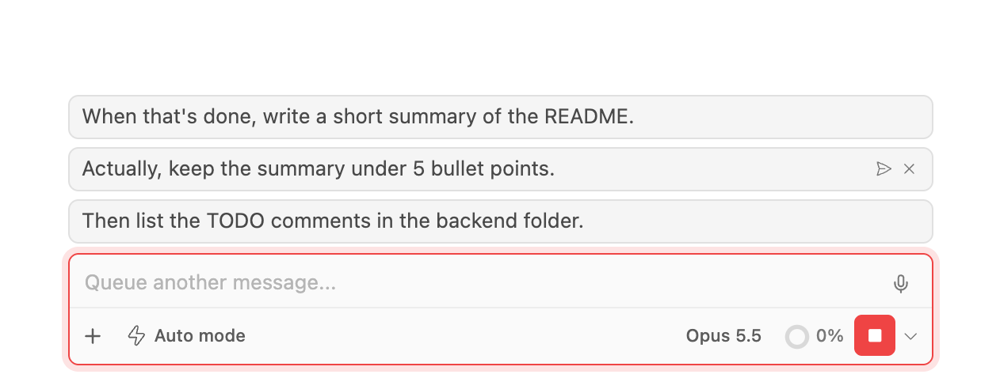
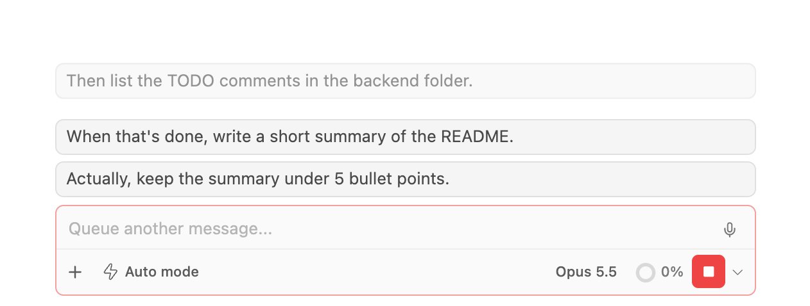
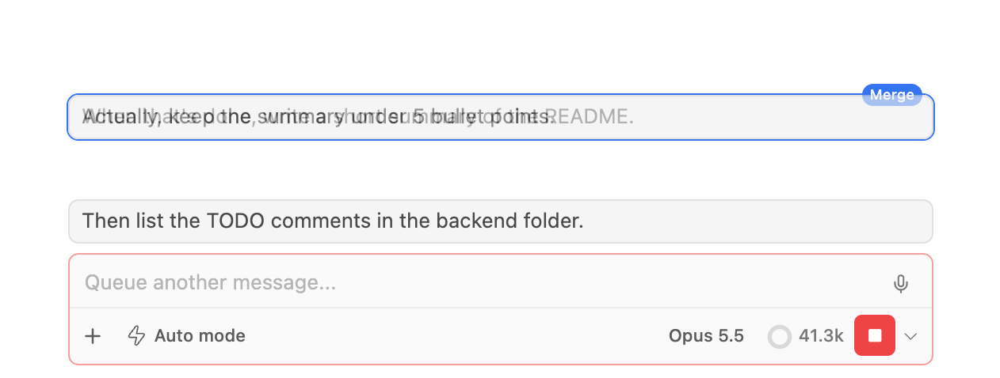
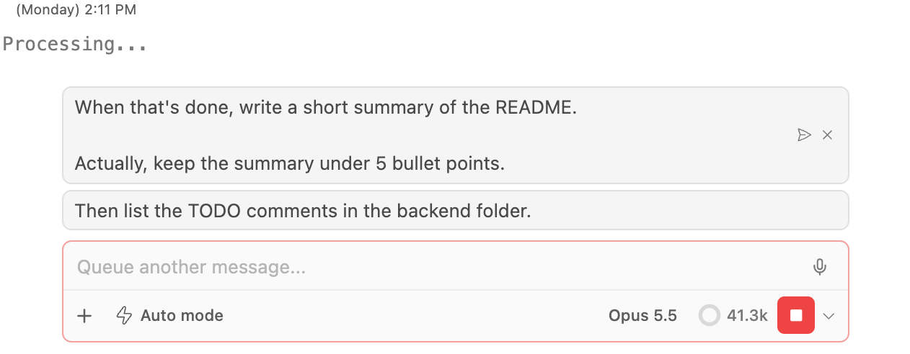
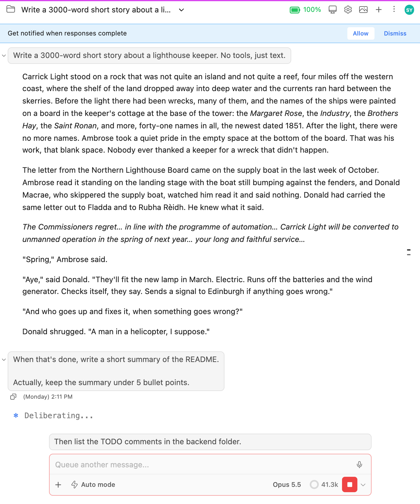

# Merge, reorder or steer now: managing queued messages

> Languages: **English** · [한국어](./ko.md)
>
> Related: [#568](https://github.com/Swttch/swttch/issues/568), [#569](https://github.com/Swttch/swttch/pull/569)

## What's new

When you type a message while Claude is still working and **Follow-up behavior** is set to **Queue**, the message waits in a queue and is sent after the current turn finishes. Until now that queue was a dead end: all you could do with a queued message was remove it. You could not fix the order, join two messages that belong together, or decide that one of them should go out right now.

Now you can:

- **Drag a message** to a new place in the queue.
- **Drag a message onto another one** to merge the two.
- **Steer now** sends a message to Claude immediately, in the middle of the current turn.
- **Remove from queue** works as before.

There is also a **chevron next to the send button** that switches Follow-up behavior between Queue and Steer without opening Settings.

## The queue only exists in Queue mode

The queue is only used when **Follow-up behavior** is **Queue**. You find the setting in **Settings > General > Composer > Follow-up behavior**. Since [#547](https://github.com/Swttch/swttch/issues/547) the default is **Steer**: a message typed while Claude works is sent to the current run straight away, and nothing is queued. If you never see a queue, this is why. Switch to Queue first (the chevron below is the quickest way).

With Steer selected, the shortcut named in the setting's description does the opposite for **one message** (it queues that one message). That per-message shortcut works with both behaviors, so a message queued that way can be dragged, merged, steered and removed like any other.

## Switching from the send button

Next to the send button there is a small **chevron**. It opens a small menu with two choices, the current one checked:

- **Queue messages**
- **Steer the current run**

The chevron does not keep a separate copy of the choice. It writes **the same setting** as Settings > General > Composer > Follow-up behavior, so the two always agree.

If the **project overrides** Follow-up behavior (the setting is set on the project tab of Settings), the chevron writes the **project's** value, because changing the global value would change nothing you can see in that project. If the project does not override it, the chevron writes the global value.

## The queued messages

Queued messages appear above the message box as a **stack of bubbles**, the oldest on top. **Hover the stack** and the bubbles fan out so you can see each one. **Click a bubble** to expand its text, as before.

Hover a message and two small icons appear **inside the bubble, on the right**, the same way the rename and delete icons appear on a session in the session dropdown:

| Icon | What it does |
|------|--------------|
| **Steer now** (paper plane) | Sends the message to Claude right away |
| **Remove from queue** (×) | Deletes it from the queue |

Clicking an icon does not expand the bubble.

## Dragging a message

Press on a message and move the pointer: the message follows it. A plain click still expands the text; the drag only starts once you have moved a few pixels. The stack stays fanned out for the whole drag, even if the pointer leaves it.

Where you **hold** the message decides what happens. Nothing changes the moment you pass over another message: you have to stay still over it for a short moment (about a third of a second), the same way you move an app icon on a phone's home screen.

| Where you hold it | What you see | What happens when you release |
|-------------------|--------------|-------------------------------|
| Near the **top or bottom edge** of another message | The other messages **move aside** to make room | The message **moves** to that place |
| Over the **middle** of another message | That message gets an **outline** and a **Merge** label; nothing moves | The two messages **merge** |
| You move on before the short moment is over | Nothing | Nothing changes |

Releasing the message outside the stack, or before anything moved aside or got outlined, leaves the queue as it was.

## Merging two messages

Drag a message and hold it over the **middle** of another one until that one is outlined, then release. Use it for messages you typed separately but that belong together. The two messages **do not need to be next to each other**.

- The text of the message you **dragged** is added **after** the text of the message you **dropped it on**, after a blank line. So the order of the text is yours to choose: to merge A and B, drag A onto B to get "B, then A", or drag B onto A to get "A, then B".
- **Attachments of both messages are kept and sent**: those of the message you dropped it on first, then those of the one you dragged. The queued bubble shows text only, so they are not visible there.
- The merged message **takes the place of the message you dropped it on**. The message you dragged is gone from the queue.
- You can merge again: drag a third message onto the result, and so on.

## Steering one now

**Steer now** takes the message out of the queue and sends it to Claude **immediately, in the middle of the current turn**, the same way a message sent in Steer mode is. Claude receives it while working and can change course. The other queued messages stay where they are.

If Claude can't take input at that moment, Steer now does nothing and the message stays in place.

## When queued messages are sent

The queue sends **one message each time a turn finishes**, **oldest first** (the top of the stack). If three messages are queued, they go out over the next three turns, not all at once. Reordering decides which goes first, and Steer now lets one skip the wait.

If the Claude process exits (it crashed, or the session was closed), the queue is emptied: no turn will finish to send what is left.

## Limits

- **Mouse only.** Moving and merging are done by dragging. There is no keyboard way to do them yet.
- **The queue keeps moving while you drag.** If a turn finishes during your drag, the top message is sent. If the message you are dragging, or the one you drop it on, has left the queue by the time you release, nothing happens.
- **Two messages at a time.** There is no multi-select merge; merge again to join more.
- **Queued text cannot be edited.** Remove the message and type it again.
- **No undo for a merge.** Once merged, the two messages are one. Remove the merged message and retype what you need if you merged by mistake.
- **Only with Follow-up behavior set to Queue** (or for a message you queued with the per-message shortcut). In Steer mode there is no queue to manage.
