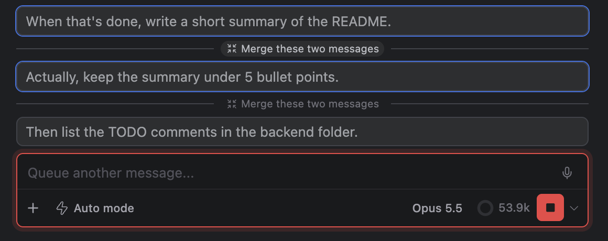

# Merge, reorder or steer now: managing queued follow-up messages

> Languages: **English** · [한국어](./ko.md)
>
> Related: [#568](https://github.com/Swttch/swttch/issues/568)

## What's new

When you type a message while Claude is still working and **Follow-up behavior** is set to **Queue**, the message waits in a queue and is sent after the current turn finishes. Until now that queue was a dead end: all you could do with a queued message was remove it. You could not fix the order, join two messages that belong together, or decide that one of them should go out right now.

Each queued message now has a small toolbar that appears when you hover it:

- **Steer now** sends that message to Claude immediately, in the middle of the current turn.
- **Move up** and **Move down** change its place in the queue.
- **Remove from queue** is the same button as before.

Between two queued messages there is also a **Merge these two messages** button that joins them into one.

There is also a **chevron next to the send button** that switches Follow-up behavior between Queue and Steer without opening Settings.

## The queue only exists in Queue mode

The queue is only used when **Follow-up behavior** is **Queue**. You find the setting in **Settings > General > Composer > Follow-up behavior**. Since [#547](https://github.com/Swttch/swttch/issues/547) the default is **Steer**: a message typed while Claude works is sent to the current run straight away, and nothing is queued. If you never see a queue, this is why. Switch to Queue first (the chevron below is the quickest way).

With Steer selected, the shortcut named in the setting's description does the opposite for **one message** (it queues that one message). That per-message shortcut works with both behaviors, so a message queued that way gets the same toolbar.

## Switching from the send button

Next to the send button there is a small **chevron**. It opens a small menu with two choices, the current one checked:

- **Queue messages**
- **Steer the current run**

The chevron does not keep a separate copy of the choice. It writes **the same setting** as Settings > General > Composer > Follow-up behavior, so the two always agree.

If the **project overrides** Follow-up behavior (the setting is set on the project tab of Settings), the chevron writes the **project's** value, because changing the global value would change nothing you can see in that project. If the project does not override it, the chevron writes the global value.

## The queued messages

Queued messages appear above the message box as a **stack of bubbles**, the oldest on top. **Hover the stack** and the bubbles fan out so you can see each one. **Click a bubble** to expand its text, as before.

The buttons on a bubble's toolbar:

| Button | What it does | Where it is missing |
|--------|--------------|---------------------|
| **Steer now** | Sends the message to Claude right away | |
| **Move up** | Swaps it with the message before it | The first bubble |
| **Move down** | Swaps it with the message after it | The last bubble |
| **Remove from queue** | Deletes it from the queue | |

## Merging two messages

When the stack is fanned out, a **Merge these two messages** button sits on a line **between each pair of bubbles**. Its place tells you which two messages it joins: the one just above it and the one just below it. Hovering the button outlines those two bubbles. Use it for follow-ups you typed as several messages but that belong together.

- The lower message's text is added **after the upper one's, after a blank line** (a blank line between the two texts).
- **Attachments of both messages are kept and sent**: the first message's, then the second's. The queued bubble shows text only, so they are not visible there.
- The merged message **keeps the upper message's place** in the queue. The lower message is gone from the queue.
- You can merge again: merging the result with the message below it joins three messages, and so on.

To merge two messages that are **not next to each other**, move one of them first so they are adjacent, then merge.

## Steering one now

**Steer now** takes the message out of the queue and sends it to Claude **immediately, in the middle of the current turn**, the same way a message sent in Steer mode is. Claude receives it while working and can change course. The other queued messages stay where they are.

If Claude can't take input at that moment, Steer now does nothing and the message stays in place.

## When queued messages are sent

The queue sends **one message each time a turn finishes**, **oldest first** (the top of the stack). If three messages are queued, they go out over the next three turns, not all at once. Reordering decides which goes first, and Steer now lets one skip the wait.

If the Claude process exits (it crashed, or the session was closed), the queue is emptied: no turn will finish to send what is left.

## Limits

- **No drag and drop.** Use Move up and Move down.
- **No multi-select merge.** Merging always joins two neighboring messages. Reorder first to merge messages that are not adjacent.
- **Queued text cannot be edited.** Remove the message and type it again.
- **No undo for a merge.** Once merged, the two messages are one. Remove the merged message and retype what you need if you merged by mistake.
- **Only with Follow-up behavior set to Queue** (or for a message you queued with the per-message shortcut). In Steer mode there is no queue to manage.
