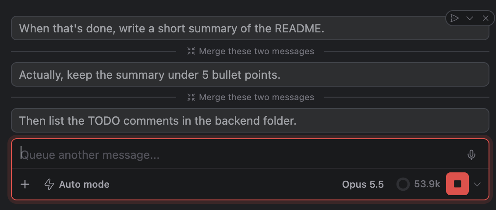

# 합치기, 순서 바꾸기, 지금 보내기: 대기열의 후속 메시지 다루기

> 언어: [English](./en.md) · **한국어**
>
> 관련: [#568](https://github.com/Swttch/swttch/issues/568)

## 새로워진 점

Claude가 아직 작업 중일 때 메시지를 입력하고 **후속 메시지 처리 방식(Follow-up behavior)** 이 **Queue(대기열에 추가)** 로 되어 있으면, 그 메시지는 대기열에서 기다렸다가 지금 턴이 끝난 뒤에 전송됩니다. 지금까지는 대기열에 들어간 메시지로 할 수 있는 일이 지우는 것뿐이었습니다. 순서를 바로잡을 수도, 함께 가야 할 두 메시지를 하나로 합칠 수도, 그중 하나를 지금 바로 보내겠다고 정할 수도 없었습니다.

이제 대기 중인 메시지마다 마우스를 올리면 작은 도구 막대가 나타납니다.

- **Steer now(지금 조정)** 는 그 메시지를 현재 턴 도중에 Claude에게 바로 보냅니다.
- **Move up(위로 이동)** 과 **Move down(아래로 이동)** 은 대기열 안에서 자리를 바꿉니다.
- **Remove from queue(대기열에서 제거)** 는 예전과 같은 버튼입니다.

대기 중인 두 메시지 사이에는 둘을 하나로 합치는 **Merge these two messages(이 두 메시지 병합)** 버튼도 있습니다.

그리고 **전송 버튼 옆의 셰브런**으로 설정 화면을 열지 않고도 후속 메시지 처리 방식을 Queue와 Steer 사이에서 바꿀 수 있습니다.

## 대기열은 Queue 방식에서만 있습니다

대기열은 **후속 메시지 처리 방식**이 **Queue** 일 때만 쓰입니다. 이 설정은 **설정 > 일반 > 입력창 > 후속 메시지 처리 방식** 에 있습니다. [#547](https://github.com/Swttch/swttch/issues/547) 이후 기본값은 **Steer(현재 작업 조정)** 입니다. Claude가 일하는 동안 입력한 메시지가 곧바로 현재 실행에 전달되고, 아무것도 대기열에 들어가지 않습니다. 대기열을 한 번도 본 적이 없다면 이 때문입니다. 먼저 Queue로 바꾸세요(아래의 셰브런이 가장 빠릅니다).

Steer를 고른 상태에서는 설정 설명에 적힌 단축키가 **메시지 하나**에 대해 반대로 동작합니다(그 메시지 하나만 대기열에 넣습니다). 메시지별 단축키는 두 방식 모두에서 동작하므로, 그렇게 대기열에 넣은 메시지에도 같은 도구 막대가 붙습니다.

## 전송 버튼에서 바꾸기

전송 버튼 옆에 작은 **셰브런**이 있습니다. 누르면 선택지 두 개가 있는 작은 메뉴가 열리고, 지금 쓰는 쪽에 체크 표시가 붙어 있습니다.

- **Queue messages(메시지를 대기열에 추가)**
- **Steer the current run(현재 작업 조정)**

셰브런은 선택을 따로 들고 있지 않습니다. 설정 > 일반 > 입력창 > 후속 메시지 처리 방식과 **같은 설정**에 쓰므로 둘은 항상 일치합니다.

**프로젝트가 후속 메시지 처리 방식을 재정의**하고 있으면(설정 화면의 프로젝트 탭에서 값을 정해 둔 경우) 셰브런은 **프로젝트의** 값을 씁니다. 전역 값을 바꿔도 그 프로젝트에서는 눈에 보이는 변화가 없기 때문입니다. 프로젝트가 재정의하지 않으면 전역 값을 씁니다.

## 대기 중인 메시지

대기 중인 메시지는 입력창 위에 **말풍선 더미**로 보이며, 가장 오래된 것이 맨 위에 있습니다. **더미에 마우스를 올리면** 말풍선들이 펼쳐져 하나씩 볼 수 있습니다. **말풍선을 누르면** 예전처럼 본문이 펼쳐집니다.

말풍선 도구 막대의 버튼은 다음과 같습니다.

| 버튼 | 하는 일 | 없는 곳 |
|------|---------|---------|
| **Steer now** (지금 조정) | 메시지를 Claude에게 바로 보냅니다 | |
| **Move up** (위로 이동) | 바로 앞 메시지와 자리를 바꿉니다 | 첫 번째 말풍선 |
| **Move down** (아래로 이동) | 바로 뒤 메시지와 자리를 바꿉니다 | 마지막 말풍선 |
| **Remove from queue** (대기열에서 제거) | 대기열에서 지웁니다 | |

## 두 메시지 합치기

더미가 펼쳐져 있으면 **말풍선 쌍마다 그 사이의 줄**에 **Merge these two messages** 버튼이 있습니다. 버튼의 자리가 어느 두 메시지를 합치는지 알려줍니다. 바로 위의 메시지와 바로 아래의 메시지입니다. 버튼에 마우스를 올리면 그 두 말풍선에 테두리가 그려집니다. 여러 메시지로 나눠 입력했지만 사실은 함께 가야 하는 후속 요청에 쓰세요.

- 아래 메시지의 본문이 **위 메시지 본문 뒤에 빈 줄 하나를 두고** 이어 붙습니다.
- **두 메시지의 첨부는 모두 유지되어 전송됩니다**. 첫 번째 메시지의 첨부가 먼저, 그다음 두 번째 메시지의 첨부입니다. 대기 말풍선은 본문만 보여주므로 첨부는 거기에 보이지 않습니다.
- 합친 메시지는 대기열에서 **위 메시지의 자리를 지킵니다**. 아래 메시지는 대기열에서 사라집니다.
- 다시 합칠 수 있습니다. 합친 결과를 그 아래 메시지와 또 합치면 세 메시지가 하나가 되고, 그다음도 마찬가지입니다.

**나란히 있지 않은** 두 메시지를 합치려면 먼저 하나를 옮겨 붙여 놓은 다음 합치세요.

## 하나를 지금 보내기

**Steer now** 는 메시지를 대기열에서 꺼내 **현재 턴 도중에 바로** Claude에게 보냅니다. Steer 방식에서 보낸 메시지와 같은 방식입니다. Claude는 작업하는 중에 그 메시지를 받아 방향을 바꿀 수 있습니다. 대기 중인 다른 메시지들은 제자리에 남습니다.

그 순간 Claude가 입력을 받을 수 없으면 Steer now는 아무 일도 하지 않고 메시지는 제자리에 남습니다.

## 대기 중인 메시지가 전송되는 때

대기열은 **턴이 끝날 때마다 메시지를 하나씩**, **가장 오래된 것부터**(더미의 맨 위) 보냅니다. 세 개가 대기 중이면 한꺼번에 가지 않고 다음 세 턴에 걸쳐 나갑니다. 순서 바꾸기로 무엇이 먼저 갈지를 정하고, Steer now로 하나가 기다림을 건너뛰게 할 수 있습니다.

Claude 프로세스가 종료되면(충돌했거나 세션이 닫힌 경우) 대기열은 비워집니다. 남은 것을 보낼 턴이 더는 끝나지 않기 때문입니다.

## 한계

- **끌어다 놓기는 없습니다.** Move up과 Move down을 쓰세요.
- **여러 개를 골라 합치기는 없습니다.** 합치기는 항상 이웃한 두 메시지를 잇습니다. 나란히 있지 않은 메시지는 먼저 순서를 바꾼 뒤 합치세요.
- **대기 중인 본문은 고칠 수 없습니다.** 메시지를 지우고 다시 입력하세요.
- **합치기는 되돌릴 수 없습니다.** 한 번 합치면 두 메시지는 하나입니다. 잘못 합쳤다면 합친 메시지를 지우고 필요한 것을 다시 입력하세요.
- **후속 메시지 처리 방식이 Queue일 때만** 쓸 수 있습니다(또는 메시지별 단축키로 대기열에 넣은 메시지). Steer 방식에서는 다룰 대기열이 없습니다.
