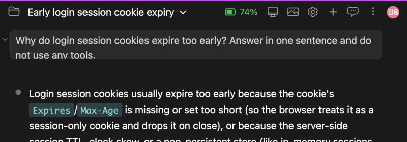
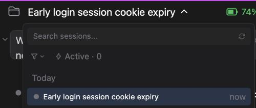

# 세션 제목: Claude Code가 만들고, 어디서나 같게 보이고, 이름 변경은 흔적을 남기지 않는다

> Language: [English](./en.md) · **한국어**

## 제보 내용

[#562](https://github.com/Swttch/swttch/issues/562)에서 한 사용자가 이렇게 적었습니다. 이 앱에서 세션 이름은 처음 보낸 메시지의 앞부분이 그대로 붙는 것이고, Claude의 다른 앱에서는 대화 내용으로 만든 짧은 이름이 붙는다는 것입니다. 이름을 바꾸는 것도 이 앱 안에서만 통하는 일이었습니다. 세션 드롭다운에서 입력한 이름을 터미널의 Claude Code나 다른 클라이언트는 볼 수 없었습니다.

세 가지를 한꺼번에 바꿔서, 세션이 어디서 열리든 같게 읽히도록 했습니다.

- 새 세션에 터미널에서처럼 **생성된 제목**이 붙습니다.
- 세션은 Claude Code의 다른 클라이언트들이 쓰는 **이름 순서 그대로** 목록에 표시됩니다.
- 드롭다운에서 입력한 이름은 **Claude Code 자체의 세션 이름**이 되고, 대화에는 아무것도 추가하지 않습니다.

## 생성된 제목

새 세션의 첫 메시지를 보내면, 첫 답변이 아직 흘러오는 동안 Claude Code가 그 세션의 짧은 제목을 만들고 상단바가 그 제목을 받습니다. 제목은 상단바, 세션 드롭다운, 세션 목록 페이지에 나타납니다.

*제목이 도착한 뒤의 상단바. 그 전에는 메시지의 첫 단어들이 보였습니다.*

*같은 제목이 세션 드롭다운에 나온 모습.*

제목은 이렇게 만들어집니다.

- 세션이 무엇에 관한 것인지 2~5단어의 짧은 명사구로 씁니다.
- 대화에서 쓰는 언어로 나옵니다. **설정 > 일반 > 언어**(Claude의 응답 언어)를 정했다면 제목도 그 언어를 따릅니다.
- 첫 메시지로 한 번만 만들고, 대화가 진행돼도 바뀌지 않습니다.

### 제목이 나타나는 방식

방금 생성된 제목은 상단바와 세션 행에서 첫 단어들을 한 번에 갈아치우지 않고 한 글자씩 붙으며 나타납니다. 1초 안팎이 걸리고, 제목이 아무리 길어도 1.5초를 넘지 않습니다. 한 번만 재생됩니다. 직접 입력한 이름, 다시 연 세션, 새로 읽은 목록은 제목이 그대로 보입니다. 운영체제에서 동작 줄이기를 켜 두었다면 제목이 바로 나타납니다.

### 제목이 만들어지지 않는 경우

- 첫 메시지가 `/init` 같은 슬래시 명령입니다. Claude Code는 명령으로 세션 이름을 짓지 않으므로 세션은 원래 가진 단어로 남습니다.
- 첫 메시지가 아주 짧습니다. 아무것도 돌아오지 않으면 다음 메시지들이 다시 시도하며, 모두 세 번까지 시도합니다.
- 이 버전 이전에 만든 세션이거나 예전 세션을 다시 연 경우입니다. 이 설정을 켠 채 이 앱에서 시작한 세션만 요청합니다.
- 아래 설정이 꺼져 있습니다.

Claude Code에 물을 수 없거나 답이 없으면 아무 일도 일어나지 않습니다. 세션은 이미 가진 단어로 목록에 남으며 예전과 똑같습니다. 고장나는 것도, 오류가 뜨는 것도 없습니다.

## 세션이 목록에 표시되는 방식

드롭다운과 세션 목록 페이지는 세션이 가진 것 중 다음 순서의 첫 번째를 이름으로 씁니다.

| 순서 | 무엇 | 어디서 오는가 |
| --- | --- | --- |
| 1 | 직접 준 이름 | 드롭다운의 **이름 바꾸기** 또는 어느 Claude Code 클라이언트에서든 `/rename` |
| 2 | 생성된 제목 | Claude Code, 첫 메시지 직후 |
| 3 | 그 세션에서 마지막으로 보낸 메시지 | 세션 자체 |
| 4 | Claude Code가 써 둔 요약 | 세션 자체 |
| 5 | 첫 메시지 | 세션 자체 |

Claude Code의 다른 클라이언트들이 쓰는 순서와 같아서, 한 세션이 터미널, 에디터 확장, 데스크톱 앱에서 같은 이름으로 보입니다. 이 버전 전에는 여기서 2번과 3번이 빠져 있었습니다.

## 설정 두 가지

둘 다 **설정 > 일반**에 있고 기본값은 켜짐입니다. 다른 설정처럼 프로젝트 탭에서 프로젝트별로 정할 수도 있습니다.

*새 행 두 개, 둘 다 켜짐.*

- **Generate session titles automatically**(세션 제목 자동 생성). 끄면 새 세션에 제목을 요청하지 않고, 이미 가진 것(마지막 메시지, 다음 설정도 껐다면 첫 메시지)으로 표시합니다. Claude Code 자체에는 이 스위치가 없어서 이 앱만의 설정입니다.
- **List unnamed sessions by their last prompt**(이름 없는 세션을 마지막 프롬프트로 표시). 켜면 이름도 생성된 제목도 없는 세션을 그 세션에서 마지막으로 보낸 메시지로 표시합니다. 끄면 요약이나 첫 메시지로 표시하며, 이 앱이 예전에 하던 방식입니다. 이름이나 생성된 제목이 있는 세션에는 영향이 없습니다.

둘 중 하나를 꺼도 그때부터 목록이 읽히는 방식만 바뀝니다. 아무것도 지워지지 않고, 다시 켜면 앞의 이름이 돌아옵니다.

## 세션 이름 바꾸기

드롭다운이나 세션 목록 페이지에서 세션에 마우스를 올리고 연필을 누른 뒤 새 이름을 입력하고 **Enter**를 누릅니다. 새 이름이 바로 보입니다.

- **이름은 Claude Code 자체의 이름입니다.** 세션 안에 저장되므로 터미널의 세션 선택 화면과 Claude Code의 다른 클라이언트에도 나옵니다. 예전에는 이 앱만 읽는 파일에 따로 저장했습니다.
- **대화는 그대로입니다.** 이름을 바꿔도 채팅에는 `/rename` 명령이나 그 답이 한 줄도 추가되지 않습니다.
- **돌아가고 있는 세션에는 알려 줍니다.** 세션이 열려 있고 돌아가는 중이면 Claude Code에 직접 요청합니다. 돌아가고 있지 않으면 이름 변경만을 위해 짧게 사는 Claude Code를 하나 띄웁니다. 1~2초가 걸리고 그동안 이름은 이미 화면에 나와 있습니다. 모델을 부르지 않고 사용량도 쓰지 않습니다.
- **저장하지 못하면** 이전 이름이 화면에 돌아옵니다. 보이는 이름이 곧 저장된 이름입니다.
- **이름은 한 줄, 200자까지입니다.** 줄바꿈은 공백이 되고 더 긴 이름은 잘립니다. Claude Code가 하는 것과 같습니다.

너무 오래된 Claude Code라 조용한 요청을 받지 못하면 공식 `/rename` 명령으로 이름을 바꿉니다. 이름은 똑같이 바뀌지만, 터미널에서처럼 명령과 그 답이 대화에 추가된다는 점이 다릅니다.

### 이전 버전에서 입력한 이름

이 버전 이전에 입력한 이름은 그대로 두는 동안 계속 표시됩니다. 그 세션의 이름을 한 번 더 바꾸면 새 이름이 모든 곳에서 앞섭니다.

## 하지 않는 것

- 이미 있는 세션에는 제목을 만들지 않습니다. 이름은 위의 목록 순서가 정하는 대로 나옵니다.
- IDE의 에디터 탭 이름표를 따로 바꾸지는 않습니다. 탭은 다른 제목 변경과 똑같이 새 제목을 받으며, 한 글자씩 붙는 효과는 없습니다.
- 제목은 한 번 만들어지면 다시 만들지 않습니다. 바꾸려면 세션 이름을 바꾸세요.

## 자주 묻는 질문

**왜 세션이 아직 첫 메시지 그대로 보이나요?** 첫 메시지가 명령이거나 아주 짧았거나(위 참고), 설정이 꺼져 있거나, Claude Code가 답하지 않은 경우입니다. 다른 메시지를 보내면 다시 시도하며 모두 세 번까지 합니다.

**왜 목록에 마지막 메시지가 보이나요?** 이름도 생성된 제목도 없는 세션은 마지막 메시지로 표시됩니다. 첫 메시지로 보고 싶다면 **List unnamed sessions by their last prompt**를 끄세요.

**더 나은 제목을 얻을 수 있나요?** 세션 이름을 바꾸세요. 직접 준 이름이 항상 먼저입니다.

## 관련 링크

- [#562](https://github.com/Swttch/swttch/issues/562)
- [이 기능이 의존하는 예외의 기록](../../principle-exceptions/562-generate-session-title.md)
