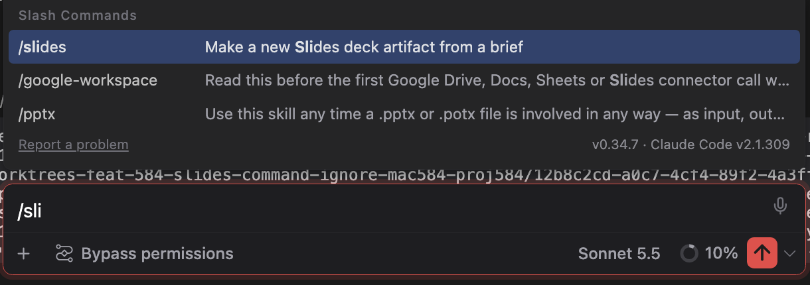

# `/slides`가 이제 여기서도 되고, 아티팩트에는 링크가 달린 카드가 생깁니다

> Language: [English](./en.md) · **한국어**

## 무엇이 문제였나

터미널에서 Claude Code에 `/sli`까지 치면 명령 목록에 `/slides`가 나옵니다. 이 채팅에서는 나오지 않았습니다. 그래도 `/slides`를 보내면 Claude Code가 이렇게 답했습니다.

> /slides isn't installed in this session

터미널에서 슬라이드 덱을 만들던 사람이 여기서는 같은 일을 할 방법이 없었습니다. 페이지를 게시하거나 페이지에 달린 댓글을 읽는 것 같은 다른 아티팩트 기능도 마찬가지였습니다.

## 왜 그랬나

아티팩트는 Claude Code가 세션에서 만든 내용을 claude.ai의 비공개 주소로 게시하는 페이지입니다. Claude Code는 세션마다 아티팩트가 존재하는지를 스스로 정합니다.

Claude Code 문서에 따르면 Claude Code가 다른 프로그램의 일부로 실행될 때는 아티팩트가 기본으로 꺼져 있습니다. Agent SDK 안에서, GitHub Action에서, 그리고 직접 만든 스크립트에서 `-p`로 실행할 때입니다. 이 채팅은 Claude Code를 그런 방식으로 띄우기 때문에 "꺼짐" 쪽에 속했습니다. 터미널 세션은 그 쪽이 아니라서, 터미널 사용자는 아무것도 하지 않아도 `/slides`를 받았습니다.

문서는 그런 세션에서 아티팩트를 켜는 방법을 적어 두지 않았습니다. Claude Code 안에는 그것을 켜는 스위치가 있고, 환경변수 `CLAUDE_CODE_ARTIFACT`입니다. 이 채팅이 Claude Code를 띄울 때 이제 그 스위치를 켜 줍니다. 그래서 세션이 터미널 세션처럼 취급됩니다.

## 이제 보이는 것



`/slides`가 명령 목록에 나옵니다. `/slides` 뒤에 짧은 요청을 적어 보내세요.

```text
/slides a quarterly review of the platform team's reliability work, for the engineering all-hands
```

Claude가 슬라이드 아티팩트를 만들고 어디 있는지 알려 줍니다. 요청 없이 `/slides`만 보내면, 아무것도 만들기 전에 덱이 무엇에 관한 것인지 먼저 묻습니다.

작업하는 동안 아티팩트 도구를 부르는 호출마다 채팅에 카드가 하나씩 나옵니다.


| 카드의 부분 | 무엇인가 |
| --- | --- |
| 점 옆의 이름 | 어떤 도구를 불렀는지: `Artifact`, `ArtifactComments`(페이지의 댓글을 읽고 답하기), `ArtifactData`(페이지가 따로 저장한 데이터) |
| 이름 옆의 동작과 대상 | 호출이 무엇을 하고 무엇에 관한 것인지: `quickstart slides`, 만드는 페이지의 제목, 데이터 호출의 컬렉션 |
| 그 아래 링크 | 만들어졌거나 갱신된 페이지. 누르면 터미널과 같이 기본 브라우저에서 열립니다 |
| OUT 상자 | 그 호출에 대한 Claude Code의 답을 온 그대로 보여 줍니다 |

`/slides`를 한 번 실행하면 보통 위의 두 카드처럼 호출이 두 번 일어납니다. 첫 호출 `quickstart`는 Claude Code에게 어떤 템플릿을 쓸지 묻는 호출이고, 그 카드의 링크는 Claude Code가 답에서 알려 준 Slides 템플릿 자체의 페이지입니다. 두 번째 호출이 덱을 만들고, 그 카드의 링크가 새 페이지입니다. 같은 덱을 나중에 고치면 같은 주소가 다시 나옵니다.

`/design`도 같은 방식으로 돌아옵니다. `/design a settings screen for a mobile banking app`처럼 요청을 붙여 실행하면, Claude가 화면들을 한 캔버스의 아트보드로 그려 Design 아티팩트로 게시합니다. `/slides`에 Slides 템플릿이 필요하듯 `/design`에는 Design 템플릿이 켜져 있어야 합니다.

새 아티팩트는 본인에게만 보입니다. 공유하려면 페이지를 열고 머리글의 **Share**를 쓰세요.

## `/slides`에 필요한 것

아래는 이 채팅이 정하는 조건이 아닙니다. Claude Code 자신의 조건이고, 터미널에서와 똑같이 적용됩니다.

| 필요한 것 | 내용 |
| --- | --- |
| claude.ai 로그인 | API 키, 게이트웨이 토큰, 클라우드 공급자 자격증명을 쓰는 세션은 아티팩트를 게시할 수 없습니다 |
| 요금제 | Pro, Max, Team, Enterprise |
| Claude Code 2.1.265 이상 | `/slides`가 처음 생긴 버전 |
| Slides 템플릿이 켜져 있을 것 | Team과 Enterprise 요금제에서는 조직 소유자가 정합니다. 꺼져 있으면 `/slides`가 목록에 없습니다 |
| Anthropic API | Amazon Bedrock, Google Cloud, Microsoft Foundry로는 쓸 수 없습니다 |

계정이 조건을 채우지 못하면 터미널에서처럼 `/slides`가 나타나지 않습니다.

## 아티팩트를 끄려면

공식 방법은 여기서도 모두 통합니다.

- Claude Code 설정에 `"enableArtifact": false`를 둡니다.
- IDE를 띄우는 환경에 `CLAUDE_CODE_DISABLE_ARTIFACT=1`을 둡니다.
- `permissions.deny`에 `Artifact`를 추가합니다.

IDE를 띄우는 환경에 `CLAUDE_CODE_ARTIFACT`를 직접 정해 두었다면(`0` 포함) 이 채팅은 그 값을 건드리지 않습니다.

## 바뀌지 않은 것

이 채팅은 페이지 자체를 보여 주지 않습니다. 링크를 주고, 페이지는 브라우저에서 열립니다. 터미널의 Claude Code도 같지만, 터미널은 첫 게시 뒤에 브라우저를 스스로 열어 주기도 합니다. 이 채팅은 아직 그렇게 하지 않습니다. 페이지를 IDE 안에서 보여 주는 것, 브라우저를 대신 열어 주는 것, 터미널의 `/artifacts` 목록은 [#593](https://github.com/Swttch/swttch/issues/593)에서 다룹니다.

---

[#584](https://github.com/Swttch/swttch/issues/584)로 제보되었습니다. 이 기능이 기대는 예외는 [584-artifact-env-for-slides.md](../../principle-exceptions/584-artifact-env-for-slides.md)에 기록되어 있습니다.
