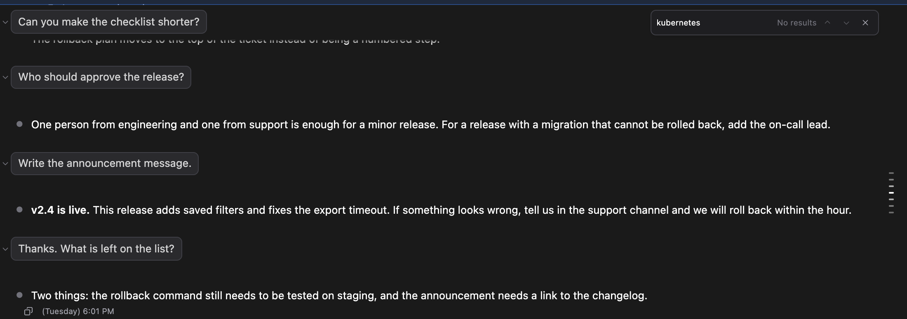

# Search the conversation: Cmd+F (Ctrl+F) finds any word, even in messages you have not scrolled to yet

> Language: **English** · [한국어](./ko.md)

## What was missing

A long chat is hard to find your way around in. The answer you remember from an hour ago is somewhere above, and the only way back to it was to scroll and hope. A terminal gives you its own find for this. The chat in the IDE did not, and the IDE's own Find does not search a chat, so there was nothing to press.

Reported in [#531](https://github.com/Swttch/swttch/issues/531) as "Search in chat history", with the goal of getting around a long history more easily.

## Open it

Press the find shortcut while the chat has focus:

| Where you are | Shortcut |
| --- | --- |
| macOS | **Cmd+F** |
| Windows and Linux | **Ctrl+F** |

On macOS, Ctrl+F is left alone. In the message box it keeps moving the cursor one character to the right, as it does everywhere else on a Mac.

The same row, "Search the conversation", is in the list of shortcuts that **Cmd+/** (**Ctrl+/**) opens:

A bar appears at the top right of the conversation, under any banners the chat is showing, and the cursor is in it. Type what you are looking for.

## What you see

| What | Meaning |
| --- | --- |
| Yellow highlight | Every place the text appears |
| Orange highlight | The match you are on now. The conversation scrolls to put it in the middle of the screen |
| `9 of 9` | Which match you are on, and how many there are. The search starts at the newest match, so with nine matches it starts at `9 of 9` |
| `No results` | Nothing in this conversation contains the text |

To move between matches:

| To do this | Press |
| --- | --- |
| Go to the next match | **Enter**, or the down arrow in the bar |
| Go to the previous match | **Shift+Enter**, or the up arrow in the bar |
| Go past the last match | The next press goes back to the first match |
| Start a new search | **Cmd+F** (**Ctrl+F**) again. The text in the box is selected, so typing replaces it. This also works when the cursor has gone back to the message box |
| Close the bar | **Esc**, or the X in the bar |

Closing the bar removes the highlights and puts the cursor back where it was before you opened it.

## It searches the whole conversation, and loads only as far as you go

A long session is loaded a page at a time, and the older pages are not on the screen until you ask for them with "Load older messages". A find that only looked at what is on the screen would say "No results" for something that is plainly in the session. A find that loaded the whole session to look would put every page of a long conversation on the screen just so you could look for one word.

So the search is done in two places:

- **The session file is searched as soon as you stop typing.** That is how the count comes up at once, for the whole session, without loading anything. `9 of 9` means the ninth of nine matches in the whole conversation.
- **The conversation is loaded only as far as the match you move to.** The first match shown is the newest one, which is usually on the screen already or just above it. Each press of the up arrow or **Shift+Enter** goes to the next older match. When that match is in a part that is not loaded yet, the conversation is loaded back to it, and no further, and the screen moves there. While that happens the number next to the arrows turns into a small spinner.

Matches are numbered in the order they appear in the conversation, so the number goes up as you go down the screen. The search starts at the newest match, because that is where you are reading, which makes the first number `9 of 9` when there are nine. The **up arrow** and **Shift+Enter** go to the previous match, the next one up the conversation and so the next older one. The **down arrow** and **Enter** go to the next match, the next one down and so the next newer one. From the newest match, **Enter** goes around to the oldest match of all, which loads the conversation back to it.

Two things follow from this:

- A match far back costs the loading of everything between it and where you are, because the conversation is one unbroken run and cannot have a gap in the middle. Going back match by match loads it in small steps instead of all at once.
- The count for the part that is not loaded yet comes from the session file and not from the screen. Once you reach it, the number is the screen's own, and it can move by a match or two where the file holds text the screen does not show, such as the inside of a tool's request.

`No results` is shown once the whole session file has been searched. If the search of the file fails, the bar still works on what is loaded.

## What it looks through

- Everything the conversation shows as text: your messages, Claude's replies, and the text on tool cards.
- Upper and lower case do not matter. `Rollback` finds `rollback`.
- A reply you have folded away is searched too. When the match you move to is inside a folded reply, that reply opens so you can see it.
- While Claude is still writing, new text is searched as it arrives.

## What it does not do

- It looks inside one session. It does not search your other sessions. The session list has its own search for those.
- There are no switches for whole words, exact case or patterns.
- A match has to be in one unbroken piece of text. A phrase that formatting cuts in two, for example one half in bold and one half not, is not found as one phrase. Search for one of the halves instead.
- The message box and the find bar itself are never searched.
- At most 2000 matches are counted. A single letter in a very long session reaches that quickly, and the bar then shows the count with a plus, such as `1 of 2000+`. A longer word gets you the exact count.

## Where it works

In the IDE and in the browser version alike. In the IDE, Cmd+F and Ctrl+F open this bar when the chat has focus, and the IDE's own Find does not open on top of it. That was checked in IntelliJ IDEA 2024.2.6 and in IntelliJ IDEA 2026.3 EAP on macOS and on Windows. In an editor tab, the keys are still the IDE's own Find, as before.

---

Reported in [#531](https://github.com/Swttch/swttch/issues/531), shipped in v0.34.9.
