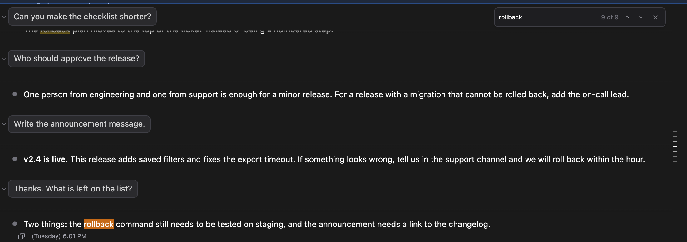

# 대화 안에서 찾기: Cmd+F(Ctrl+F)로 아직 스크롤하지 않은 메시지까지 한 번에 찾는다

> Language: [English](./en.md) · **한국어**

## 빠져 있던 것

긴 대화에서는 길을 잃기 쉽습니다. 한 시간 전에 받은 답이 위 어딘가에 있다는 것은 기억나는데, 거기로 돌아가는 방법은 스크롤하며 눈으로 찾는 것뿐이었습니다. 터미널에는 터미널 자체의 찾기가 있습니다. IDE 안의 채팅에는 그런 것이 없었고, IDE의 찾기는 채팅 안을 찾지 못하므로 누를 수 있는 키가 아예 없었습니다.

[#531](https://github.com/Swttch/swttch/issues/531)에서 "채팅 기록 안에서 검색"이라는 이름으로 제보되었습니다. 긴 기록 사이를 더 쉽게 오가고 싶다는 목적이었습니다.

## 여는 방법

채팅에 포커스가 있을 때 찾기 단축키를 누릅니다.

| 사용 환경 | 단축키 |
| --- | --- |
| macOS | **Cmd+F** |
| Windows와 Linux | **Ctrl+F** |

macOS의 Ctrl+F는 건드리지 않습니다. 메시지 입력창에서는 맥의 다른 곳에서처럼 커서를 한 글자 오른쪽으로 옮기는 키로 그대로 남습니다.

**Cmd+/**(**Ctrl+/**)로 여는 단축키 목록에도 "Search the conversation" 줄로 들어 있습니다. 한국어 화면에서는 "대화 내용에서 찾기"로 보입니다.

배너가 떠 있으면 그 아래, 대화 영역 오른쪽 위에 찾기 막대가 나타나고 커서가 그 안에 들어가 있습니다. 찾을 말을 입력합니다.

## 화면에 보이는 것

| 보이는 것 | 뜻 |
| --- | --- |
| 노란 칠 | 그 말이 나오는 모든 자리 |
| 주황 칠 | 지금 위치한 일치. 대화가 스크롤되어 그 자리를 화면 한가운데에 둡니다 |
| `9 of 9` | 지금 몇 번째 일치인지, 전체가 몇 개인지. 시작은 가장 새로운 일치라서 아홉 군데면 `9 of 9`에서 시작합니다. 한국어 화면에서는 `9 / 9`로 보입니다 |
| `No results` | 이 대화에 그 말이 들어 있는 곳이 없음. 한국어 화면에서는 `결과 없음`으로 보입니다 |

일치 사이를 오가는 방법은 이렇습니다.

| 하려는 일 | 누를 것 |
| --- | --- |
| 다음 일치로 | **Enter**, 또는 막대의 아래쪽 화살표 |
| 이전 일치로 | **Shift+Enter**, 또는 막대의 위쪽 화살표 |
| 마지막 일치를 지나면 | 한 번 더 누르면 첫 번째 일치로 돌아갑니다 |
| 새로 찾기 | **Cmd+F**(**Ctrl+F**)를 다시 누릅니다. 입력칸의 글자가 선택되므로 바로 입력하면 바뀝니다. 커서가 메시지 입력창으로 돌아가 있을 때도 마찬가지입니다 |
| 막대 닫기 | **Esc**, 또는 막대의 X |

막대를 닫으면 칠해진 것이 사라지고, 커서는 막대를 열기 직전에 있던 자리로 돌아갑니다.

## 대화 전체를 찾되, 이동하는 곳까지만 불러온다

긴 세션은 한 번에 한 쪽씩 불러옵니다. 오래된 쪽은 "Load older messages"(한국어 화면에서는 "이전 메시지 더 보기")를 눌러야 화면에 올라옵니다. 화면에 올라와 있는 것만 보는 찾기라면, 세션에 분명히 있는 말도 "결과 없음"으로 답하게 됩니다. 반대로 찾기를 위해 세션 전체를 불러온다면, 단어 하나를 찾으려고 긴 대화의 모든 쪽을 화면에 올리게 됩니다.

그래서 검색을 두 곳에서 나눠 합니다.

- **입력을 멈추면 세션 파일 전체를 먼저 검색합니다.** 아무것도 불러오지 않고도 세션 전체의 개수가 바로 나오는 이유입니다. `9 of 9`는 대화 전체에서 아홉 군데 가운데 아홉 번째라는 뜻입니다.
- **대화는 이동하려는 일치까지만 불러옵니다.** 처음에 보이는 일치는 가장 새로운 것이고, 대개 이미 화면에 있거나 바로 위에 있습니다. 위쪽 화살표나 **Shift+Enter**를 누를 때마다 한 칸 더 오래된 일치로 갑니다. 그 일치가 아직 불러오지 않은 부분에 있으면 거기까지, 그리고 그보다 더 오래된 곳은 빼고 불러온 다음 화면이 그 자리로 움직입니다. 불러오는 동안에는 화살표 옆의 숫자 자리에 작은 돌아가는 표시가 나옵니다.

일치는 대화에 나타나는 순서대로 번호를 붙입니다. 그래서 화면에서 아래로 갈수록 번호가 커집니다. 시작 위치는 가장 새로운 일치입니다. 읽고 있는 자리가 새로운 쪽이기 때문이고, 아홉 군데면 처음에 `9 of 9`로 보입니다. **위쪽 화살표**와 **Shift+Enter**는 이전 일치로 가는데, 대화에서 한 칸 위, 곧 한 칸 더 오래된 일치입니다. **아래쪽 화살표**와 **Enter**는 다음 일치로 가는데, 대화에서 한 칸 아래, 곧 한 칸 더 새로운 일치입니다. 가장 새로운 일치에서 **Enter**를 누르면 가장 오래된 일치로 돌아가는데, 이때는 거기까지 불러옵니다.

이 방식에서 따라 나오는 것이 둘 있습니다.

- 멀리 있는 일치로 가려면 그 일치와 지금 자리 사이를 모두 불러와야 합니다. 대화는 끊어지지 않은 한 줄이라서 가운데가 비어 있을 수 없기 때문입니다. 일치를 하나씩 거슬러 가면 한꺼번에 불러오지 않고 조금씩 나눠 불러옵니다.
- 아직 불러오지 않은 부분의 개수는 화면이 아니라 세션 파일에서 센 것입니다. 그 부분에 도착하면 개수는 화면이 센 값으로 바뀌고, 파일에는 있지만 화면에는 보이지 않는 글(예를 들어 도구에게 보낸 요청의 속이나 긴 도구 출력)이 있으면 처음 숫자보다 줄어들 수 있습니다. 도구 카드로 가득 찬 수천 줄짜리 세션 두 개에서 흔한 단어를 찾았을 때는 17%와 6%가 줄었습니다(`922`가 `766`으로, `1543`이 `1453`으로).

`결과 없음`은 세션 파일 전체를 검색한 뒤에 나옵니다. 파일 검색이 실패하면 막대는 불러온 부분만으로 계속 동작합니다.

## 어디를 찾는가

- 대화가 글자로 보여 주는 모든 것: 내 메시지, Claude의 답변, 도구 카드에 적힌 글자.
- 대소문자는 구분하지 않습니다. `Rollback`을 입력해도 `rollback`이 찾아집니다.
- 접어 둔 답변 안도 찾습니다. 이동하려는 일치가 접힌 답변 안에 있으면 그 답변이 펼쳐져서 볼 수 있게 됩니다.
- Claude가 아직 쓰는 중이면 새로 도착하는 글자도 찾습니다.

## 하지 않는 것

- 지금 열린 세션 안에서만 찾습니다. 다른 세션은 찾지 않습니다. 다른 세션은 세션 목록의 검색으로 찾습니다.
- 단어 단위, 대소문자 일치, 패턴 같은 옵션은 없습니다.
- 일치는 끊어지지 않은 한 덩어리의 글자 안에 있어야 합니다. 서식 때문에 둘로 갈린 문구, 예를 들어 절반만 굵은 글씨인 문구는 한 문구로는 찾아지지 않습니다. 갈린 반쪽 중 하나로 찾으면 됩니다.
- 메시지 입력창과 찾기 막대 자신은 찾지 않습니다.
- 일치는 최대 2000개까지 셉니다. 아주 긴 세션에서 한 글자만 입력하면 금방 그 수에 닿고, 그러면 막대에 `1 of 2000+`처럼 더하기 표시가 붙은 개수가 나옵니다. 단어 하나를 입력하면 정확한 개수가 나옵니다.

## 어디서 되는가

IDE에서도 브라우저 버전에서도 같습니다. IDE에서는 채팅에 포커스가 있을 때 Cmd+F와 Ctrl+F가 이 막대를 열고, IDE 자신의 찾기가 그 위에 뜨지 않습니다. macOS와 Windows의 IntelliJ IDEA 2024.2.6과 IntelliJ IDEA 2026.3 EAP에서 확인했습니다. 에디터 탭에서는 이전과 같이 이 키가 IDE 자신의 찾기입니다.

---

[#531](https://github.com/Swttch/swttch/issues/531)에서 제보되었고, v0.34.9에 담겼습니다.
