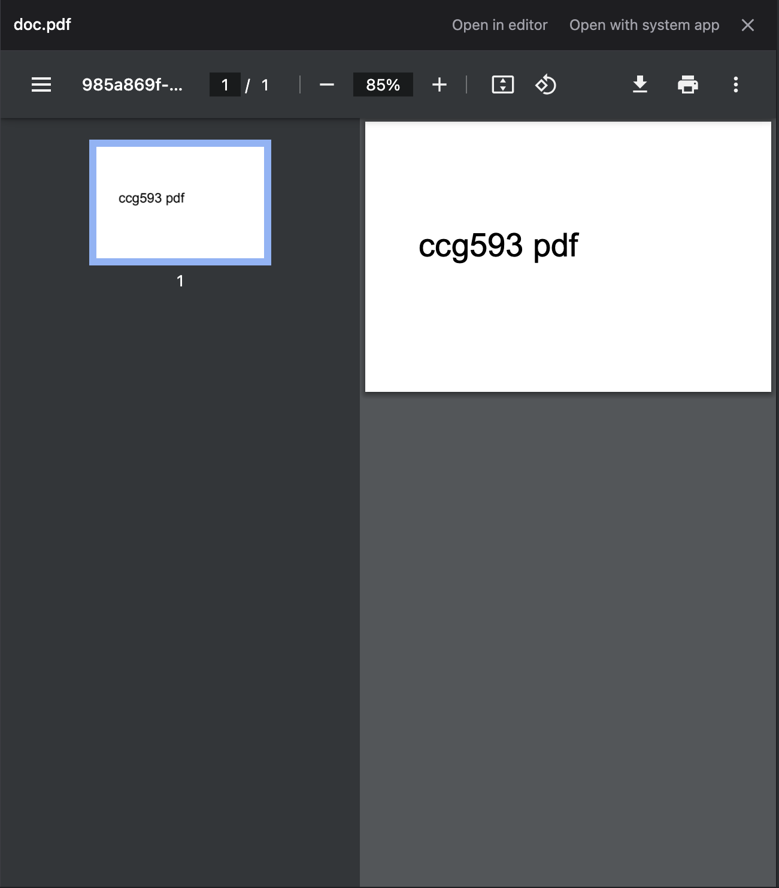
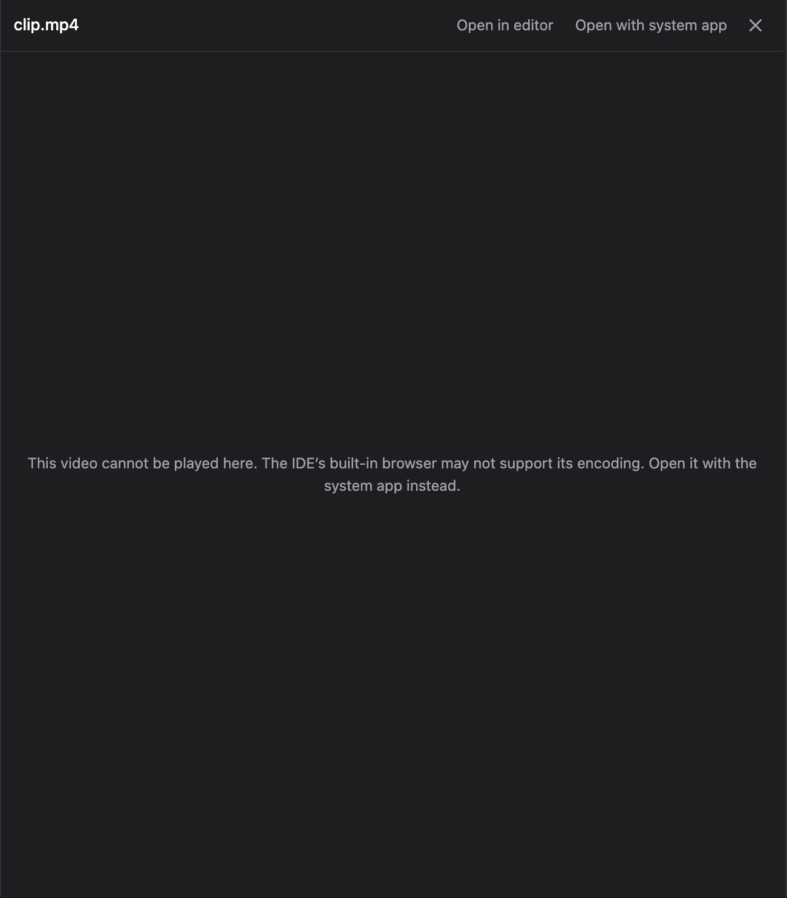

# 새 아티팩트가 저절로 열리고, 페이지·PDF·그림이 채팅 옆에서 미리 보입니다

> Language: [English](./en.md) · **한국어**

아티팩트는 Claude Code가 세션에서 만든 내용을 claude.ai의 비공개 주소로 게시하는 페이지입니다. `/slides`가 만드는 슬라이드 덱이 그 예입니다([첫 번째 조각](../094-slides_and_artifact_cards/ko.md)). 이 문서는 그 둘레에서 일어나는 일을 다룹니다. 브라우저가 저절로 열리는 것, 파일 경로를 누르면 채팅 옆에서 페이지·PDF·그림·영상을 보여 주는 pane입니다.

모두 터미널이 하는 것과 같게 하고, Claude Code Desktop이 보여 주는 것을 IDE가 담을 수 있는 만큼 가져오려는 것입니다. [#593](https://github.com/Swttch/swttch/issues/593)에서 요청했습니다.

## 처음 게시한 뒤 브라우저가 저절로 열립니다

터미널에서는 Claude가 페이지를 처음 게시하면 Claude Code가 브라우저로 그 페이지를 엽니다. 이 채팅은 Claude Code를 그 규칙상 절대 열지 않는 방식으로 띄우기 때문에, 지금까지는 링크만 채팅에 남고 아무 일도 일어나지 않았습니다. 이제 채팅이 직접 페이지를 엽니다.

| 상황 | 일어나는 일 |
| --- | --- |
| Claude가 새 페이지를 게시했다 | 기본 브라우저가 그 페이지를 한 번 엽니다 |
| Claude가 이미 게시한 페이지를 갱신했다(같은 파일이거나 페이지 주소) | 아무것도 열리지 않습니다. 이미 열려 있는 탭이 새 내용을 보여 줍니다 |
| 호출이 실패했다 | 아무것도 열리지 않습니다 |
| 지난 세션을 불러와 스크롤한다 | 아무것도 열리지 않습니다. 지켜보는 동안 일어난 게시만 브라우저를 엽니다 |
| IDE를 띄우는 환경에서 `CLAUDE_CODE_ARTIFACT_AUTO_OPEN`이 `0`, `false`, `no`, `off`이다 | 아무것도 열리지 않습니다. Claude Code 문서가 알려 주는 바로 그 스위치입니다 |

페이지를 보려면 그 브라우저에 claude.ai 로그인이 있어야 합니다. 아티팩트는 어느 것이나 마찬가지이고, 새 페이지는 나에게만 열립니다.

브라우저는 채팅의 백엔드가 도는 컴퓨터에서 열립니다. IDE에서는 그것이 내 컴퓨터입니다. 터널로 다른 컴퓨터의 채팅을 쓰고 있다면, 지금 보는 화면이 아니라 그 컴퓨터에서 페이지가 열립니다. 그 컴퓨터의 터미널이 하는 것과 같습니다.

## 페이지·PDF·그림·영상이 채팅 옆에서 열립니다

채팅 안의 이 종류 파일 경로를 누르면(Claude의 답, `Write`나 `Read` 카드, 파일 칩) IDE 편집기 대신 채팅 끝쪽에 pane이 열립니다.

| 종류 | 파일 | pane이 받는 최대 크기 |
| --- | --- | --- |
| 페이지 | `.html`, `.htm` | 5 MB |
| 그림 | `.png`, `.jpg`, `.jpeg`, `.gif`, `.webp`, `.svg`, `.bmp`, `.avif` | 10 MB |
| PDF | `.pdf` | 50 MB |
| 영상 | `.mp4`, `.m4v`, `.mov`, `.webm` | 200 MB |

pane 머리에는 컨트롤이 셋 있습니다.

- **Open in editor**는 같은 파일을 IDE 편집기로 엽니다. 고치려던 파일일 때 씁니다.
- **Open with system app**은 내 컴퓨터가 그 종류에 쓰는 앱으로 엽니다.
- **닫기 표시**나 `Esc`는 pane을 닫습니다. 다른 경로를 누르면 pane의 내용이 바뀝니다.

소스 코드 같은 나머지는 전과 같이 편집기에서 열립니다. `page.html#L40`처럼 줄을 가리키는 클릭도 편집기로 갑니다. 줄은 편집기에서만 뜻이 있기 때문입니다.

### 페이지

페이지는 격리된 프레임 안에서 그려집니다. 스크립트는 돌지만 채팅에는 손댈 수 없습니다. 옆에 있는 파일은 읽지 못합니다. `style.css`나 `logo.png`를 상대경로로 불러오는 페이지는 그것들 없이 보입니다. 혼자 서도록 쓴 페이지는, Claude가 대부분의 요청에서 만드는 것이 그렇습니다, 그대로 보입니다.

### PDF

PDF는 IDE에 내장된 브라우저가 평소의 뷰어로 그립니다. 그릴 수 있는지는 그 브라우저에 달려 있습니다. 맥의 IntelliJ IDEA 2024.2와 263 얼리액세스 빌드에서는 그려졌습니다. 내 IDE에서 안 그려지면 **Open with system app**을 쓰세요.

### 영상

IDE에 내장된 브라우저에는 대부분의 `.mp4`가 쓰는 H.264 디코더가 없습니다. 그런 영상은 위 문장이 나오고, **Open with system app**으로 재생하면 됩니다. VP9로 만든 `.webm`은 pane에서 재생됩니다.

### 너무 크거나 읽을 수 없는 파일

표의 한도를 넘는 파일, 옮겨지거나 지워진 파일, pane이 보여 주지 않는 종류는 각각 이유를 한 문장으로 말하고, 머리의 **Open in editor**와 **Open with system app**은 그대로 있습니다. 내 컴퓨터에서 밖으로 보내는 것은 없습니다. pane은 내 컴퓨터의 채팅 백엔드를 거쳐 4 MB 조각으로 파일을 읽습니다.

## Claude가 보낸 파일과 그림이 채팅에 나옵니다

Claude Code는 `SendUserFile` 도구로 파일을 건네주고, `Read`로 그림을 읽습니다. 둘 다 이제 맨 도구 줄 대신, Claude Code Desktop처럼 담고 있는 내용을 채팅에 그려 줍니다.

- **Claude가 읽은 그림**(png, jpg, gif, webp를 `Read`한 경우)은 그 줄 아래에 메시지 너비로 나옵니다.
- **Claude가 보낸 파일**은 한 덩어리로 나옵니다. 영상은 플레이어로, 그림은 썸네일로, 그 밖의 파일은 카드 격자로 나옵니다.
  - **썸네일**은 120px이고 그림이 잘리지 않고 안에 맞춰 들어갑니다. 누르면 뷰어가 열리고("3개 중 1개"), 그 덩어리의 그림들을 화살표로 넘겨 봅니다.
  - `display: render`로 한 장만 보낸 그림은 메시지 너비로 통째로 나옵니다.
  - **카드**는 모서리에 파일 종류(`PDF`, `CSV`, `PPTX`...), 아래쪽에 이름과 크기를 보여 줍니다. 누르면 채팅의 경로를 눌렀을 때 열리는 곳에서 열립니다. 페이지·그림·PDF·영상은 위에서 설명한 pane, 나머지는 편집기입니다.
  - **영상**은 플레이어로 재생됩니다. IDE에 내장된 브라우저에는 H.264 디코더가 없어서, 그것을 쓰는 `.mp4`는 카드로 바뀝니다.
- **Claude가 쓴 파일**(`Write`)은 줄마다 번호를 달고 추가됨 표시를 한 상자로, 앞의 200줄까지 스크롤하며 봅니다. **Claude가 읽은 파일**(`Read`)은 돌아온 내용을 그 줄 아래 상자에 보여 줍니다.

채팅이 읽을 수 없는 그림이나 영상(옮겨졌거나 지워졌거나, 그림은 10MB, 영상은 32MB를 넘는 경우)은 카드로 나옵니다.

## 세션 레일

세션 레일은 구역이 셋 있는 패널이고, 그 셋은 Claude Code Desktop의 세션 레일이 처음 여는 구역과 같습니다. 헤더 도크에 있습니다. **⋮** 메뉴에서 **세션 레일**을 고르거나, 도크로 끌어내 아이콘으로 두면 됩니다. `Esc`나 바깥 클릭으로 닫습니다.

- **환경**: 세션이 도는 폴더와, Claude Code가 마지막으로 기록한 브랜치입니다.
- **컨텍스트**: 열기 전에는 닫혀 있습니다. 열면 Claude Code의 공식 `/context` 명령에 물어서 사용량을 퍼센트, 막대, 분류별 한 줄로 그리고, 진행 중인 답변이 끝나면 다시 묻습니다. 명령을 읽을 수 없으면 그렇다고 말합니다.
- **결과물**: 세션이 만들어 준 것을 최신부터 보여 줍니다. 게시한 페이지, 보낸 파일, 도구가 돌려준 그림입니다. 다섯 줄을 보여 주고 **더 보기**가 나머지를 펼칩니다. 페이지를 누르면 브라우저에서, 그림을 누르면 뷰어에서, 다른 파일은 채팅의 경로처럼 열립니다. 터미널의 `/artifacts` 목록이 이 채팅에서는 여기에 있습니다.

목록은 채팅이 불러온 부분만이 아니라 세션 전체에서 가져오고, 에셋 화면이 보여 주는 목록과 같습니다.

### 에셋 화면에도 나옵니다

에셋 화면에는 지금까지 사용자가 붙인 그림만 있었습니다. 이제 두 번째 구역 **Claude가 만든 것**이 있습니다. Claude의 도구가 돌려준 그림(png를 `Read`한 것, 스크린샷), `SendUserFile`로 보낸 파일, 게시한 아티팩트 페이지를 만든 단계별로 묶어 보여 줍니다. 그림을 누르면 뷰어가 열리고, 규칙은 첨부한 그림과 같습니다. 누구나 모든 썸네일을 보고, 세션 전체를 넘겨 보는 것은 후원자의 혜택입니다. 파일은 채팅의 경로를 눌렀을 때 열리는 곳에서, 페이지는 브라우저에서 열립니다.

## 하지 않는 것

- 아티팩트 페이지 자체를 IDE 안에 그리지는 않습니다. 페이지는 claude.ai 로그인이 필요하고 주소를 다른 페이지가 프레임에 넣을 수도 없어서 브라우저에서 엽니다. IDE의 자체 브라우저가 그것을 담을 수 있는지는 [#593](https://github.com/Swttch/swttch/issues/593)에서 계속 확인하고 있습니다.
- 터미널의 `/artifacts`처럼 내가 가진 모든 아티팩트를 나열하지는 않습니다. Claude Code가 이 채팅에는 그 명령을 내주지 않습니다. 세션 레일의 결과물은 현재 세션의 페이지만 나열합니다.
- pane은 파일이 바뀌는 것을 따라가지 않고, 페이지 안의 상대경로도 풀지 않습니다.

## 안 될 때

| 보이는 것 | 이유와 할 일 |
| --- | --- |
| Claude가 페이지를 게시했는데 브라우저가 안 열렸다 | IDE를 띄우는 환경에서 `CLAUDE_CODE_ARTIFACT_AUTO_OPEN`이 `0`, `false`, `no`, `off`가 아닌지 확인하세요. |
| 브라우저가 두 번 열렸다 | Claude Code 버전과 함께 [#593](https://github.com/Swttch/swttch/issues/593)에 알려 주세요. 채팅은 Claude Code가 여는 일을 맡기고 있다고 가정합니다 |
| pane의 페이지에 스타일이나 그림이 없다 | 다른 파일을 상대경로로 부르는 페이지입니다. 시스템 앱으로 여세요 |
| PDF가 비어 있다 | IDE 내장 브라우저가 그리지 못했습니다. **Open with system app**을 쓰세요 |
| 영상 자리에 문장이 나온다 | IDE 브라우저가 그 인코딩을 지원하지 않습니다. **Open with system app**을 쓰세요 |

---

[#593](https://github.com/Swttch/swttch/issues/593)에서 요청했습니다. [#584](https://github.com/Swttch/swttch/issues/584)와 [#591](https://github.com/Swttch/swttch/pull/591) 위에 쌓았습니다. `/slides` 뒤의 환경변수는 [584-artifact-env-for-slides.md](../../principle-exceptions/584-artifact-env-for-slides.md)에 기록했습니다.
