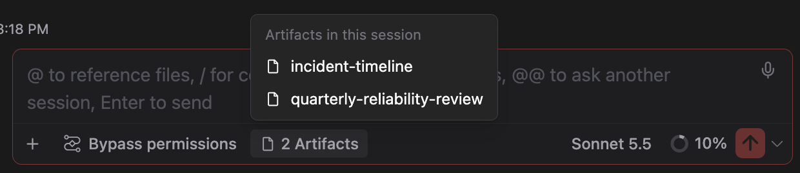
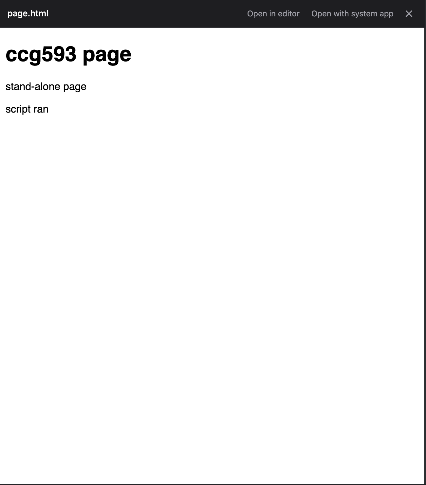

# A new Artifact opens for you, the chat keeps a pill for it, and pages, PDFs and pictures preview beside the chat

> Language: **English** · [한국어](./ko.md)

An Artifact is a page that Claude Code publishes from your session to a private address on claude.ai, as `/slides` does for a deck ([the first piece of this](../094-slides_and_artifact_cards/en.md)). This page covers what happens around it: the browser opening by itself, a small pill that keeps the pages of the session within reach, and a pane that shows a page, a PDF, a picture or a video beside the chat when you click its file path.

All of it is meant to match what the terminal does, and to take over what Claude Code Desktop shows, as far as an IDE can carry it. It was asked for in [#593](https://github.com/Swttch/swttch/issues/593).

## The browser opens by itself after the first publish

In a terminal, the first time Claude publishes a page, Claude Code opens it in your browser. This chat starts Claude Code in a way that, by its own rule, never does that, so until now the link sat in the chat and nothing happened. Now the chat opens the page itself.

| Situation | What happens |
| --- | --- |
| Claude publishes a new page | Your default browser opens the page, once |
| Claude updates a page it already published (same file, or the page's address) | Nothing opens. The tab you already have shows the new version |
| The call fails | Nothing opens |
| You scroll through an old session | Nothing opens. Only a publish that happens while you watch opens the browser |
| `CLAUDE_CODE_ARTIFACT_AUTO_OPEN` is `0`, `false`, `no` or `off` in the environment that starts the IDE | Nothing opens, the same switch Claude Code's own documentation gives |

The page needs your claude.ai login in that browser, the same as any Artifact. A new page is private to you.

The browser opens on the machine where the chat's backend runs. In the IDE that is your own computer. If you use the chat through a tunnel to another machine, the page opens there, not on the screen you are looking at, as a terminal on that machine would.

## A pill under the input keeps the session's pages

Once the session has published a page, a small pill with a page icon appears in the row of tags under the input.

- With one page, the pill shows its name. **Click it** and the page opens in your browser.
- With several, the pill shows a count such as "2 Artifacts". **Click it** and a list opens above it, newest first. Pick one and it opens in your browser.

- **`Ctrl+]`** reopens the most recent page without the pointer, the same as in a terminal. It is `Ctrl` on every system, also on a Mac; `Cmd` does not count, because the terminal's key is `Ctrl+]` there too.
- `Esc` or a click elsewhere closes the list.

The pill is read from the conversation, so a session you open from the history shows its pages the same as one that just published them.

**What the name is.** If Claude gave the page a title when it published, that is the name. Otherwise the pill uses the name of the file that was published, without its extension. The page's own `<title>` is not part of what Claude Code reports back, so a page whose title differs from its file name shows the file name here, while the browser tab shows the title.

**Limits of the key.** On a Mac with a Hangul input source selected, the system turns `Ctrl+]` into a different key before the chat sees it, and the shortcut does nothing. Switch to the English input source, or click the pill. The pill never depends on the keyboard.

## A page, a PDF, a picture or a video opens beside the chat

Click a path to one of these in the chat, in Claude's reply, in a `Write` or `Read` card, or in a file chip, and a pane opens on the end side of the chat instead of the IDE editor.

| Kind | Files | Largest the pane takes |
| --- | --- | --- |
| Page | `.html`, `.htm` | 5 MB |
| Picture | `.png`, `.jpg`, `.jpeg`, `.gif`, `.webp`, `.svg`, `.bmp`, `.avif` | 10 MB |
| PDF | `.pdf` | 50 MB |
| Video | `.mp4`, `.m4v`, `.mov`, `.webm` | 200 MB |

The header of the pane has three controls:

- **Open in editor** opens the same file in the IDE editor, for a file you meant to edit.
- **Open with system app** opens it in whatever your computer uses for that kind of file.
- **The close mark**, or `Esc`, closes the pane. Clicking another path replaces what the pane shows.

Anything else, such as source code, still opens in the editor as before. A click that names a line, such as a link to `page.html#L40`, goes to the editor too, because a line only means something there.

### A page

The page is drawn in a sandboxed frame. Its scripts run, but with no access to the chat. It cannot read the files next to it: a page that pulls in `style.css` or `logo.png` by relative path shows without them. A page written to stand alone, which is what Claude produces for most requests, shows as it is.

### A PDF

The PDF is drawn by the browser built into the IDE, with its usual viewer. Whether it can draw one depends on that browser. It did on IntelliJ IDEA 2024.2 and on the 263 early-access build, both on a Mac. If your IDE cannot, use **Open with system app**.

### A video

The browser built into the IDE does not include the H.264 decoder, which is what most `.mp4` files use. Such a video shows the message above, and **Open with system app** plays it. A `.webm` video with VP9 plays in the pane.

### A file that is too large or cannot be read

A file over the limit in the table, a file that has been moved or deleted, and a kind the pane does not show each get one sentence saying so, with **Open in editor** and **Open with system app** still in the header. Nothing is sent from your computer: the pane reads the file through the chat's own backend on your machine, in pieces of 4 MB.

## Files and pictures Claude sends show up in the chat

Claude Code can hand you a file with its `SendUserFile` tool, and read a picture with `Read`. Both now draw what they carry in the chat, the way Claude Code Desktop does, instead of a bare tool row.

- **A picture Claude read** (`Read` of a png, jpg, gif or webp) appears under its row at the width of the message.
- **Files Claude sent** appear as one block: a video as a player, pictures as thumbnails, everything else as a grid of cards.
  - A **thumbnail** is 120 px, with the picture fitted inside it and not cropped. Click one and a viewer opens ("1 of 3", with arrows to step through the pictures of that block).
  - A picture sent alone with `display: render` is drawn whole, at the width of the message.
  - A **card** shows the kind of file in its corner (`PDF`, `CSV`, `PPTX`...), its name and its size. Click one and it opens where a path in the chat opens: the pane described above for a page, a picture, a PDF or a video, the editor for the rest.
  - A **video** plays in a player. The IDE's built-in browser has no H.264 decoder, so an `.mp4` that uses it falls back to a card.
- **A file Claude wrote** (`Write`) lists its lines, numbered and marked as added, in a box you can scroll, up to the first 200 lines. **A file Claude read** (`Read`) shows what came back in a box under its row.

A picture or video the chat cannot read (moved, deleted, over 10 MB for a picture or 32 MB for a video) shows as a card instead.

## The session rail

The session rail is a panel with three sections, the same three Claude Code Desktop's session rail opens with. It sits in the header dock: open the **⋮** menu and choose **Session rail**, or drag it out to the dock itself to get an icon. `Esc` or a click outside closes it.

- **Environment**: the folder the session runs in and the branch Claude Code last recorded for it.
- **Context**: closed until you open it. Opening it asks Claude Code's own `/context` command and draws the usage as a percentage, a bar and one row per category, and it asks again when a running reply ends. If the command cannot be read, it says so.
- **Outputs**: what the session made for you, newest first: the pages it published, the files it sent, and the pictures its tools returned. It shows five rows and **Show more** lists the rest. Click a page and it opens in your browser, a picture opens the viewer, any other file opens like a path in the chat. This is where the terminal's `/artifacts` list lives in this chat.

The list is read from the messages the chat has loaded, so a long session that has not been scrolled back to its start lists only what is loaded.

## What this does not do

- It does not draw the Artifact page itself inside the IDE. The page needs a claude.ai login, and the address cannot be framed by another page, so it opens in your browser. Whether the IDE's own browser can carry it is still being checked in [#593](https://github.com/Swttch/swttch/issues/593).
- It does not list every Artifact you own, as the terminal's `/artifacts` does. Claude Code does not offer that command to this chat. The pill and the session rail's Outputs list the pages of the current session only.
- The pane does not follow a file as it changes, and it does not resolve relative paths inside a page.

## If something does not work

| What you see | Why, and what to do |
| --- | --- |
| The browser did not open after Claude published a page | Check that `CLAUDE_CODE_ARTIFACT_AUTO_OPEN` is not `0`, `false`, `no` or `off` in the environment that starts the IDE. The pill is still there, click it |
| The browser opened twice | Tell us in [#593](https://github.com/Swttch/swttch/issues/593) with your Claude Code version. The chat expects Claude Code to leave opening to it |
| The pill is missing | It shows after a publish that succeeded. A call that failed, or `quickstart`, `list` and `read`, does not count as a published page |
| `Ctrl+]` does nothing | A Hangul input source on a Mac, or the IDE's own binding for the key. Click the pill |
| A page in the pane lacks its style or pictures | It refers to other files by relative path. Open it with the system app |
| A PDF is blank | The IDE's built-in browser could not draw it. Use **Open with system app** |
| A video shows the message | Its encoding is not supported by the IDE's browser. Use **Open with system app** |

---

Asked for in [#593](https://github.com/Swttch/swttch/issues/593). Builds on [#584](https://github.com/Swttch/swttch/issues/584) and [#591](https://github.com/Swttch/swttch/pull/591). The environment variable behind `/slides` is recorded in [584-artifact-env-for-slides.md](../../principle-exceptions/584-artifact-env-for-slides.md).
