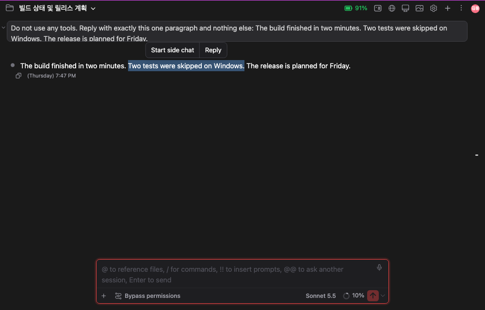
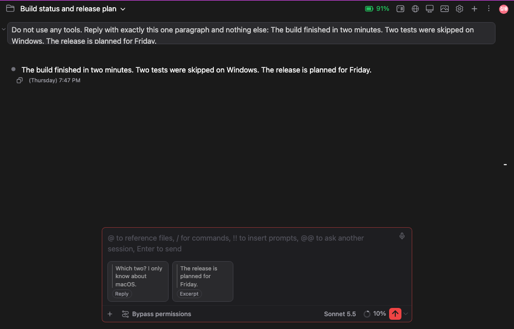

# Reply to what you select: drag over any text in the chat to quote it

> Languages: **English** · [한국어](./ko.md)

## What's new

Select text anywhere in the conversation, in Claude's answers, in your own messages, in tool output, and a small bar appears right above the selection with two buttons: **Start side chat** and **Reply**. This is the same gesture as in the Claude desktop app.



The bar appears when you release the mouse (or Shift+arrow), follows the text if the chat scrolls, and disappears when the selection is gone. It does not appear for text selected inside the message box or in a dialog.

## Reply

**Reply** opens a card next to the selection. The quoted text is on top, in grey beside a bar, and the box under it takes your comment.


| Key | What happens |
| --- | --- |
| **Enter** | Puts the reply in the message box as a card. Nothing is sent yet, so you can add more cards or type more text first |
| **Cmd+Enter** (**Ctrl+Enter** on Windows and Linux) | Puts the reply in the message box and sends the message right away, together with whatever the message box already holds |
| **Shift+Enter** | A new line in the comment |
| **Esc** | Closes the card |

The send button's tooltip lists the first two.

The card stays open while you look elsewhere: clicking or selecting other text in the chat does not close it, and a new selection brings up no bar while a card is open. The quoted text stays highlighted for as long as its card is open.

### Reply and Excerpt cards

The card lands in the row of attachments in the message box. A reply with a comment is a **Reply** card, which shows your comment. If you press Enter with the comment left empty, it is an **Excerpt** card, which shows the quoted text. Several cards can wait there together. Click a card to read all of it, or hover it and press **×** to remove it.



### After you send

Claude receives the quotes as plain text in front of what you typed, so it reads exactly what each comment is about. In the conversation, each reply is drawn as its quote (grey, beside a bar) with your comment under it, and each excerpt is drawn as a card above the message.


The text Claude receives is written the way Claude Desktop writes it, so a session started there looks the same here and the other way round:

```
<!-- reply 1 -->
> Two tests were skipped on Windows.

Which two? I only know about macOS.


<!-- attach -->
> The release is planned for Friday.

Answer in one short sentence. Do not use tools.
```

A first reply carries the number of replies; the ones after it do not. Anyone using the CLI can write the same thing by hand, so nothing here depends on an undocumented feature.

## Start side chat

**Start side chat** opens the [/btw side question window](../091-btw_side_question_window/en.md) with the selection already in its box as a quote (`> the selected text`) and the cursor on the line under it. Nothing is sent until you press Enter. The answer stays in that window and never enters the main conversation.

## Also in this change

- A message made only of pictures no longer draws an empty bubble above them. The pictures take its place, and the copy, fork and time line sits under them, as Claude Desktop shows it.
