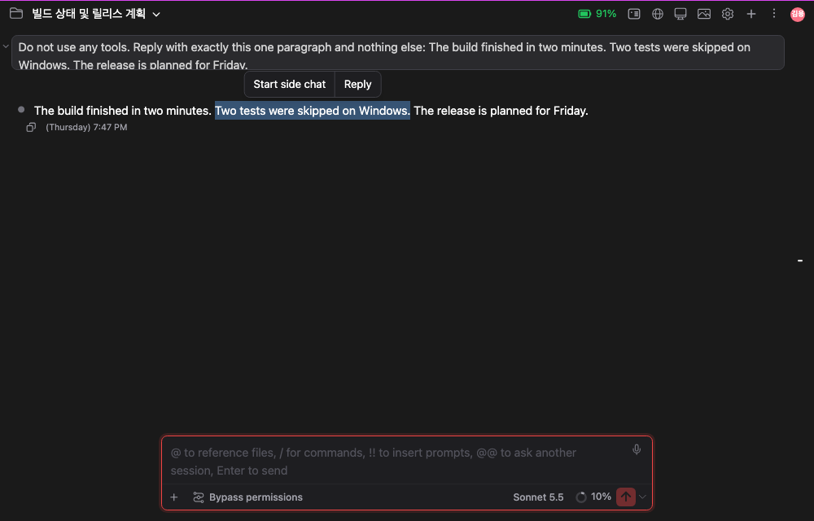
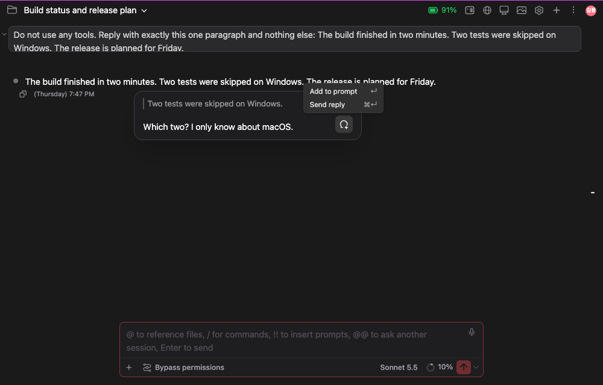
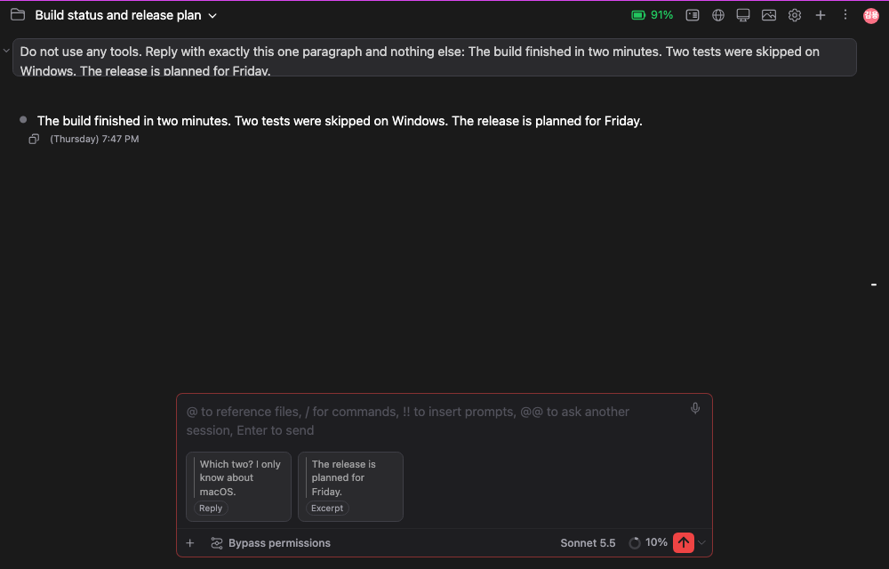
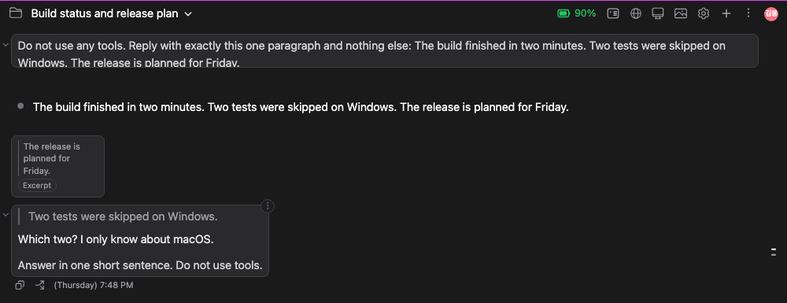

# 선택한 글에 답글 달기: 채팅의 어떤 글이든 드래그하면 인용할 수 있다

> 언어: [English](./en.md) · **한국어**

## 새로 생긴 것

대화 속 어디서든 글자를 드래그하면(Claude의 답변, 내가 보낸 메시지, 도구 출력 모두) 선택한 글자 바로 위에 작은 막대가 뜨고 **사이드 채팅 시작**과 **답글** 두 버튼이 있습니다. Claude 데스크탑 앱과 같은 동작입니다.



막대는 마우스를 놓을 때(또는 Shift+방향키) 나타나고, 채팅이 스크롤되면 글자를 따라가며, 선택이 풀리면 사라집니다. 입력창 안이나 대화상자 안에서 고른 글에는 뜨지 않습니다.

## 답글

**답글**을 누르면 선택한 글자 옆에 카드가 열립니다. 위에는 인용 글이 막대 옆에 회색으로 들어 있고, 그 아래 입력칸에 코멘트를 씁니다.



| 키 | 동작 |
| --- | --- |
| **Enter** | 답글을 입력창에 카드로 붙입니다. 아직 보내지 않으므로 카드를 더 붙이거나 글을 더 쓸 수 있습니다 |
| **Cmd+Enter** (Windows·Linux는 **Ctrl+Enter**) | 답글을 입력창에 붙이고, 입력창에 있는 내용과 함께 바로 보냅니다 |
| **Shift+Enter** | 코멘트에서 줄바꿈 |
| **Esc** | 카드를 닫습니다 |

보내기 버튼의 툴팁에 앞의 두 가지가 적혀 있습니다.

코멘트를 쓰기 시작한 카드는 다른 곳을 보는 동안에도 열려 있습니다. 채팅의 다른 곳을 누르거나 다른 글을 선택해도 닫히지 않고, 카드가 열려 있는 동안에는 새로 선택한 글에 막대가 뜨지 않습니다. 인용한 글은 카드가 열려 있는 동안 계속 강조됩니다. 아직 아무것도 쓰지 않은 카드는 다른 곳을 누르거나 선택하는 순간 사라지고, 새로 선택한 글에는 그 글의 막대가 뜹니다.

### 답장 카드와 발췌 카드

카드는 입력창의 첨부 줄에 놓입니다. 코멘트를 쓴 답글은 코멘트가 보이는 **답장** 카드이고, 코멘트를 비워 둔 채 Enter를 누르면 인용한 글이 보이는 **발췌** 카드입니다. 카드는 여러 장을 함께 둘 수 있습니다. 카드를 누르면 전체 내용을 읽을 수 있고, 마우스를 올려 **×** 를 누르면 지워집니다.



### 보낸 뒤

Claude는 인용을 직접 쓴 글 앞에 붙은 평범한 글로 받으므로, 각 코멘트가 무엇에 대한 것인지 그대로 읽습니다. 대화에서는 답글마다 인용(막대 옆 회색 글자)과 그 아래 코멘트로 그려지고, 발췌는 메시지 위에 카드로 그려집니다.



Claude에게 가는 글은 Claude 데스크탑이 쓰는 방식 그대로라서, 데스크탑에서 시작한 세션을 여기서 열어도 같게 보이고 반대도 같습니다.

```
<!-- reply 1 -->
> Two tests were skipped on Windows.

Which two? I only know about macOS.


<!-- attach -->
> The release is planned for Friday.

Answer in one short sentence. Do not use tools.
```

첫 답글에는 답글 개수가 붙고 그다음 답글에는 붙지 않습니다. CLI를 쓰는 사람도 같은 글을 손으로 쓸 수 있으므로, 문서화되지 않은 기능에 기대는 부분은 없습니다.

## 사이드 채팅 시작

**사이드 채팅 시작**은 [/btw 곁가지 질문 창](../091-btw_side_question_window/ko.md)을 열고, 선택한 글을 인용(`> 선택한 글`)으로 미리 채워 두며 커서는 그 아래 줄에 놓입니다. Enter를 누르기 전에는 아무것도 보내지 않습니다. 답은 그 창에만 남고 메인 대화에는 들어가지 않습니다.

## 함께 바뀐 것

- 이미지만 보낸 메시지는 더 이상 이미지 위에 빈 말풍선을 그리지 않습니다. 이미지가 말풍선 자리를 차지하고, 복사·분기·시각 줄이 그 아래에 붙습니다. Claude 데스크탑과 같은 모습입니다.
