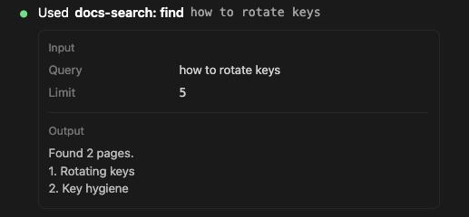
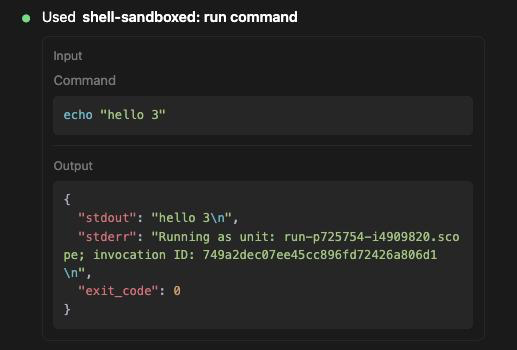
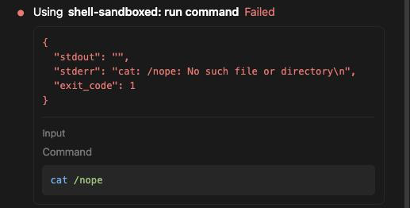
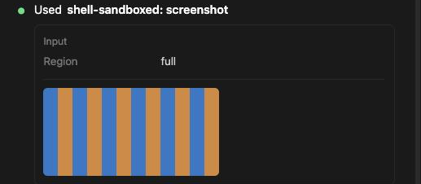

# MCP tool calls show their input, their JSON output and when they failed

> Languages: **English** · [한국어](./ko.md)

## What's new

When Claude calls a tool from one of your MCP servers, the call used to show little more than the tool's name. A call whose arguments had no obvious "main" field, like a shell tool that takes a `command`, showed nothing at all while it was collapsed, and a result that came back as JSON was one long line with its quotes and `\n` escapes. Since v0.35.3 the call is drawn as a card, laid out like the one in the Claude desktop app: the input you gave the tool, the output it returned, and, if the call failed, the error first.

This applies to every MCP tool that has no card of its own. The JetBrains IDE tools (`mcp__idea__…`) keep the cards described in [Native rendering for JetBrains IDE MCP tools](../007-jetbrains_mcp_native_rendering/en.md).

Reported in [#596](https://github.com/Swttch/swttch/issues/596).

## The header

The first line names the call as `server: tool`: the server exactly as you named it in your MCP settings, then the tool with its underscores read as spaces (`mcp__shell-sandboxed__run_command` is `shell-sandboxed: run command`). The name is bold. A word beside it, in normal weight, says what the call is doing:

| State | Header |
| --- | --- |
| Waiting for the result | **Using** shell-sandboxed: run command |
| Finished | **Used** shell-sandboxed: run command |
| Failed | **Using** shell-sandboxed: run command, then a red **Failed** |
| Declined by you | shell-sandboxed: run command, with no word beside it, because the tool never ran |

A failed call stays on "Using" on purpose: it never finished using the tool. The word comes from your interface language, so in Korean it reads "사용 중" and "사용함", and the order around the name follows each language.

After the name, a dim line can show the most relevant argument. Claude looks through the call's arguments for `query`, `message`, `channel`, `repo`, `url`, `path`, `title` and `search`, in that order, and shows the first one that holds text, cut at 40 characters. A `channel` gets a `#` in front and a `url` is shortened to its host name. A call with none of those, such as one that only has a `command` or a `text`, shows no dim line; its arguments are in the card below.

## Input

The **Input** section lists one field per argument, in the order Claude sent them. The caption is the argument's name made readable: `timeout_ms` becomes "Timeout ms". Nothing about the names is assumed, so an MCP server can use any names it likes.

How each kind of value is shown:

| Value | Shown as |
| --- | --- |
| Text | As it is. Line breaks are kept, so a script reads as a script. An empty string is shown as two quotes, so the caption does not look blank |
| Number, true/false, null | In the code font |
| A list of plain values | One line, separated by commas: `--fast, --no-color` |
| A list that holds objects | As indented JSON |
| An object | A group under its own caption, indented behind a thin rule, with one field per line |
| `command` (text) | In a tinted code box under its caption, coloured as a shell command |

A call with no arguments has no Input section.

## Output

When the tool's result is JSON, the **Output** section shows that same JSON, indented and coloured, in a tinted box. Keys, nesting, numbers and `\n` stay as the server sent them. Anything that is not JSON is shown as plain text under the caption.

- Long output stops at about 200 pixels with a fade at the bottom. Click it to open it in full, and click again to fold it.
- Long lines wrap instead of scrolling sideways.
- When there is no Input section above it, the Output section has no caption either; there is nothing to tell it apart from.
- A call that was declined shows your decision where the output would be, as before.

## Failed calls

When the server reports an error, its text comes first in the card, in red and without a box, and the Input section follows it. The header keeps "Using" and gets the red **Failed** beside the name. A red dot sits in front of the header, as it always did.

## Pictures

If the result holds a picture, such as a screenshot from a browser or desktop tool, the picture is drawn in the card at its own size, within the width of the chat. Click it to open it larger. Before, the picture was dropped and the call looked empty.

The CLI also adds a line of text next to a picture, `[Image: source: <path>]`, saying where it kept a copy. When the picture is drawn, that line is hidden, since a file path in the middle of the output only gets in the way. Any other text the tool returns with the picture is still shown.

## What it does not do

- Only text and pictures from a result are shown. Other kinds of content a server can return, such as a link to a resource, are not drawn.
- Only JSON output and a `command` are coloured. Other code, such as a `script`, is plain text in the Input section.
- There is no copy button on the card yet. Select the text you need and copy it.
- Calls from tools that have their own card keep that card.

## Related

- [#596](https://github.com/Swttch/swttch/issues/596): View arguments of a call to an MCP tool.
