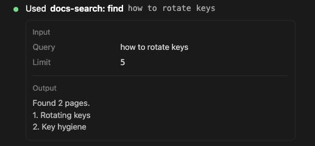
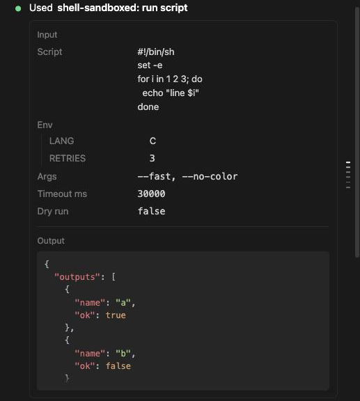
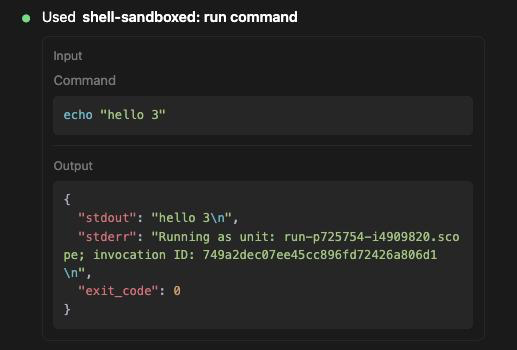
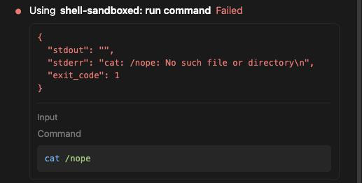
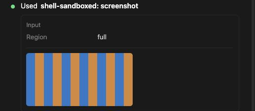

# MCP 도구 호출에 입력, JSON 출력, 실패가 보인다

> 언어: [English](./en.md) · **한국어**

## 새로 생긴 것

Claude가 내 MCP 서버의 도구를 부르면, 예전에는 호출 줄에 도구 이름 정도만 보였습니다. 셸 도구의 `command`처럼 인자에 뚜렷한 "대표 항목"이 없는 호출은 접힌 상태에서 아무것도 보여 주지 않았고, JSON으로 돌아온 결과는 따옴표와 `\n`이 그대로 붙은 긴 한 줄이었습니다. v0.35.3부터는 호출이 카드로 그려집니다. Claude 데스크탑 앱의 카드와 같은 구성으로, 도구에 넘긴 입력, 도구가 돌려준 출력, 그리고 실패한 호출이면 오류가 맨 앞에 나옵니다.

전용 카드가 없는 모든 MCP 도구에 적용됩니다. JetBrains IDE 도구(`mcp__idea__…`)는 [JetBrains IDE MCP 도구 전용 렌더링](../007-jetbrains_mcp_native_rendering/ko.md)의 카드를 그대로 씁니다.

[#596](https://github.com/Swttch/swttch/issues/596)에서 제보되었습니다.

## 제목 줄

첫 줄은 호출을 `서버: 도구`로 부릅니다. 서버는 MCP 설정에 적은 이름 그대로, 도구는 밑줄을 띄어쓰기로 읽은 이름입니다(`mcp__shell-sandboxed__run_command`는 `shell-sandboxed: run command`). 이름은 굵게 나오고, 그 옆에 보통 굵기의 낱말이 호출의 상태를 알려 줍니다.

| 상태 | 제목 줄 |
| --- | --- |
| 결과를 기다리는 중 | shell-sandboxed: run command **사용 중** |
| 끝남 | shell-sandboxed: run command **사용함** |
| 실패 | shell-sandboxed: run command **사용 중**, 그 뒤에 빨간 **실패** |
| 내가 거절함 | shell-sandboxed: run command, 도구가 실행되지 않았으므로 옆에 낱말 없음 |

실패한 호출이 "사용 중"에 머무는 것은 의도입니다. 도구를 끝까지 쓰지 못했다는 뜻입니다. 낱말은 화면 언어를 따르고, 이름 앞뒤 순서도 언어마다 다릅니다(영어는 "Using", "Used"가 이름 앞에 옵니다).

이름 뒤에는 가장 알맞은 인자를 흐린 글씨로 보여 주는 줄이 붙을 수 있습니다. 호출의 인자에서 `query`, `message`, `channel`, `repo`, `url`, `path`, `title`, `search`를 이 순서로 찾아 글이 들어 있는 첫 번째 값을 40자까지 보여 줍니다. `channel`은 앞에 `#`이 붙고, `url`은 호스트 이름만 남습니다. 이 중 어느 것도 없는 호출(예: `command`나 `text`만 있는 호출)에는 흐린 줄이 없고, 인자는 아래 카드에 있습니다.

## 입력

**입력**(Input) 구역에는 Claude가 보낸 순서대로 인자가 한 줄씩 나옵니다. 이름표는 인자 이름을 읽기 좋게 바꾼 것입니다(`timeout_ms`는 "Timeout ms"). 이름에 대한 가정은 없어서 MCP 서버가 어떤 이름을 쓰든 같은 모양입니다.

값은 종류마다 이렇게 보입니다.

| 값 | 보이는 모양 |
| --- | --- |
| 글 | 그대로. 줄바꿈이 살아 있어서 스크립트는 스크립트처럼 읽힙니다. 빈 글은 이름표가 비어 보이지 않게 따옴표 두 개로 보입니다 |
| 숫자, true/false, null | 코드 글꼴 |
| 단순한 값의 목록 | 쉼표로 이은 한 줄: `--fast, --no-color` |
| 객체가 든 목록 | 들여쓴 JSON |
| 객체 | 자기 이름표 아래에 가는 선 뒤로 들여쓴 묶음, 한 줄에 필드 하나 |
| `command`(글) | 이름표 아래 색이 깔린 코드 상자 안에, 셸 명령으로 색칠 |

인자가 없는 호출에는 입력 구역이 없습니다.

## 출력

도구의 결과가 JSON이면 **출력**(Output) 구역이 그 JSON을 그대로 들여쓰고 색칠해서 색이 깔린 상자에 보여 줍니다. 키, 중첩, 숫자, `\n`은 서버가 보낸 대로 남습니다. JSON이 아닌 글은 이름표 아래에 일반 글로 나옵니다.

- 긴 출력은 약 200픽셀에서 아래쪽이 흐려지며 멈춥니다. 누르면 전체가 열리고, 다시 누르면 접힙니다.
- 긴 줄은 옆으로 스크롤하지 않고 줄바꿈됩니다.
- 위에 입력 구역이 없으면 출력 구역에도 이름표가 없습니다. 구분할 대상이 없기 때문입니다.
- 거절한 호출은 출력 자리에 내가 내린 결정이 예전처럼 나옵니다.

## 실패한 호출

서버가 오류를 알리면, 그 글이 카드 맨 앞에 상자 없이 빨간색으로 나오고 그 아래에 입력 구역이 이어집니다. 제목 줄은 "사용 중"을 유지하고 이름 옆에 빨간 **실패**가 붙습니다. 제목 줄 앞의 빨간 점은 전과 같습니다.

## 그림

결과에 스크린샷처럼 그림이 들어 있으면 카드 안에 그림이 원래 크기로(채팅 폭 안에서) 그려집니다. 누르면 크게 열립니다. 예전에는 그림이 버려져서 호출이 비어 보였습니다.

CLI는 그림 옆에 복사본을 둔 곳을 알리는 글 한 줄, `[Image: source: <경로>]`도 함께 보냅니다. 그림이 그려질 때는 이 줄을 숨깁니다. 출력 한가운데의 파일 경로는 방해만 되기 때문입니다. 도구가 그림과 함께 돌려준 다른 글은 그대로 보입니다.

## 하지 않는 것

- 결과에서 글과 그림만 보여 줍니다. 서버가 돌려줄 수 있는 다른 종류의 내용(예: 리소스 링크)은 그리지 않습니다.
- 색칠은 JSON 출력과 `command`만 합니다. `script` 같은 다른 코드는 입력 구역에서 일반 글입니다.
- 카드에 복사 버튼은 아직 없습니다. 필요한 글을 선택해서 복사하세요.
- 전용 카드가 있는 도구의 호출은 그 카드를 그대로 씁니다.

## 관련

- [#596](https://github.com/Swttch/swttch/issues/596): MCP 도구 호출의 인자 보기.
