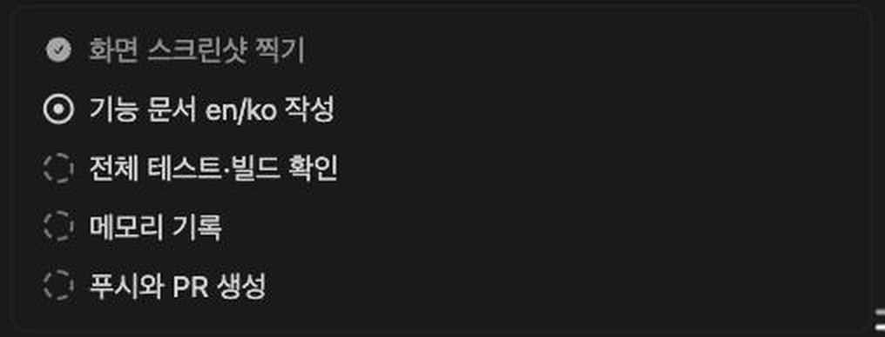
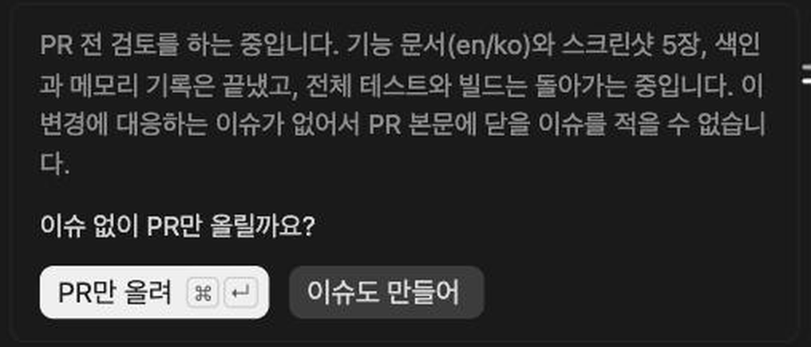
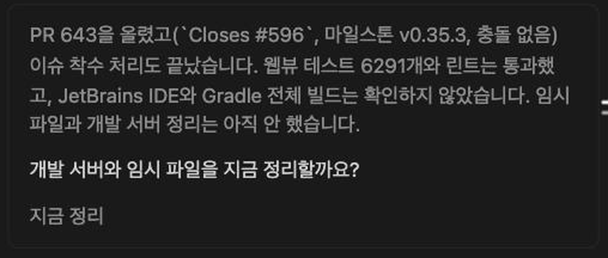
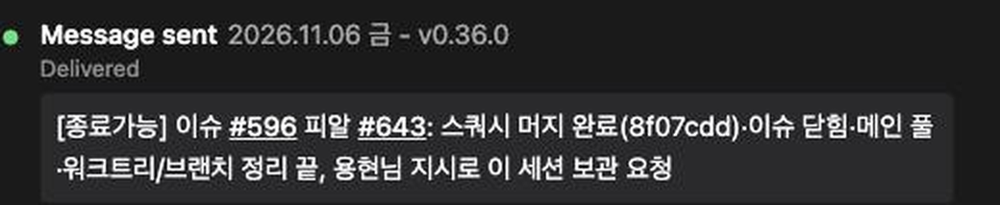
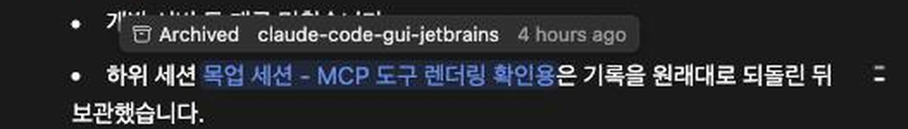

# Sessions that Claude starts, the plan and wrap-up boxes, messages to other sessions and session links look like Claude Desktop's

> Languages: **English** · [한국어](./ko.md)

## What's new

When you work with the Claude desktop app, its sessions can start other sessions, hand each other messages and link to each other in the text of a reply. Until now this chat drew all of that as plain text and raw JSON: a long first message, a tool call with a pile of fields, a session id that meant nothing to a reader. Since v0.35.3 four things are drawn the way the desktop app draws them:

1. The first message of a session another session started becomes a **Task** card and a **Context** card.
2. The **plan** and the **wrap-up** that Claude Desktop's `ccd_turn` tools keep for a turn become two plain boxes.
3. A **message sent to another session** names that session by its title, and the message sits in a card of its own.
4. A **link to a session** in the text of a reply is a blue chip that opens that session in a new tab, with a tooltip that says where it lives and when it was last used.

One smaller change comes with it: the header of an MCP tool call now reads the underscores of the server's name as spaces too (`mcp__ccd_session_mgmt__archive_session` is `ccd session mgmt: archive session`, as the tool part always was).

Everything here needs nothing from you. It appears when the chat meets one of these things.

## A session that another session started

A session that another session starts gets its first message from that session: a frame that holds the background and the task. The chat used to show it as one long bubble that began with `Background (from the session that started this one):`. Now it is drawn as two cards.

- **The line on top** says which session started this one: "Started from" and that session's title. The title comes from Claude Desktop's own session files, so it is there only when the desktop app's files are on the same computer. Otherwise the line says "Started from another session". Click the line to fold both cards.
- **The Task card** holds the task. Beside its label is the title of the session you are in, as in the desktop app.
- **The Context card** holds the background. When the first message ends with the note about the shared notes folder, that note is moved into this card.
- **Each label folds its card.** The arrow beside it turns when it is folded.
- **Long text is cut** at about six lines, with a fade, and a **Show more** button opens it in full. The same button then reads **Show less**.
- **Click anywhere on the card background** and both cards open to the height of a long bubble (80% of the window, with a scroll bar inside). Click again to close them. A click on a button, a link, or on text you are selecting does not count.
- **The text is drawn like any message**: `code` in the code style, file paths as chips.
- **Hold the pointer over a card** and a copy button appears under it, which copies that card's text.
- **While the message is pinned to the top of the chat**, scrolling the reply past it rolls the cards up the way any message of yours rolls up.

The cards appear only when the first message has exactly the frame the desktop app writes: a `Background (from the session that started this one):` part, then a `Task:` part. A message that only looks like it, or has two `Task:` lines, stays an ordinary bubble.

## The plan and the wrap-up of a turn

Claude Desktop gives Claude two tools for keeping a turn in order, `update_plan` and `wrap_up`, from a server named `ccd_turn`. They used to show as tool calls with a JSON block of their input. Now each is drawn as a bare box, with no tool title over it.

### The plan

`update_plan` keeps a checklist for the turn. The box lists the steps with a mark in front of each:

| Mark | Meaning |
| --- | --- |
| A check in a circle, the text dimmed | Done |
| A ring with a dot in it | In progress |
| A dashed circle | Waiting |

Claude can hand over the whole list, or change the one it made: tick steps off by their number, start one, or move on to the next. The chat applies those calls in order, so each plan call shows the list as that call left it. A plan has at most twelve steps. The box is drawn where the call is.

### The wrap-up

`wrap_up` closes a turn with a recap, a question and the answers to it. It is **not drawn where Claude called it** (which is before its closing message) but **after the last message of the turn**, so the turn ends on it. The recap is in dim text, the question under it, and the answers are buttons.

- **Press an answer** and it is sent as your next message, as if you had typed it. The buttons then go, and only the answer you chose stays, in dim text.
- **The first answer carries the keys** `⌘ ↵` on a Mac, or `Ctrl ↵` elsewhere. Press them while the message box is empty and the first answer is sent.
- **Once you start a message**, the keys stop working and their mark is taken off the button. That means any text, a picture or file, a picked page element, a quoted reply, or an upload that is still going. Empty the box and they return.
- **Answered by other words**: if your next message is not one of the answers, the buttons go and the box keeps only the recap and the question. If it is one of them, that answer stays.
- **A button that stands for an app action** in the desktop app, such as commit or create PR, sends its name as words (`Commit`, `Create PR`, `Fix CI` and so on) for Claude to carry out.

## A message sent to another session

When Claude sends a message to another session, the call is drawn as a card in the same frame as the other tool calls: a dot, the words **Message sent** and the title of the session it went to.

- **The title** comes from the answer the tool gets back. When that answer does not name the session, the chat reads the session's title from Claude Desktop's session files. When neither is there, the line says **another session**. It never shows the id, which tells a reader nothing.
- **The line under it** says how the delivery went. `Delivered` is shown as "Delivered" in your language. Any other state is shown in the word the tool used, such as `queued`.
- **The message** is drawn as text, with links and `code`, in a bordered box like the result of any other tool.
- **A message to an agent** (one of Claude's helper agents, not a session) keeps the card it had.

## A link to a session in a reply

When Claude writes a session into a reply as a link (`[title](#local_<id>)`), the chat draws it as the title on a blue background. Click it and that session opens **in a new tab**.

- **Hold the pointer over it** for a small tooltip: whether the session is archived, the folder it works in, and when it was last used, in your language ("4 hours ago").
- **In a browser** the link opens the session in a new browser tab. **In a JetBrains IDE** it opens in a new editor tab of the right project.
- **It needs Claude Desktop's session files** on the same computer, because they say which session the link is for. Without them, or before they are read, the chat draws the title on the blue background with nothing to open and no tooltip.

## What it does not do

- Nothing here reads anything from the desktop app but its own session files, which sit in the desktop app's data folder (`~/Library/Application Support/Claude/claude-code-sessions` on a Mac, `%APPDATA%\Claude\claude-code-sessions` on Windows, `~/.config/Claude/claude-code-sessions` on Linux). If your sessions never touch the desktop app, the titles it would show are not there.
- The **Read** state that the desktop app shows after "Delivered" on a message to another session is not shown: the chat has no way to know whether the other session read it.
- The little arrow after the session title in the desktop app, which opens a menu, is not drawn.
- Links in a message get no `(→ github.com)` mark after them.
- The language of the cards and tooltips follows your interface language. The ones the desktop app has a translation for use its wording: German, English, Spanish, French, Japanese, Korean and Portuguese. In Russian, Chinese (both kinds), Arabic and Persian the wording is ours.

## If something looks wrong

- **The first message is still one long bubble.** The cards need the exact frame the desktop app writes. A message that was typed by hand, or one edited afterwards, stays a bubble.
- **A session link is blue but nothing opens.** The chat could not read the desktop app's session file for that session. Check that the desktop app is installed on the same computer and that the session still exists there.
- **The wrap-up buttons do nothing.** They work only on the last turn of the chat, while no message after it has been sent. Older turns show the answer that was given.
- **The key mark is missing on the first button.** Something is in the message box: text, a picture, a picked element or an upload. Clear it.
- **The plan box is not where I expected.** A plan is drawn where Claude called the tool. A wrap-up is drawn after the last message of its turn.

## Related

- [MCP tool calls show their input, their JSON output and when they failed](../099-mcp_tool_call_details/en.md): the card that every other MCP tool call gets.
- [Reply to what you select in the chat](../098-reply_to_selected_text/en.md): the replies and excerpts that a message can open with.
