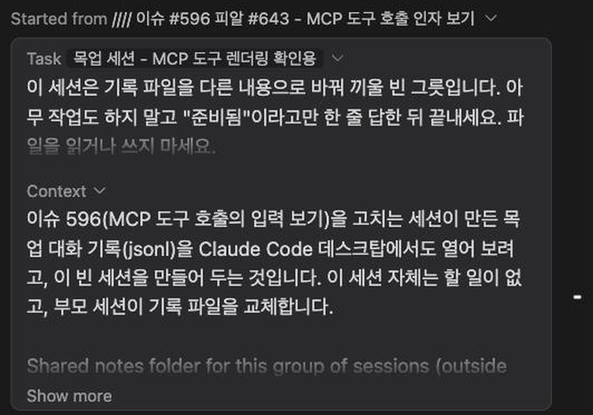
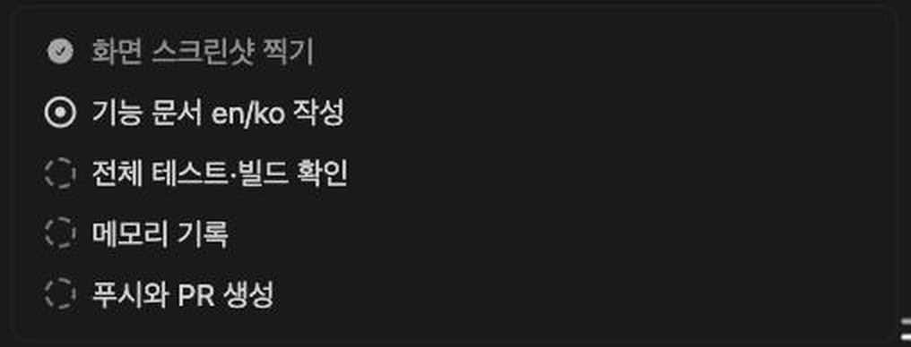
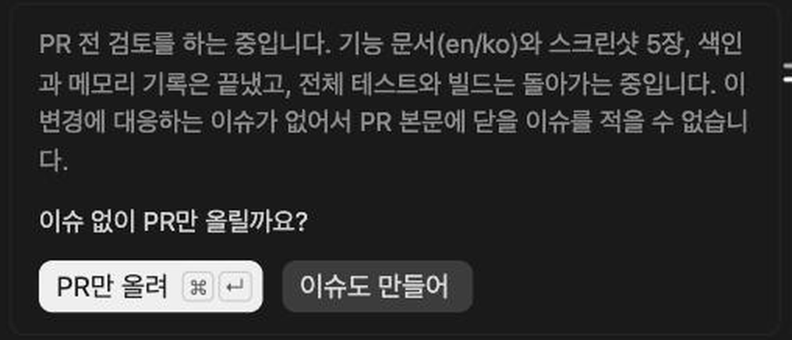
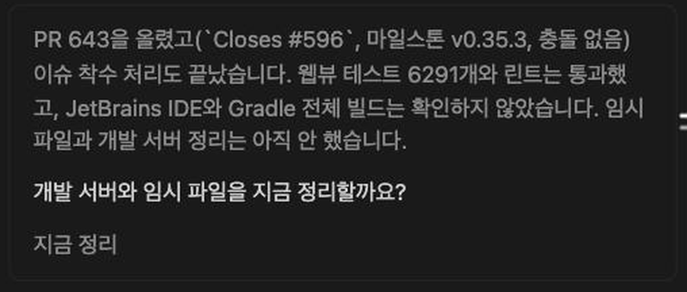
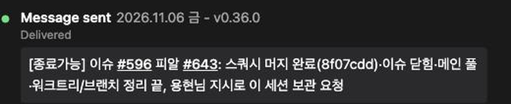
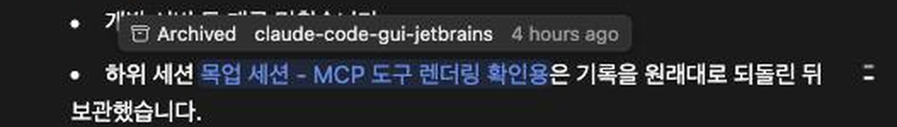

# Claude가 시작한 세션, 계획과 마무리 상자, 다른 세션에 보낸 메시지, 세션 링크가 Claude 데스크탑처럼 보입니다

> Languages: [English](./en.md) · **한국어**

## 새로 달라진 것

Claude 데스크탑 앱으로 일하면 한 세션이 다른 세션을 시작하고, 서로 메시지를 건네고, 답변 글 안에서 서로를 링크로 가리킵니다. 지금까지 이 채팅은 그 모두를 평문과 날것의 JSON으로 그렸습니다. 긴 첫 메시지 하나, 필드가 잔뜩 쌓인 도구 호출, 읽는 사람에게 아무 뜻도 없는 세션 id였습니다. v0.35.3부터 네 가지를 데스크탑 앱이 그리는 방식대로 그립니다.

1. 다른 세션이 시작한 세션의 **첫 메시지**가 **작업** 카드와 **컨텍스트** 카드가 됩니다.
2. Claude 데스크탑의 `ccd_turn` 도구가 한 턴 동안 들고 있는 **계획**과 **마무리**가 꾸밈없는 상자 둘이 됩니다.
3. **다른 세션에 보낸 메시지**가 그 세션을 제목으로 부르고, 메시지는 자기만의 카드에 담깁니다.
4. 답변 글 안의 **세션 링크**가 파란 칩이 되고, 누르면 그 세션이 새 탭에서 열리며, 올려 두면 그 세션이 어디에 있고 언제 마지막으로 쓰였는지 말해 주는 툴팁이 뜹니다.

작은 변화 하나가 함께 들어왔습니다. MCP 도구 호출의 제목 줄이 서버 이름의 밑줄도 공백으로 읽습니다(`mcp__ccd_session_mgmt__archive_session`은 `ccd session mgmt: archive session`입니다. 도구 이름 쪽은 원래 그랬습니다).

이 모두는 사용자가 따로 할 일이 없습니다. 채팅이 이런 것을 만나면 알아서 나타납니다.

## 다른 세션이 시작한 세션

다른 세션이 시작한 세션은 첫 메시지를 그 세션에게서 받습니다. 배경과 작업을 담은 틀입니다. 채팅은 이것을 `Background (from the session that started this one):`로 시작하는 긴 말풍선 하나로 보여 줬습니다. 이제는 카드 둘로 그립니다.

- **맨 위 줄**은 어느 세션이 이 세션을 시작했는지 말합니다. "다음 세션에서 시작함"과 그 세션의 제목입니다. 누가 시작했는지는 세션 관리 패키지가 알려 주고(이 앱에 있는 기록이 먼저, Claude 데스크탑의 기록이 그다음), 제목은 이 앱이 그 세션에 보여 주는 이름입니다. 그래서 여기서 바꾼 이름이 그대로 나옵니다. 제목은 링크라서, 누르면 채팅 글 속의 세션 링크처럼 그 세션이 새 탭에서 열립니다. 패키지가 없거나 0.5.0보다 옛 것이거나 시작한 세션을 찾지 못하면 "다른 세션에서 시작함"이라고만 나옵니다. 줄을 누르면 카드 둘이 접힙니다.
- **작업 카드**는 작업을 담습니다. 라벨 옆에는 데스크탑 앱처럼 지금 들어와 있는 세션의 제목이 붙습니다.
- **컨텍스트 카드**는 배경을 담습니다. 첫 메시지 끝에 공유 노트 폴더 안내가 있으면 그 안내가 이 카드로 옮겨집니다.
- **라벨을 누르면 그 카드가 접힙니다.** 접히면 옆의 화살표가 돌아갑니다.
- **긴 글은 잘립니다.** 약 여섯 줄에서 흐려지며 끊기고, **더 보기** 버튼이 전체를 엽니다. 열면 같은 버튼이 **간략히 보기**가 됩니다.
- **카드 바탕을 아무 데나 누르면** 두 카드가 긴 말풍선의 높이(창의 80%, 안에서 스크롤)로 열립니다. 다시 누르면 닫힙니다. 버튼, 링크를 누르거나 글을 드래그해 선택하는 중의 클릭은 세지 않습니다.
- **글은 일반 메시지와 같게 그려집니다.** `코드`는 코드 모양으로, 파일 경로는 칩으로 나옵니다.
- **카드에 포인터를 올리면** 아래에 복사 버튼이 나타나고, 그 카드의 글을 복사합니다.
- **이 메시지가 채팅 맨 위에 고정된 동안** 답변을 스크롤해 지나가면, 내가 보낸 다른 메시지처럼 카드가 말려 올라갑니다.

카드는 첫 메시지가 데스크탑 앱이 쓰는 틀을 정확히 갖췄을 때만 나옵니다. `Background (from the session that started this one):` 부분 다음에 `Task:` 부분이 오는 형태입니다. 비슷해 보이기만 하는 메시지나 `Task:` 줄이 둘인 메시지는 평범한 말풍선으로 남습니다.

## 한 턴의 계획과 마무리

Claude 데스크탑은 Claude에게 턴을 정돈하는 도구 둘, `update_plan`과 `wrap_up`을 `ccd_turn`이라는 서버로 줍니다. 이 둘은 입력이 JSON으로 펼쳐진 도구 호출로 보였습니다. 이제 각각 도구 제목 없이 꾸밈없는 상자로 그립니다.

### 계획

`update_plan`은 이번 턴의 체크리스트를 듭니다. 상자는 단계마다 앞에 표시를 붙여 나열합니다.

| 표시 | 뜻 |
| --- | --- |
| 동그라미 안의 체크, 글은 흐림 | 끝남 |
| 가운데 점이 있는 고리 | 진행 중 |
| 점선 동그라미 | 기다리는 중 |

Claude는 목록 전체를 건넬 수도, 이미 만든 목록을 고칠 수도 있습니다. 번호로 단계를 끝내고, 하나를 시작하고, 다음으로 넘어갑니다. 채팅은 그런 호출을 순서대로 적용하므로, 각 계획 호출은 그 호출이 남긴 목록을 보여 줍니다. 계획은 최대 열두 단계입니다. 상자는 호출이 있는 자리에 그려집니다.

### 마무리

`wrap_up`은 한 턴을 요약, 질문, 그에 대한 답들로 맺습니다. **Claude가 호출한 자리(마지막 글보다 앞)에 그려지지 않고, 턴의 마지막 메시지 뒤에 그려지므로** 턴이 이 상자로 끝납니다. 요약은 흐린 글, 그 아래 질문, 그리고 답들이 버튼으로 나옵니다.

- **답을 누르면** 내가 직접 친 것처럼 다음 메시지로 전송됩니다. 그러면 버튼은 사라지고 고른 답만 흐린 글로 남습니다.
- **첫 번째 답에는 키가 붙습니다.** Mac은 `⌘ ↵`, 그 밖에는 `Ctrl ↵`입니다. 메시지 입력창이 비어 있을 때 누르면 첫 번째 답이 전송됩니다.
- **메시지를 쓰기 시작하면** 키가 동작하지 않고 버튼의 키 표시도 사라집니다. 글자, 사진이나 파일, 고른 화면 요소, 인용한 답글, 아직 올라가는 중인 업로드 모두 해당합니다. 입력창을 비우면 돌아옵니다.
- **다른 말로 답했을 때**: 다음 메시지가 답들 중 하나가 아니면 버튼이 사라지고 상자에는 요약과 질문만 남습니다. 답들 중 하나이면 그 답이 남습니다.
- **데스크탑 앱에서 앱 동작을 뜻하는 버튼**(커밋, PR 만들기 등)은 그 이름을 말로(`Commit`, `Create PR`, `Fix CI` 등) 보내 Claude가 하게 합니다.

## 다른 세션에 보낸 메시지

Claude가 다른 세션에 메시지를 보내면, 그 호출은 다른 도구 호출과 같은 틀의 카드로 그려집니다. 점, **메시지 전송함**이라는 말, 그리고 메시지가 간 세션의 제목입니다.

- **제목**은 도구가 돌려받는 답에서 읽습니다. 그 답이 세션을 이름으로 말하지 않으면, 채팅이 Claude 데스크탑의 세션 파일에서 그 세션의 제목을 읽습니다. 둘 다 없으면 줄에 **다른 세션**이라고 나옵니다. 읽는 사람에게 아무 뜻이 없는 id는 절대 보이지 않습니다.
- **그 아래 줄**은 전달이 어떻게 됐는지 말합니다. `delivered`는 사용 중인 언어로 "배송됨"처럼 나옵니다. 다른 상태는 도구가 쓴 단어 그대로, 예를 들어 `queued`로 나옵니다.
- **메시지**는 링크와 `코드`가 살아 있는 글로, 다른 도구의 결과처럼 테두리 있는 상자에 그려집니다.
- **에이전트(세션이 아니라 Claude의 도우미 에이전트)에게 보낸 메시지**는 원래의 카드를 그대로 씁니다.

## 답변 속 세션 링크

Claude가 답변에 세션을 링크(`[제목](#local_<id>)`)로 적으면, 채팅은 제목을 파란 배경 위에 그립니다. 누르면 그 세션이 **새 탭**에서 열립니다.

- **포인터를 올리면** 작은 툴팁이 뜹니다. 세션이 보관되었는지, 작업하는 폴더, 마지막으로 쓰인 때가 사용 중인 언어로("4시간 전") 나옵니다.
- **브라우저에서는** 링크가 새 브라우저 탭에서 그 세션을 엽니다. **JetBrains IDE에서는** 알맞은 프로젝트의 새 에디터 탭에서 열립니다.
- **Claude 데스크탑의 세션 파일이 같은 컴퓨터에 있어야 합니다.** 링크가 어느 세션을 가리키는지 그 파일이 알려 주기 때문입니다. 파일이 없거나 아직 읽기 전이면, 채팅은 제목을 파란 배경으로만 그리고 열 것도 툴팁도 없습니다.

## 하지 않는 것

- 데스크탑 앱에서 읽어 오는 것은 자기 세션 파일뿐이고, 이 앱이 그 파일을 직접 열지는 않습니다. 세션 관리 패키지(0.5.0 이상)가 읽어서 답을 주면 이 앱이 보여 줍니다. 파일은 데스크탑 앱의 데이터 폴더(Mac은 `~/Library/Application Support/Claude/claude-code-sessions`, Windows는 `%APPDATA%\Claude\claude-code-sessions`, Linux는 `~/.config/Claude/claude-code-sessions`)에 있습니다. 세션이 데스크탑 앱과 무관하다면 보여 줄 제목이 없습니다.
- 데스크탑 앱이 다른 세션에 보낸 메시지의 "배송됨" 뒤에 보여 주는 **읽음** 상태는 나오지 않습니다. 채팅은 상대 세션이 읽었는지 알 방법이 없습니다.
- 데스크탑 앱에서 세션 제목 뒤에 붙는, 메뉴를 여는 작은 화살표는 그리지 않습니다.
- 메시지 속 링크 뒤에 `(→ github.com)` 표시가 붙지 않습니다.
- 카드와 툴팁의 문구는 사용 중인 인터페이스 언어를 따릅니다. 데스크탑 앱에 번역이 있는 언어(독일어, 영어, 스페인어, 프랑스어, 일본어, 한국어, 포르투갈어)는 그 문구를 씁니다. 러시아어, 중국어(간체와 번체), 아랍어, 페르시아어의 문구는 우리가 옮겼습니다.

## 이상하게 보일 때

- **첫 메시지가 여전히 긴 말풍선 하나입니다.** 카드는 데스크탑 앱이 쓰는 틀을 정확히 갖춰야 나옵니다. 손으로 쓴 메시지나 나중에 고친 메시지는 말풍선으로 남습니다.
- **세션 링크가 파랗기만 하고 열리지 않습니다.** 채팅이 그 세션의 데스크탑 세션 파일을 읽지 못한 것입니다. 데스크탑 앱이 같은 컴퓨터에 설치돼 있는지, 그 세션이 거기에 아직 있는지 확인하세요.
- **마무리의 버튼을 눌러도 아무 일이 없습니다.** 버튼은 채팅의 마지막 턴에서, 그 뒤로 보낸 메시지가 없을 때만 동작합니다. 지난 턴은 그때 한 답을 보여 줍니다.
- **첫 번째 버튼에 키 표시가 없습니다.** 입력창에 글자, 사진, 고른 요소, 업로드 중 하나가 들어 있습니다. 비워 주세요.
- **계획 상자가 생각한 자리에 없습니다.** 계획은 Claude가 도구를 부른 자리에, 마무리는 그 턴의 마지막 메시지 뒤에 그려집니다.

## 관련 문서

- [MCP 도구 호출은 입력, JSON 출력, 실패를 보여 줍니다](../099-mcp_tool_call_details/ko.md): 다른 모든 MCP 도구 호출이 받는 카드.
- [채팅에서 고른 글에 답장하기](../098-reply_to_selected_text/ko.md): 메시지가 맨 앞에 달 수 있는 답글과 발췌.
