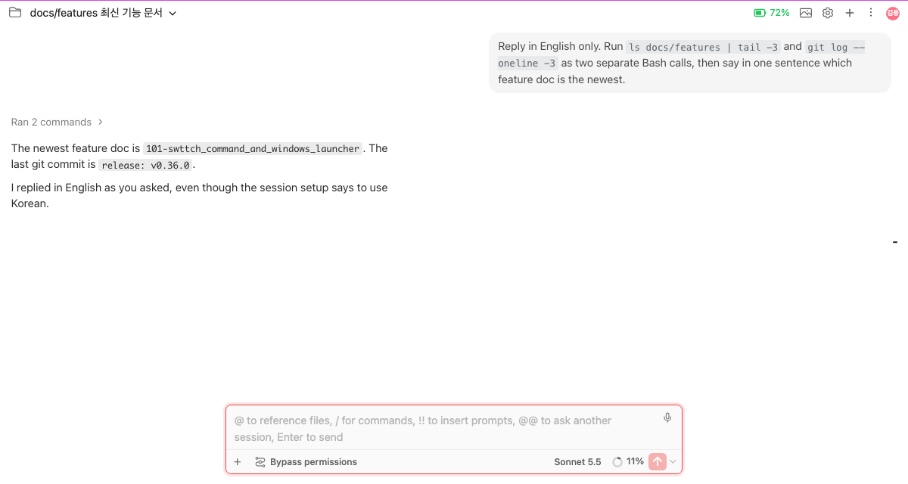
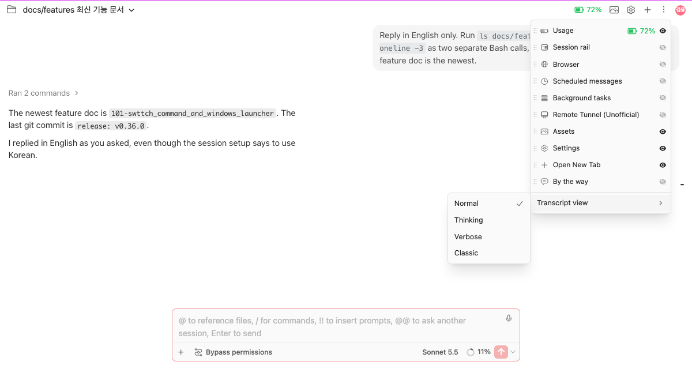
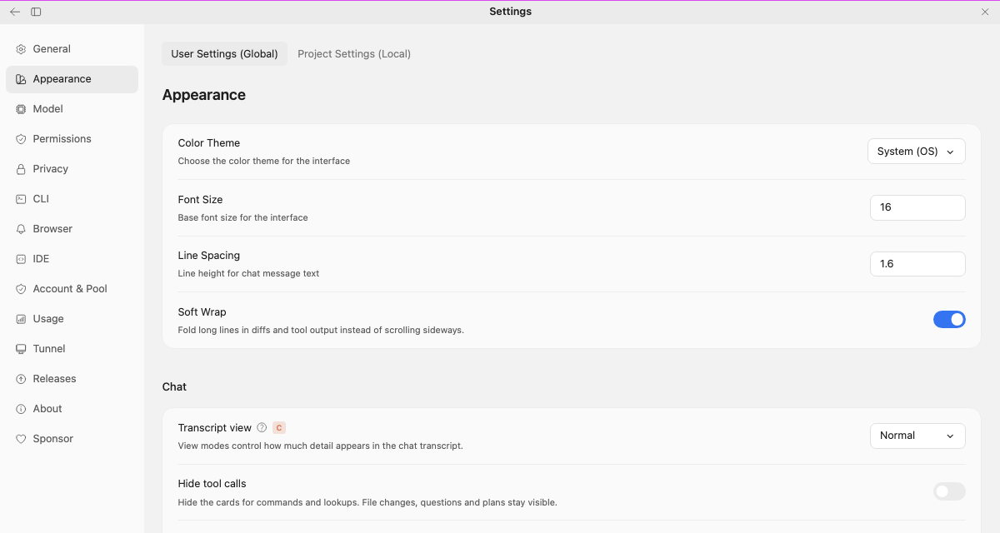
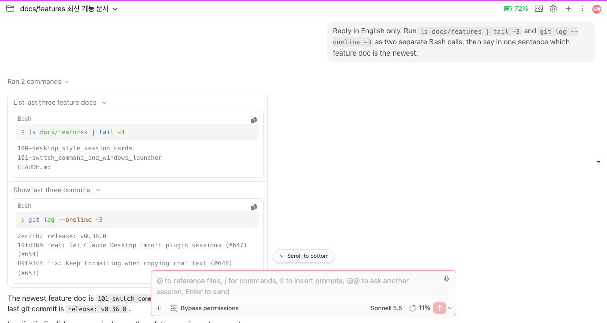
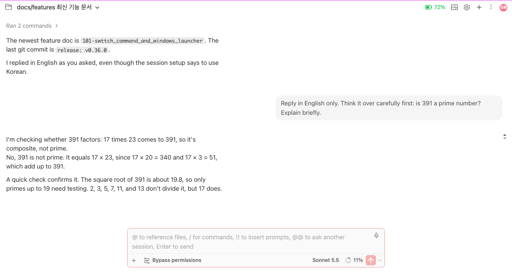
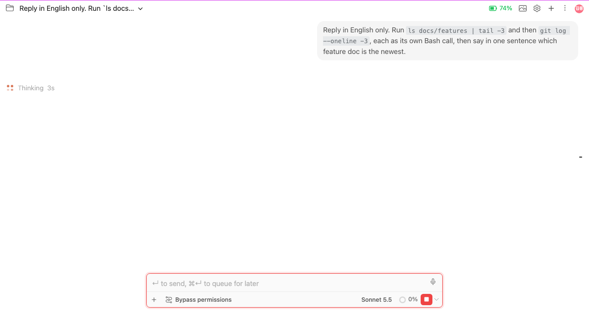

# Transcript view: Normal, Thinking and Verbose, as in Claude Desktop

> Languages: **English** · [한국어](./ko.md)
>
> Issue: [#608](https://github.com/Swttch/swttch/issues/608)

## What changed

The chat can now be drawn the way the Claude desktop app draws its transcript. There are three new views, **Normal**, **Thinking** and **Verbose**, next to the chat you already know, which is now called **Classic**. You pick one for every session in Settings, or for one session at a time from the session's menu, or by pressing `Ctrl+I`.

Classic is still the default. Nothing changes for you until you choose one of the new views.

| View | What the chat shows |
|------|---------------------|
| **Classic** | The chat as it was before this change. Nothing in it was touched. |
| **Normal** | Your messages on the right in a bubble, Claude's replies as plain text on the left. A run of tool calls is folded into one line such as `Ran 2 commands`. |
| **Thinking** | Normal, plus the short summaries of Claude's thinking, written above the reply they led to. |
| **Verbose** | Thinking, plus every tool call opened up: the command, its output, the files that were read, the intermediate steps. |

## Switching the view

**For one session: the session menu.** Open the **⋮** menu in the top bar of the chat, open **Transcript view**, and click a view. The check mark shows the current one. The choice is saved for that session only, so you can keep a session open in Verbose while the others stay in Normal.

**For every session: Settings.** Open **Settings → Appearance → Chat → Transcript view** and pick a view. Sessions that you have not given a view of their own follow this one. The same row appears in the settings of Claude Desktop, so the label carries the "Claude Desktop app setting" badge.

**By keyboard: `Ctrl+I`.** Each press moves the current session to the next view: Normal, Thinking, Verbose, Classic, and around again. It works everywhere in the chat: while you type in the input, while the settings page is open, and in the Classic view. In JetBrains IDEs the default keymap binds `Ctrl+I` to other actions (such as Implement Methods); while the chat has focus, the chat takes the key instead. A short toast at the top names the view you landed on.

About two seconds after you stop pressing it, a small banner asks **"Make … your default view?"**. Click **Make default** to apply that view to every session, or close it with the **X**. It closes itself after five seconds. The same option is in the session menu as **Make … the default**.

### A chat that has not started yet

A new chat has no session yet, so there is nothing to save a choice into. You can still pick a view in it. The choice is held for the moment and applied when you send the first message; from that point it is saved for the new session like any other. **Make … the default** works the same way before the first message.

## What each view draws

- **Your messages** sit on the right in a bubble. Hovering one shows copy, rewind and fork buttons. There is no fold arrow on a message and it does not stay pinned to the top of the chat while you scroll.
- **Tool calls** are folded into one line that says what they did (`Ran 3 commands`, `Read SOUL.md`, `Edited 2 files`) and, when something failed, how many (`2 failed`). Click the line to see a row for every call, and click a row to see the call itself: its input and its output. Calls that have no output say **No output**. Pictures that a call produced are shown as small thumbnails on the line.
- **Edits, questions, plans and wrap-ups** are drawn as the Claude desktop app draws them. See [Sessions that Claude starts, the plan and wrap-up boxes…](../100-desktop_style_session_cards/en.md) for those cards.
- **Thinking** summaries appear in the Thinking and Verbose views only.

### How thinking is asked for

Claude only writes thinking summaries when the Claude Code CLI is asked to. The Thinking and Verbose views ask for them, and Normal does not. When you switch a session between Normal and Thinking or Verbose, the CLI of that session is restarted on your **next message** with the setting that fits the new view. The conversation continues as before. Nothing is written to your `~/.claude/settings.json` for this.

If you have turned **Show thinking summaries** on in your Claude settings yourself, that choice is respected.

## While Claude works

The chat shows that a turn is running in the same way the desktop app does:

- **Four orange dots** in a square, with some of them lit and the lit ones travelling around.
- **A shimmering label** that says what is going on: `Thinking`, or the line of the tool call being waited on (its description when it has one, otherwise `Running a command`, `Reading`, `Searching`, `Editing` and so on), with how long the turn has been running (`12s`, then `1m 6s`).
- **Tokens** once Claude has started writing: for example `725 tokens 55s`.
- When a tool call runs, its folded line becomes the indicator. It stays folded: the line does not open by itself while the run goes on and does not close when it ends. Click it if you want to watch the calls.

While a turn runs, the input placeholder names both keys: `↵ to send, ⌘↵ to queue for later` (on Windows and Linux, `Ctrl+↵`). Which key sends and which queues follows your send-key setting. This text now appears in the Classic view too.

## Settings in short

| Setting | Where | Effect |
|---------|-------|--------|
| **Transcript view** | Settings → Appearance → Chat | The view of every session without a view of its own. Empty means Classic. |
| **Hide tool calls** | Settings → Appearance → Chat | Hides the cards of commands and lookups. File changes, questions and plans stay visible. |
| The session's own view | Top bar ⋮ → Transcript view | Overrides the setting above for that session only. |

You can also hand two values in through the page address, which is useful in the browser: `?pageSize=100` loads 100 entries per page and `?fontSize=15` draws the chat at 15 px. A value in the address wins over the settings until the address stops carrying it. The new views load 150 entries per page when nothing else says so.

## What it does not do

- **Classic is not removed or changed.** If something looks wrong in a new view, switch the session back to Classic from the same menu.
- **The new views do not copy every part of the desktop app.** Reading a reply aloud and pinning a message are not part of them.
- **Thinking only appears when Claude wrote it.** A short answer may have no thinking to show, in any view.
- **Colours follow the theme.** The new views were drawn in the desktop app's dark palette, and they have matching light colours for a light theme.

## Related

- Issue: [#608](https://github.com/Swttch/swttch/issues/608)
- [Sessions that Claude starts, the plan and wrap-up boxes, messages to other sessions and session links look like Claude Desktop's](../100-desktop_style_session_cards/en.md)
