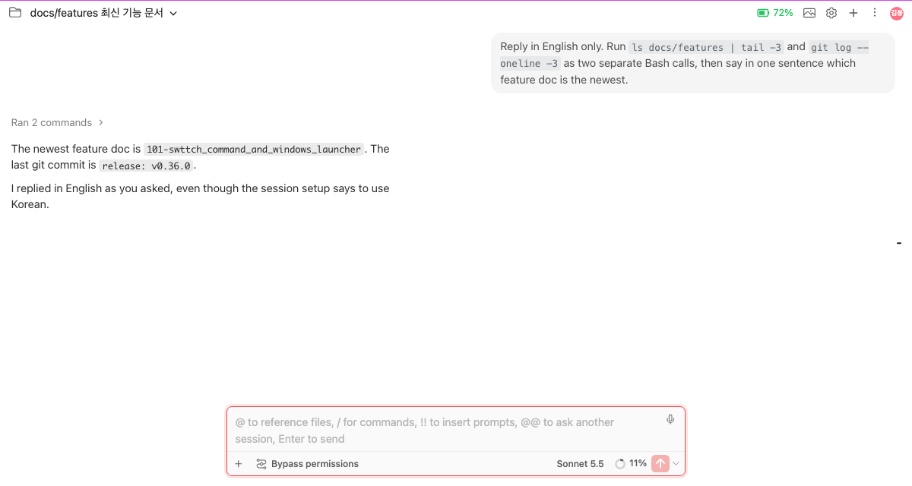
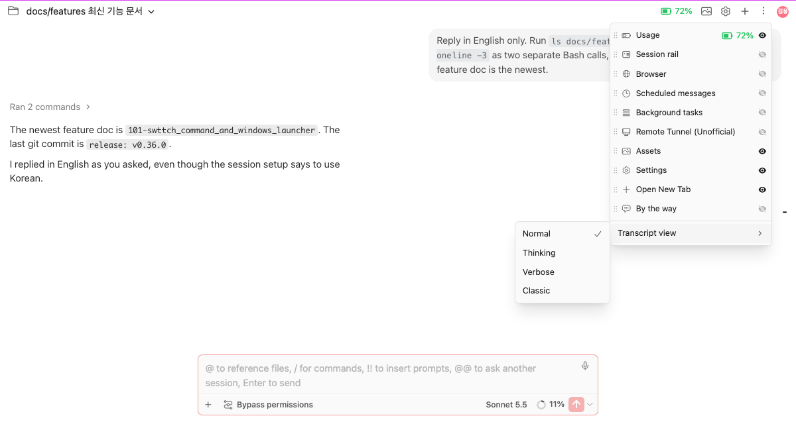
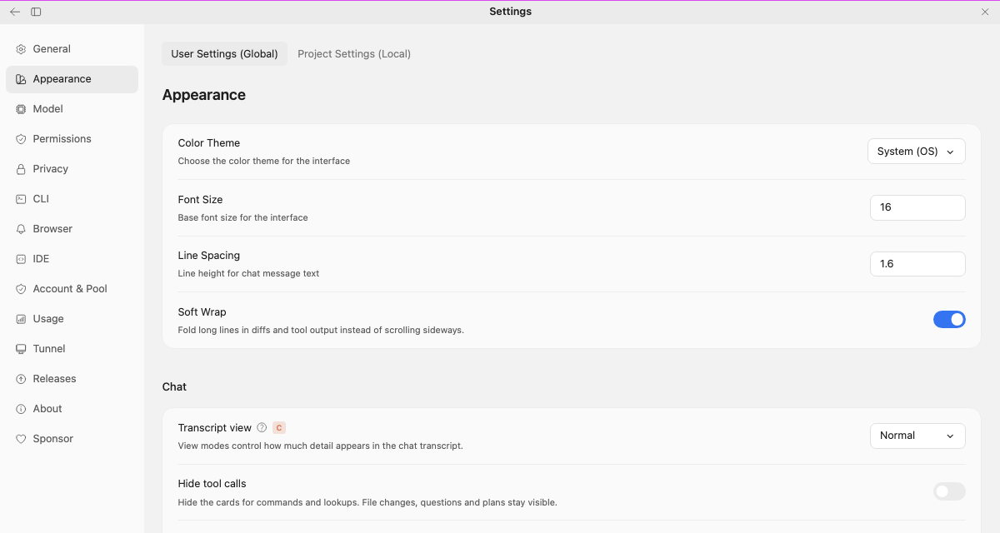
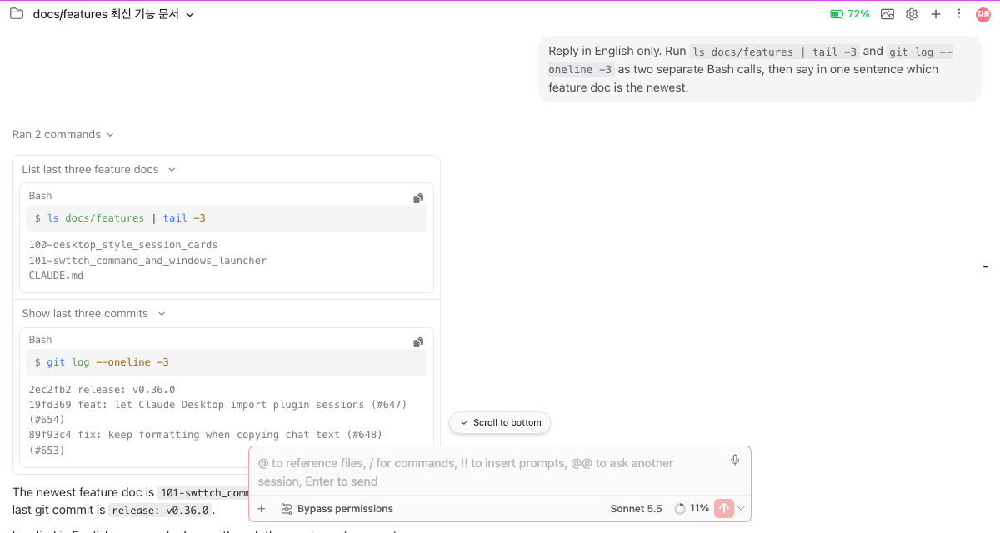
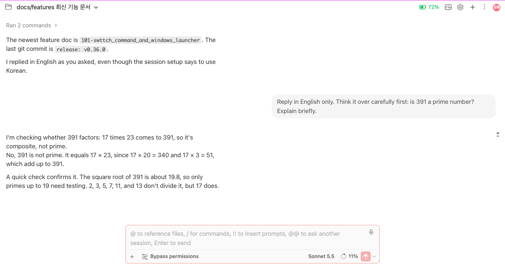
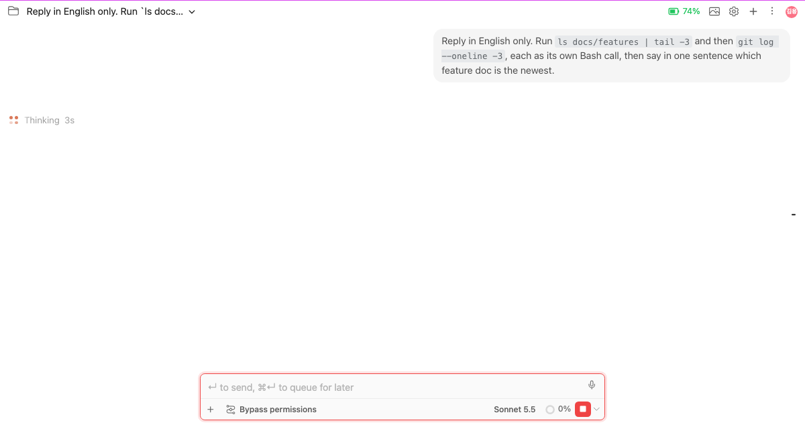

# 대화 보기: Claude 데스크탑처럼 일반, 생각, 자세히

> Languages: [English](./en.md) · **한국어**
>
> Issue: [#608](https://github.com/Swttch/swttch/issues/608)

## 새로 달라진 것

채팅을 Claude 데스크탑 앱이 대화를 그리는 방식으로 그릴 수 있습니다. 새 보기가 셋 생겼습니다. **일반**, **생각**, **자세히**입니다. 지금까지 쓰던 채팅은 **클래식**이라는 이름으로 그대로 남습니다. 보기는 설정에서 모든 세션에 한꺼번에 고르거나, 세션 메뉴에서 세션 하나에만 고르거나, `Ctrl+I`로 바꿉니다.

기본값은 지금도 클래식입니다. 새 보기를 직접 고르기 전에는 아무것도 달라지지 않습니다.

| 보기 | 채팅에 보이는 것 |
|------|------------------|
| **클래식** | 이 변경 전의 채팅 그대로입니다. 손대지 않았습니다. |
| **일반** | 내가 보낸 메시지는 오른쪽 말풍선, Claude의 답은 왼쪽 평문입니다. 도구 호출의 묶음은 `명령 2개 실행됨`처럼 한 줄로 접힙니다. |
| **생각** | 일반에 더해, 답으로 이어진 Claude의 생각을 짧게 요약한 글이 답 위에 나옵니다. |
| **자세히** | 생각에 더해, 모든 도구 호출이 펼쳐집니다. 명령, 그 출력, 읽은 파일, 중간 단계가 모두 보입니다. |

## 보기 바꾸기

**세션 하나에만: 세션 메뉴.** 채팅 상단바의 **⋮** 메뉴를 열고 **Transcript view**(대화 보기)를 열어 보기를 누릅니다. 체크 표시가 지금 보기입니다. 고른 보기는 그 세션에만 저장됩니다. 한 세션은 자세히로 열어 두고 나머지는 일반으로 둘 수 있습니다.

**모든 세션에: 설정.** **설정 → 모양 → 채팅 → 대화 보기**에서 고릅니다. 자기 보기를 따로 고르지 않은 세션은 이 값을 따릅니다. Claude 데스크탑 설정에도 같은 행이 있어서, 이 행에는 "Claude 데스크탑 앱 설정" 배지가 붙습니다.

**키보드로: `Ctrl+I`.** 누를 때마다 지금 세션이 다음 보기로 넘어갑니다. 일반, 생각, 자세히, 클래식, 다시 일반 순입니다. 채팅 어디서든 동작합니다. 입력창에 글을 쓰는 중에도, 설정 페이지가 열려 있어도, 클래식 보기에서도 됩니다. JetBrains IDE의 기본 키맵은 `Ctrl+I`를 다른 동작(메서드 구현 등)에 묶어 두는데, 채팅에 초점이 있는 동안에는 채팅이 이 키를 가져갑니다. 위쪽에 짧은 토스트가 나와 어느 보기에 닿았는지 알려 줍니다.

누르기를 멈추고 약 2초가 지나면 작은 배너가 **"… 보기를 기본값으로 설정할까요?"** 하고 묻습니다. **기본값으로 설정**을 누르면 모든 세션에 그 보기가 적용되고, **X**로 닫을 수 있습니다. 5초 뒤에는 저절로 닫힙니다. 같은 항목이 세션 메뉴에도 **… 보기를 기본값으로 설정**으로 있습니다.

### 아직 시작하지 않은 채팅

새 채팅에는 아직 세션이 없어서 선택을 저장할 곳이 없습니다. 그래도 보기를 고를 수 있습니다. 고른 보기는 임시로 들고 있다가 첫 메시지를 보내는 순간 적용되고, 그때부터는 새 세션에 다른 세션과 똑같이 저장됩니다. **기본값으로 설정**도 첫 메시지 전에 똑같이 동작합니다.

## 보기마다 그려지는 것

- **내 메시지**는 오른쪽 말풍선입니다. 올려 두면 복사, 되감기, 분기 버튼이 보입니다. 메시지에 접는 화살표는 없고, 스크롤해도 채팅 맨 위에 고정되지 않습니다.
- **도구 호출**은 한 줄로 접히고 무엇을 했는지 적습니다(`명령 3개 실행됨`, `SOUL.md 읽음`, `파일 2개 편집됨`). 실패가 있으면 몇 개인지도 적습니다(`2개 실패`). 줄을 누르면 호출마다 한 행이 보이고, 행을 누르면 그 호출의 입력과 출력이 보입니다. 출력이 없는 호출은 **출력 없음**이라고 적습니다. 호출이 만든 그림은 줄에 작은 썸네일로 나옵니다.
- **편집, 질문, 계획, 마무리**는 Claude 데스크탑이 그리는 방식으로 그립니다. 그 카드는 [Claude가 시작한 세션, 계획과 마무리 상자…](../100-desktop_style_session_cards/ko.md)를 봅니다.
- **생각** 요약은 생각과 자세히 보기에만 나옵니다.

### 생각은 어떻게 요청하나

Claude Code CLI에 요청해야만 Claude가 생각 요약을 씁니다. 생각과 자세히 보기는 요청하고, 일반은 요청하지 않습니다. 세션의 보기를 일반과 생각·자세히 사이에서 바꾸면, 그 세션의 CLI는 **다음 메시지**를 보낼 때 새 보기에 맞는 설정으로 다시 시작됩니다. 대화는 그대로 이어집니다. 이 일로 `~/.claude/settings.json`에는 아무것도 쓰지 않습니다.

Claude 설정에서 **생각 요약 표시**를 직접 켜 두었다면 그 선택이 그대로 존중됩니다.

## Claude가 일하는 동안

채팅은 턴이 돌고 있다는 사실을 데스크탑 앱과 같은 방식으로 보여 줍니다.

- 정사각형으로 놓인 **주황색 점 네 개**. 그중 몇 개가 켜져 있고, 켜진 점이 한 바퀴 돕니다.
- 지금 하는 일을 말하는 **반짝이는 글자**. `생각 중`이거나, 기다리는 도구 호출의 줄(설명이 있으면 그 설명, 없으면 `명령 실행 중`, `읽는 중`, `검색 중`, `편집 중` 등)입니다. 그 옆에 턴이 돈 시간이 나옵니다(`12초`, 60초부터 `1분 6초`).
- Claude가 쓰기 시작하면 **토큰 수**가 나옵니다. 예: `725 토큰 55초`.
- 도구 호출이 도는 동안에는 그 호출의 접힌 줄이 이 표시를 대신합니다. 줄은 접힌 채로 있습니다. 실행 중에 저절로 열리지 않고, 끝나도 저절로 닫히지 않습니다. 호출을 지켜보고 싶으면 줄을 누릅니다.

턴이 도는 동안 입력창 안내 문구는 두 키를 모두 말합니다. `↵ 키로 보내기, ⌘↵ 키로 대기열에 추가하여 나중에 보내기`입니다(Windows와 Linux에서는 `Ctrl+↵`). 어느 키가 보내고 어느 키가 대기열에 넣는지는 보내기 키 설정을 따릅니다. 이 문구는 이제 클래식 보기에서도 나옵니다.

## 설정 한눈에

| 설정 | 위치 | 효과 |
|------|------|------|
| **대화 보기** | 설정 → 모양 → 채팅 | 자기 보기가 없는 모든 세션의 보기입니다. 비어 있으면 클래식입니다. |
| **도구 호출 숨기기** | 설정 → 모양 → 채팅 | 명령과 조회의 카드를 숨깁니다. 파일 변경, 질문, 계획은 그대로 보입니다. |
| 세션 자신의 보기 | 상단바 ⋮ → 대화 보기 | 그 세션에서만 위 설정보다 앞섭니다. |

브라우저에서 쓸 때는 페이지 주소로 값 둘을 넘길 수도 있습니다. `?pageSize=100`은 한 페이지에 100개 항목을 읽고, `?fontSize=15`는 채팅을 15px로 그립니다. 주소에 실린 값은 주소에서 사라질 때까지 설정보다 앞섭니다. 새 보기는 다른 지정이 없으면 한 페이지에 150개 항목을 읽습니다.

## 하지 않는 것

- **클래식은 없애지도 바꾸지도 않았습니다.** 새 보기에서 무언가 이상하면 같은 메뉴에서 그 세션을 클래식으로 되돌립니다.
- **데스크탑 앱의 모든 부분을 따라 하지는 않습니다.** 답을 소리 내어 읽기와 메시지 고정은 들어 있지 않습니다.
- **생각은 Claude가 썼을 때만 나옵니다.** 짧은 답에는 보여 줄 생각이 없을 수 있습니다. 어느 보기에서나 그렇습니다.
- **색은 테마를 따릅니다.** 새 보기는 데스크탑 앱의 어두운 색으로 그려졌고, 밝은 테마를 위한 짝색이 따로 있습니다.

## 관련 문서

- 이슈: [#608](https://github.com/Swttch/swttch/issues/608)
- [Claude가 시작한 세션, 계획과 마무리 상자, 다른 세션에 보낸 메시지, 세션 링크가 Claude 데스크탑처럼 보입니다](../100-desktop_style_session_cards/ko.md)
