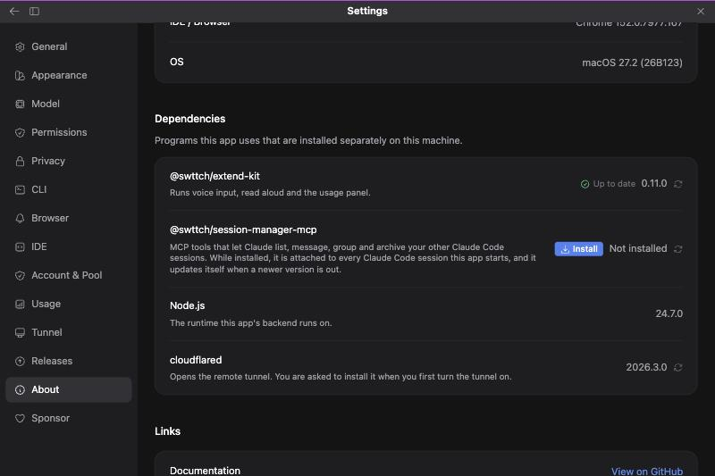
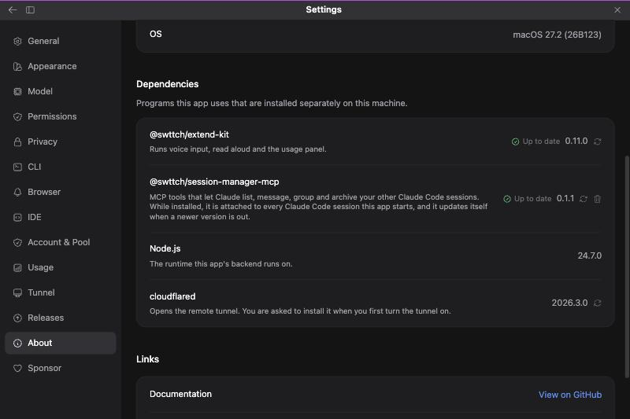

# Session management MCP: let Claude manage your other Claude Code sessions

> Languages: **English** · [한국어](./ko.md)

## What this is

The session-management MCP is a small separate program, the npm package `@swttch/session-manager-mcp`, that gives Claude a set of tools for working with your **other** Claude Code sessions. With it attached, you can ask Claude things like "which of my sessions touched the billing code?", "send this note to my other session", "put these three sessions in a group" or "archive the sessions I finished last week", and Claude does it through those tools instead of telling you to click around.

It is the same program you can add in a terminal with `claude mcp add swttch-sessions -- npx -y @swttch/session-manager-mcp --area session_mgmt`. The app does the same job for you: you install the package from **Settings → About → Dependencies**, and from then on the app hands the program to every Claude process it starts, using Claude Code's documented `--mcp-config` option.

**Nothing is installed until you press the button, and installing is what turns it on.** There is no separate switch. The reason to think before installing is cost, explained next.

## What it costs: the model's context

Attached tools take up part of the model's context for the whole session: their names from the start, and their full descriptions once Claude loads them. That space is not available for your conversation. The app attaches two areas, 27 tools together:

- `session_mgmt` (20 tools) works with the sessions you already have: find, read, message, stop, archive.
- `session` (7 tools) starts new sessions.

The package has eleven areas, 69 tools in all. The other nine are not attached unless you ask for them in a settings file (see "Choosing areas, or turning it off for a project").

| Area | What it gives Claude | Tools |
|------|----------------------|-------|
| `session_mgmt` | List, search, message, rename, archive and stop sessions, and read their recent turns | 20 |
| `session` | Start new sessions and hand off work | 7 |
| `sidebar` | Groups, pins and unread marks in the session list | 13 |
| `window` | Split view and sidebar. Needs Swttch Desktop | 4 |
| `view` | Panes and transcript view. Needs Swttch Desktop | 4 |
| `host` | Open files, free disk, sync branches | 7 |
| `pr` | Pull request status, binding and auto-merge | 5 |
| `settings` | Read and change preferences | 2 |
| `directory` | Change a session's working folder | 2 |
| `connectors` | Check and toggle a session's MCP connectors | 3 |
| `turn` | The task list and wrap-up shown under a reply | 2 |

**`window` and `view` do nothing useful inside an IDE.** They only queue requests for the screen of Swttch Desktop. Inside a JetBrains IDE nothing reads those requests, so attaching them only spends context. Some tools in other areas are listed in the package as "not yet" and answer that they are unavailable; the package's own README keeps the current status of every tool.

## Installing it

Open **Settings → About** and find the **Dependencies** section. The row named `@swttch/session-manager-mcp` shows **Install** and "Not installed".



Press **Install**. A confirmation says that this installs `@swttch/session-manager-mcp` globally on this machine, that it is attached to every Claude Code session the app starts from then on, and that its tools take up part of Claude's context. Confirm it. The app installs the package with the package manager that fits your machine (npm, Volta, pnpm and so on, the same way it installs the extend kit) and then checks that it can find the program. The package is about 200 KB.



**It applies to the next Claude process that starts.** A Claude process that is already running keeps the tools it started with. To get the tools in a conversation that is open now, start a new session, or let the conversation's Claude process restart.

## What happens when Claude starts

When the package is installed, the app adds one `--mcp-config` argument to the `claude` command it starts. The argument has one server per attached area, named `swttch_<area>`, so Claude sees tools named like `mcp__swttch_session_mgmt__list_sessions`. Each server is told which session is calling (so "this session" means the right one) and where the app keeps its data. Your own MCP servers keep loading as usual.

If the package is not installed, no argument is added at all.

While a session is running, the server also appears in the app's **MCP Servers** window, next to your other servers, as `swttch_session_mgmt` and `swttch_session`. Each area is a small separate process (about 10 MB) that lives as long as the session's Claude process.

## Starting a session from a session

Tell Claude, in any session, something like "start a session for the billing refactor". Claude writes a brief and starts a separate Claude Code session with it. The new session runs on its own in the background, in the same folder unless you say otherwise, and appears in the session list. When you open it, the top of the conversation shows that Claude started it from another session, with the brief.

In the conversation that started it, the start is drawn as a card with the new session's title; a click on the card opens that session. When Claude mentions the session in its reply, the name is a link that opens it too.

When the new session ends its turn, the session that started it receives a message with the new session's last reply (the first 400 characters when it is longer). It is drawn as "Received message from" with the session's name, and Claude there tells you the result. You do not have to ask or wait. This happens only while the session that started it is still open in the app; if you closed it in the meantime, open the new session to read its answer.

In the session list (the dropdown in the top bar and the session panel alike), a session that another session started is drawn under that session, indented, with a line running down from it. A session started by a started session is drawn one step further in, under the session that started it, so the list shows who started whom at every level. Sessions under the same session are listed in the order they were started. Every session that started others carries a small arrow after its title: a click folds what it started away, and another click brings it back. The whole tree sits where its most recent session belongs, so a session that is working now is not buried under a session that last spoke days ago. When a search matches only a started session, it is shown as an ordinary row.

You can also say "start it and move it to the top level". Claude then detaches the new session: it is no longer linked to the session that started it and no longer reports to it. The conversation shows a line saying the session was moved to the top level, and the session list shows it as a row of its own.

A session renamed through these tools ("rename this session to ...") gets its name where Claude Code itself keeps it, so the new name shows in this app's session list, in the terminal's `claude --resume` list and in the other Claude Code apps alike.

The other session tools read as lines of their own as well ("Looked up session", "Listed sessions", "Archived session"), the way the desktop app shows the same work. These lines and the card are drawn in the Normal, Thinking and Verbose views; the Classic view shows the calls as ordinary tool calls.

## Keeping it up to date

You do not update it yourself. **If the package is installed** and a newer version exists, the app updates it:

- when the app's backend starts, and
- whenever the version is looked up, which is what opening **Settings → About** or pressing the row's re-check button does.

While the update runs, the row shows **Updating…** and there is nothing to press. When it is over the row shows the new version and "Up to date".

If the automatic update fails (no permission to write to the package manager's global folder, for example), the row shows an **Update** button instead. Pressing it runs the update by hand and shows the reason if it fails again.

**If the package is not installed, the app never installs it by itself.**

## Removing it

Press the trash button at the end of the row. A confirmation explains that the package is removed from this machine and is no longer attached to new Claude processes. This is how you turn it off. Reinstalling is one button press.

## Choosing areas, or turning it off for a project

There is no screen for this. The setting `sessionMcp` in a settings file changes what an installed package attaches.

To attach more areas everywhere, put it in `~/.claude-code-gui/settings.js`. To change it for one project, put it in that project's `.claude-code-gui/settings.json`, for example

```json
{ "sessionMcp": { "areas": ["session_mgmt", "session", "pr"] } }
```

To keep an installed package out of one project:

```json
{ "sessionMcp": { "enabled": false } }
```

A project value wins over the global one. Names that are not areas are ignored.

Keep `session` in the list if you want to say "start a session for this task". Starting a session is a tool of the `session` area, not of `session_mgmt`. Without it Claude has no such tool and may run an ordinary subagent inside the current session instead.

## The rest of the Dependencies section

The section lists the separately installed programs the app uses, each with the version found on this machine. Its rows read the same way as the Claude Code version row above them: a status on the left, the version, and a button that checks again.

| Row | What it is | What you can do there |
|-----|-----------|------------------------|
| `@swttch/extend-kit` | Runs voice input, read aloud and the usage panel | Install, update, check again. The Voice input section keeps its own control for the same package, including removal |
| `@swttch/session-manager-mcp` | This feature | Install, remove, check again. Updates are automatic |
| Node.js | The runtime the app's backend runs on | Nothing. It is reported for bug reports |
| cloudflared | Opens the remote tunnel | Check again. It is installed when you first turn the tunnel on |

## Safety

These tools can do real things: delete and archive sessions, stop a running turn, change a session's model and permission mode. The package is deliberately conservative, for example its file tools only accept paths inside the calling session's folder. Claude Code's own permission prompts apply to every tool call, so read-only tools are good candidates for an allow rule, and delete, archive and stop are not.

**In a session running in Bypass permissions mode, none of those prompts appear.** With the package installed and that mode on, the model can archive or stop your other sessions without asking. Install it with that in mind.

## Questions and troubleshooting

**The install fails with a permission message.** Your package manager's global folder needs administrator rights. The message contains the exact command to run in a terminal. Run it there, then press the row's re-check button.

**I installed it but Claude has no `swttch` tools.** Check that the current conversation's Claude process started after the install (see "It applies to the next Claude process that starts"), and that no settings file sets `sessionMcp.enabled` to `false` or leaves `areas` empty.

**I installed or removed it in a terminal and the row is wrong.** Press the re-check button at the end of the row.

**I installed it in a terminal and the next session had no tools.** The app is not told about a terminal install. The first Claude process started after it looks again in the background, and the processes started after that one get the tools. Opening **Settings → About** makes the app look at once.

**Do I have to use this screen?** No. Anyone can attach the same program in a terminal with `claude mcp add`, as shown at the top. The screen exists so that the install and the updates do not need a terminal.

**The tools say "unavailable".** Those tools need Swttch Desktop (the `window` and `view` areas) or are not built yet. See the table above.
