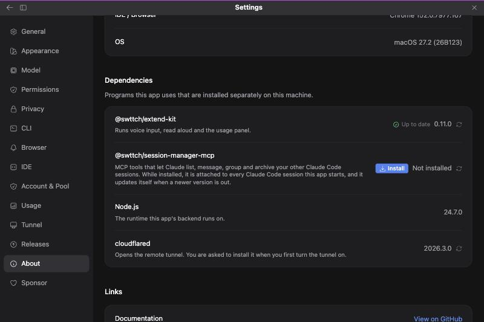
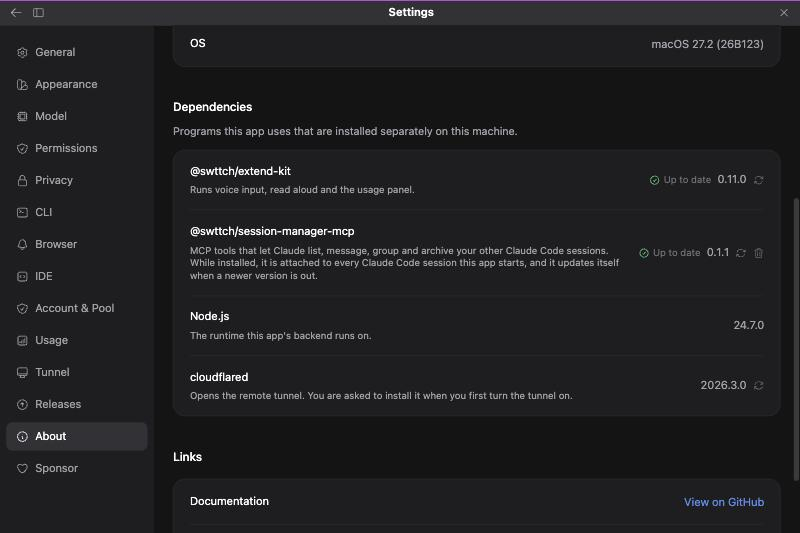

# 세션 관리 MCP: Claude가 다른 Claude Code 세션을 직접 다루게 하기

> Languages: [English](./en.md) · **한국어**

## 무엇인가

세션 관리 MCP는 npm 패키지 `@swttch/session-manager-mcp`로 배포되는 작은 별도 프로그램입니다. 붙이면 Claude가 **다른** Claude Code 세션을 다루는 도구를 갖게 됩니다. "결제 코드를 건드린 세션이 어느 것이지?", "이 메모를 다른 세션에 보내줘", "세션 세 개를 한 그룹으로 묶어줘", "지난주에 끝낸 세션을 보관해줘"처럼 말하면 Claude가 클릭하라고 안내하는 대신 도구로 직접 처리합니다.

터미널에서 `claude mcp add swttch-sessions -- npx -y @swttch/session-manager-mcp --area session_mgmt`로 붙이는 것과 같은 프로그램입니다. 앱이 같은 일을 대신 해 줍니다. **설정 → 정보 → 의존성**에서 패키지를 설치하면, 그때부터 앱이 띄우는 모든 Claude 프로세스에 Claude Code의 공식 옵션인 `--mcp-config`로 이 프로그램을 건네줍니다.

**버튼을 누르기 전에는 아무것도 설치되지 않고, 설치하는 것이 곧 켜는 것입니다.** 따로 켜는 스위치는 없습니다. 설치하기 전에 생각해 볼 것은 비용이며 바로 아래에 설명합니다.

## 비용: 모델의 컨텍스트

붙은 도구는 세션 내내 모델의 컨텍스트 일부를 차지합니다. 처음부터 이름이 들어가고, Claude가 도구를 불러오면 설명 전체가 들어갑니다. 그만큼 대화에 쓸 공간이 줄어듭니다. 앱은 영역 두 개, 도구 27개를 붙입니다.

- `session_mgmt`(도구 20개)는 이미 있는 세션을 다룹니다. 찾기, 읽기, 메시지 보내기, 멈추기, 보관하기입니다.
- `session`(도구 7개)은 새 세션을 시작합니다.

패키지에는 영역이 열한 개 있고 도구는 모두 69개입니다. 나머지 아홉 개 영역은 설정 파일에서 요청하지 않는 한 붙지 않습니다("영역을 고르거나 프로젝트에서 끄기" 참고).

| 영역 | Claude에게 주는 것 | 도구 수 |
|------|--------------------|---------|
| `session_mgmt` | 세션 조회·검색·메시지·이름 변경·보관·중단, 최근 턴 읽기 | 20 |
| `session` | 새 세션 시작과 작업 넘기기 | 7 |
| `sidebar` | 세션 목록의 그룹·고정·안 읽음 표시 | 13 |
| `window` | 화면 분할과 사이드바, 스위치 데스크탑 필요 | 4 |
| `view` | 패널과 대화 보기 방식, 스위치 데스크탑 필요 | 4 |
| `host` | 파일 열기, 디스크 정리, 브랜치 동기화 | 7 |
| `pr` | 풀 리퀘스트 상태·연결·자동 병합 | 5 |
| `settings` | 설정 조회와 변경 | 2 |
| `directory` | 세션의 작업 폴더 바꾸기 | 2 |
| `connectors` | 세션의 MCP 커넥터 확인과 켜고 끄기 | 3 |
| `turn` | 답변 아래에 보이는 작업 목록과 마무리 요약 | 2 |

**`window`와 `view`는 IDE 안에서 쓸모가 없습니다.** 스위치 데스크탑의 화면에 요청을 쌓아 두기만 하는데, JetBrains IDE 안에서는 그 요청을 읽는 곳이 없어서 컨텍스트만 차지합니다. 다른 영역에도 패키지가 "아직 안 됨"으로 표시한 도구가 있고, 그 도구는 쓸 수 없다고 답합니다. 도구별 현재 상태는 패키지의 README에 있습니다.

## 설치하기

**설정 → 정보**를 열고 **의존성** 섹션을 찾습니다. `@swttch/session-manager-mcp` 행에 **설치** 버튼과 "설치되지 않음"이 보입니다.



**설치**를 누릅니다. 확인창이 "이 컴퓨터에 `@swttch/session-manager-mcp`를 전역으로 설치하고, 그때부터 앱이 시작하는 모든 Claude Code 세션에 붙으며, 도구가 Claude의 컨텍스트 일부를 차지한다"고 알려 줍니다. 확인하면 앱이 이 컴퓨터에 맞는 패키지 관리자(npm, Volta, pnpm 등, 확장킷을 설치하는 것과 같은 방식)로 설치하고, 프로그램을 찾을 수 있는지 확인합니다. 패키지 크기는 200KB 정도입니다.



**다음에 뜨는 Claude 프로세스부터 적용됩니다.** 이미 실행 중인 Claude 프로세스는 시작할 때 받은 도구를 그대로 씁니다. 지금 열려 있는 대화에서 도구를 쓰려면 새 세션을 시작하거나 그 대화의 Claude 프로세스가 다시 뜨게 하세요.

## Claude가 뜰 때 일어나는 일

패키지가 설치되어 있으면, 앱이 띄우는 `claude` 명령에 `--mcp-config` 인자가 하나 붙습니다. 이 인자에는 붙이는 영역마다 `swttch_<영역>`이라는 서버가 하나씩 들어 있어서, Claude는 `mcp__swttch_session_mgmt__list_sessions` 같은 이름의 도구를 보게 됩니다. 각 서버는 지금 호출하는 세션이 어느 것인지(그래서 "이 세션"이 올바른 세션을 뜻하도록)와 앱이 데이터를 두는 위치를 전달받습니다. 사용자의 다른 MCP 서버는 그대로 불러옵니다.

패키지가 설치되어 있지 않으면 인자를 아예 붙이지 않습니다.

세션이 실행되는 동안에는 앱의 **MCP 서버** 창에도 다른 서버들과 나란히 `swttch_session_mgmt`, `swttch_session`이라는 이름으로 나타납니다. 영역 하나는 작은 별도 프로세스 하나(약 10MB)이고, 그 세션의 Claude 프로세스가 살아 있는 동안 같이 떠 있습니다.

## 세션 안에서 다른 세션 시작하기

아무 세션에서나 Claude에게 "결제 리팩터링 주제로 세션을 시작해"처럼 말합니다. Claude가 작업 지시를 쓰고 그것으로 별도의 Claude Code 세션을 시작합니다. 새 세션은 뒤에서 혼자 실행되고, 따로 말하지 않으면 같은 폴더에서 돌며, 세션 목록에 나타납니다. 그 세션을 열면 대화 맨 위에 "Claude가 다른 세션에서 시작함"이라는 표시와 작업 지시가 보입니다.

세션을 시작한 대화에는 그 시작이 새 세션의 제목이 적힌 카드로 그려지고, 카드를 누르면 그 세션이 열립니다. Claude가 답변에서 그 세션을 언급하면 이름이 링크가 되어, 눌러도 그 세션이 열립니다.

새 세션이 턴을 마치면, 그 세션을 시작한 세션에 새 세션의 마지막 답변(길면 앞 400자)이 메시지로 도착합니다. "다음 발신자로부터 메시지 수신"과 세션 이름으로 그려지고, 거기 있는 Claude가 결과를 알려 줍니다. 따로 묻거나 기다릴 필요가 없습니다. 이 동작은 시작한 세션이 앱에 아직 열려 있을 때만 일어납니다. 그사이에 닫았다면 새 세션을 열어 답을 읽으세요.

세션 목록(상단바의 드롭다운과 세션 패널 모두)에서, 다른 세션이 시작한 세션은 그 세션 아래에 들여쓰기로 그려지고 묶음 왼쪽에 선이 내려갑니다. 묶음 안의 세션은 시작된 순서대로 나열됩니다. 세션을 시작한 쪽의 제목 뒤에는 작은 화살표가 붙습니다. 화살표를 누르면 아래에 달린 세션이 접히고, 다시 누르면 펼쳐집니다. 묶음은 그 안에서 가장 최근에 움직인 세션의 자리에 놓입니다. 그래서 지금 일하는 세션이 며칠 전에 마지막으로 말한 세션 아래에 묻히지 않습니다. 검색어가 시작된 세션에만 맞으면 그 세션은 보통 줄로 보입니다.

"시작한 뒤 최상위로 옮겨"라고 말할 수도 있습니다. 그러면 Claude가 새 세션을 분리합니다. 분리된 세션은 자기를 시작한 세션과 더 이상 연결되지 않고 그 세션에 결과를 알리지도 않습니다. 대화에는 "세션이 최상위 수준으로 이동됨"이라는 줄이 그려지고, 세션 목록에서는 그 세션이 따로 떨어진 줄로 보입니다.

이 도구로 세션 이름을 바꾸면("이 세션 이름을 ...로 바꿔") 이름이 Claude Code가 이름을 두는 바로 그 자리에 기록됩니다. 그래서 새 이름이 이 앱의 세션 목록, 터미널의 `claude --resume` 목록, 다른 Claude Code 앱에 똑같이 보입니다.

다른 세션 도구도 각자의 줄로 읽힙니다("세션 조회됨", "세션 목록 조회됨", "세션 보관됨"). 데스크탑 앱이 같은 일을 보여 주는 방식과 같습니다. 이 줄과 카드는 일반, 사고 과정, 자세히 보기에서 그려지고, 클래식 보기에서는 일반 도구 호출로 보입니다.

## 최신 상태 유지

직접 업데이트할 필요가 없습니다. **패키지가 설치되어 있고** 새 버전이 있으면 앱이 업데이트합니다.

- 앱의 백엔드가 시작될 때
- 버전을 조회할 때. **설정 → 정보**를 열거나 행의 다시 확인 버튼을 누르면 버전을 조회합니다.

업데이트가 도는 동안 행에는 **업데이트 중…**이 보이고 누를 것이 없습니다. 끝나면 새 버전과 "최신 버전"이 보입니다.

자동 업데이트가 실패하면(예: 패키지 관리자의 전역 폴더에 쓸 권한이 없을 때) 행에 **업데이트** 버튼이 대신 나타납니다. 누르면 직접 업데이트를 실행하고, 다시 실패하면 이유를 보여 줍니다.

**패키지가 설치되어 있지 않으면 앱이 알아서 설치하는 일은 절대 없습니다.**

## 제거

행 끝의 휴지통 버튼을 누릅니다. 확인창이 "이 컴퓨터에서 지우고 새 Claude 프로세스에는 더 이상 붙이지 않는다"고 알려 줍니다. 끄는 방법이 이것입니다. 다시 설치하는 데는 버튼 한 번이면 됩니다.

## 영역을 고르거나 프로젝트에서 끄기

이것을 다루는 화면은 없습니다. 설정 파일의 `sessionMcp` 값이 설치된 패키지가 무엇을 붙일지 바꿉니다.

모든 곳에서 영역을 더 붙이려면 `~/.claude-code-gui/settings.js`에 적습니다. 프로젝트 하나에서만 바꾸려면 그 프로젝트의 `.claude-code-gui/settings.json`에 적습니다. 예를 들면 다음과 같습니다.

```json
{ "sessionMcp": { "areas": ["session_mgmt", "session", "pr"] } }
```

설치된 패키지를 프로젝트 하나에서 빼려면 이렇게 적습니다.

```json
{ "sessionMcp": { "enabled": false } }
```

프로젝트 값이 전역 값보다 이깁니다. 영역이 아닌 이름은 무시됩니다.

"이 주제로 세션을 시작해"라고 시키고 싶다면 목록에 `session`을 남겨 두세요. 새 세션을 시작하는 도구는 `session_mgmt`가 아니라 `session` 영역에 있습니다. 없으면 Claude에게 그 도구가 없어서, 지금 세션 안에서 일반 서브에이전트를 대신 돌릴 수 있습니다.

## 의존성 섹션의 나머지

이 섹션은 앱이 사용하는, 따로 설치되는 프로그램을 이 컴퓨터에서 찾은 버전과 함께 나열합니다. 행은 바로 위의 Claude Code 버전 행과 똑같이 읽힙니다. 왼쪽에 상태, 그 옆에 버전, 그리고 다시 확인하는 버튼이 있습니다.

| 행 | 무엇인가 | 여기서 할 수 있는 것 |
|----|----------|----------------------|
| `@swttch/extend-kit` | 음성 입력, 소리 내어 읽기, 사용량 패널을 실행합니다 | 설치, 업데이트, 다시 확인. 음성 입력 섹션에도 같은 패키지를 다루는 컨트롤이 그대로 있고, 삭제는 그쪽에 있습니다 |
| `@swttch/session-manager-mcp` | 이 기능 | 설치, 삭제, 다시 확인. 업데이트는 자동입니다 |
| Node.js | 앱의 백엔드가 실행되는 런타임 | 없음. 버그 제보에 쓰라고 보여 줍니다 |
| cloudflared | 원격 터널을 엽니다 | 다시 확인. 터널을 처음 켤 때 설치됩니다 |

## 안전

이 도구들은 실제로 일을 합니다. 세션을 삭제하고 보관하고, 진행 중인 턴을 멈추고, 세션의 모델과 권한 모드를 바꿉니다. 패키지는 일부러 보수적으로 만들어졌습니다. 예를 들어 파일 도구는 호출한 세션의 폴더 안 경로만 받습니다. Claude Code의 권한 확인은 모든 도구 호출에 그대로 적용되므로, 읽기 전용 도구는 허용 규칙에 넣어도 좋지만 삭제·보관·중단은 그렇지 않습니다.

**권한 우회(Bypass permissions) 모드로 실행 중인 세션에서는 그 확인이 하나도 뜨지 않습니다.** 패키지를 설치한 채로 그 모드를 쓰면, 모델이 묻지 않고 다른 세션을 보관하거나 멈출 수 있습니다. 그 점을 감안해서 설치하세요.

## 질문과 문제 해결

**설치가 권한 안내와 함께 실패해요.** 패키지 관리자의 전역 폴더에 관리자 권한이 필요한 경우입니다. 안내 문구에 터미널에서 실행할 정확한 명령이 들어 있습니다. 터미널에서 실행한 뒤 행의 다시 확인 버튼을 누르세요.

**설치했는데 Claude에 `swttch` 도구가 없어요.** 지금 대화의 Claude 프로세스가 설치한 뒤에 시작되었는지("다음에 뜨는 Claude 프로세스부터 적용됩니다" 참고), 그리고 어느 설정 파일도 `sessionMcp.enabled`를 `false`로 두거나 `areas`를 비워 두지 않았는지 확인하세요.

**터미널에서 설치하거나 지웠는데 행의 내용이 틀려요.** 행 끝의 다시 확인 버튼을 누르세요.

**터미널에서 설치했는데 다음 세션에 도구가 없어요.** 터미널에서 한 설치는 앱에 전달되지 않습니다. 설치한 뒤 처음 뜨는 Claude 프로세스가 뒤에서 다시 찾아보고, 그다음에 뜨는 프로세스부터 도구가 붙습니다. **설정 → 정보**를 열면 앱이 바로 다시 찾습니다.

**꼭 이 화면을 써야 하나요?** 아닙니다. 위에 적은 것처럼 터미널에서 `claude mcp add`로 같은 프로그램을 붙일 수 있습니다. 이 화면은 설치와 업데이트를 터미널 없이 하도록 만든 것입니다.

**도구가 "unavailable"이라고 답해요.** 스위치 데스크탑이 필요한 도구(`window`, `view` 영역)이거나 아직 만들어지지 않은 도구입니다. 위 표를 보세요.
