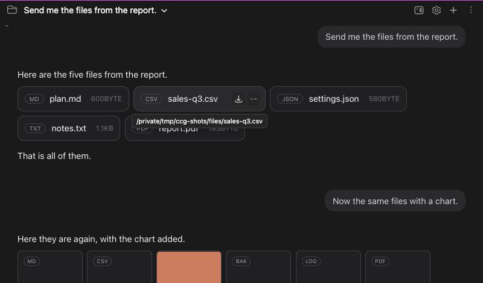
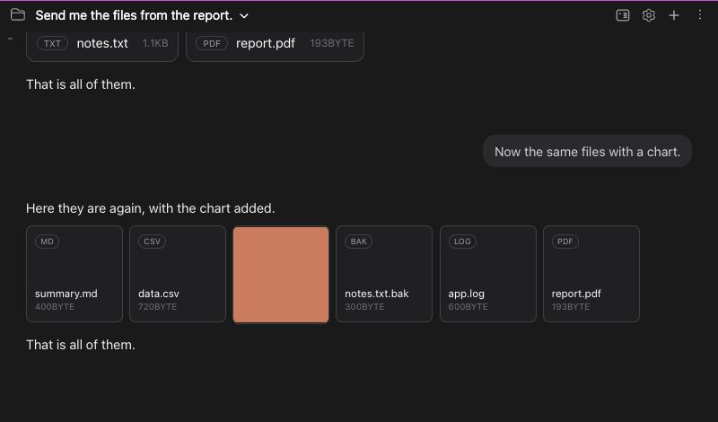
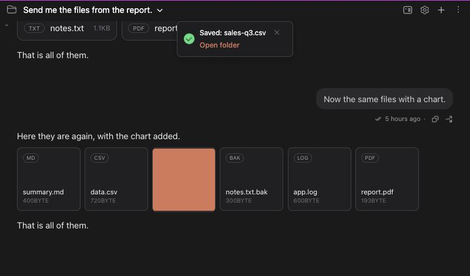
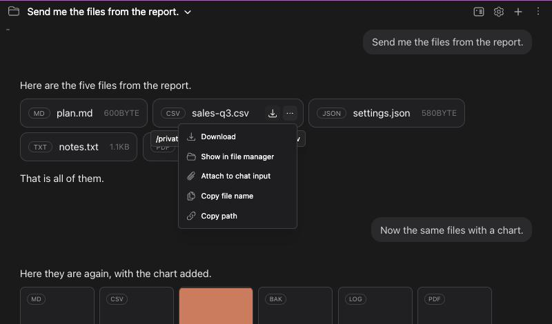
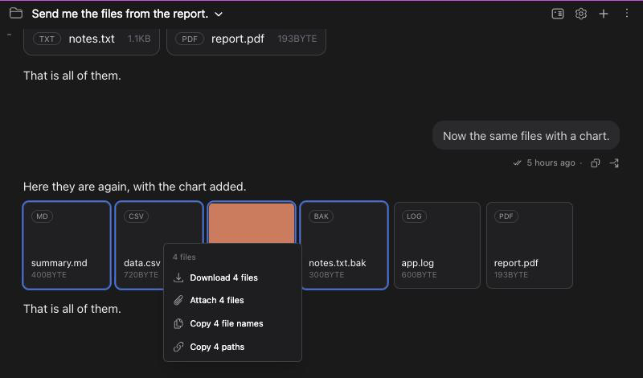

# Files Claude sends: save them where you want, and see that they were saved

> Languages: **English** · [한국어](./ko.md)

When Claude hands you a file (a plan, a report, a picture, a spreadsheet), it appears in the chat as a **chip** or a **card**. This page covers everything you can do with it: save it to a folder you choose, get a message that says it was saved, open the folder, copy its name or path, attach it to your next message, and do all of that for several files at once.

Related: [#675](https://github.com/Swttch/swttch/issues/675), the report that asked for a sign that a download finished and for a way to choose the folder. The way files are drawn in the chat comes from [#593](https://github.com/Swttch/swttch/issues/593).

## What you see in the chat

Claude can send files with its `SendUserFile` tool. Swttch draws them the way Claude Desktop does:

- **A chip** is one line with the kind of the file, its name and its size. Files that are not pictures are chips, however many there are, and they sit side by side and wrap onto the next line.
- **A card** is a square with the kind in the corner, the name and the size at the bottom. If **a picture** (png, jpg, gif, webp, bmp or avif) is among the files, the other files become cards too, so that they line up with the picture's thumbnail.
- **A sound or a video** that can be played is drawn as a player above the rest. It has no menu or buttons of its own.
- A **single file** is always a chip. A single picture is shown at its own size.

Click a chip or a card to open the file. What the preview pane next to the chat can show (a page, a picture, a PDF, a video, and text or code files) opens there. Anything else is handed to another program or the IDE's editor, and a short message says it was opened.

## Saving a file

Move the pointer over a chip or a card. Two buttons appear at its corner:

- The **download button** (an arrow pointing down) saves the file.
- The **"..." button** opens a menu with more things to do (see below).

Press the download button and Swttch opens your computer's **save dialog**: the IDE's own dialog in a JetBrains IDE, the operating system's dialog when you use Swttch in a browser. The file name is filled in. Choose the folder and press Save.

While the file is being written, the **background of the chip or card fills** from the left, so you can see it is working. A small file is done so fast that you may only see it flash.

When it is saved, a message appears at the top of the chat:

- It names the file, not the whole path, so it stays short.
- **Open folder** opens the folder the file was saved in, with the file selected, in your file manager (Finder, Explorer, or the file manager of your Linux desktop). The message closes when you press it.
- The message stays **5 seconds**. The **x** closes it sooner.
- If you close the save dialog without pressing Save, nothing is saved and no message appears.
- If the file could not be read (it was moved or deleted and no copy is kept), a message says so.

## The menu

Press the "..." button, or **right-click** the chip or card. Both open the same menu:

| Entry | What it does |
|---|---|
| **Download** | The same as the download button: the save dialog, then the message. |
| **Show in file manager** | Shows the file where it is now (the file Claude made, not a saved copy) in Finder, Explorer or your file manager. |
| **Attach to chat input** | Puts the file in the attachment row of your message box, the same chip the file picker makes. It is attached by its path, so Claude reads it from where it is. |
| **Copy file name** | Copies the name, for example `sales-q3.csv`. |
| **Copy path** | Copies the full path of the file. |

The menu opens as soon as the pointer is over the "..." button, and it stays open while the pointer is on it. A click or the keyboard opens it too.

## Several files at once

You can pick several chips or cards and act on all of them together. Picking works **within the files of one message**.

- **Shift+click** picks the run of files from the last one you picked up to the one you click. With nothing picked yet it picks just that one.
- **Cmd+click** (**Ctrl+click** on Windows and Linux) adds one file to the pick, or takes it out if it is already there. Holding Shift as well does the same.
- A picked file has a **blue outline**.
- **Press Esc**, click on something else in the window, or **click a file without Shift or Cmd** (which also opens it) to let go of the pick.

Right-click one of the picked files, or press its "..." button, and the menu is for all of them:

- **Download N files** asks for **one folder** (the IDE's or the system's folder dialog) and saves every file there under its own name. A name that is already taken in that folder is not written over: the new file gets a number, for example `plan (1).md`. Each chip or card fills its own background as its file is written, and one message says how many files were saved and the name of the folder, with the same **Open folder** button.
- **Attach N files** puts all of them in the attachment row.
- **Copy N file names** and **Copy N paths** copy one name or path per line.
- **Show in file manager** is left out, because the files can be in different folders.

Right-click a file that is **not** in the pick and the menu is for that file alone; the pick is let go of.

## Limits

- **No default folder.** Swttch asks where to save every time, as Claude Desktop does. There is no setting to keep a fixed folder.
- **A file can be up to 200 MB**, and a download of several files can carry up to 200 files.
- **A file Claude deleted or moved** can still be saved if it is small: Swttch keeps a copy of every file Claude sends, up to 30 MB, so the card keeps working. Larger files need the original to still be there.
- **Picking works inside one message.** You cannot pick files of two different messages together.
- **The same file shown twice.** If the same file appears in several messages, saving one of them fills the background of all of them at once, because they are the same file.
- **Players have no menu.** A video or a sound that plays in the chat has no download button; use the player's own menu.
- **Older plugin, newer page.** If Swttch runs in a browser but the IDE side is an older plugin that does not know the save dialog, the file goes through the browser's own download: it lands in the browser's download folder, you are not asked where, and the message says only "Downloaded".

## Questions

**The save dialog opened somewhere I did not expect.** The IDE and the system remember where you saved last. Pick the folder you want; nothing is saved until you press Save.

**I pressed download and nothing happened.** If the dialog is not on screen, look for a second window behind the IDE. If you closed the dialog, nothing is saved on purpose. If a message says the file could not be saved, the file is gone and too large to have been kept.

**Can I choose a folder once and keep it?** Not yet. Choosing the folder each time is how Claude Desktop does it too.
