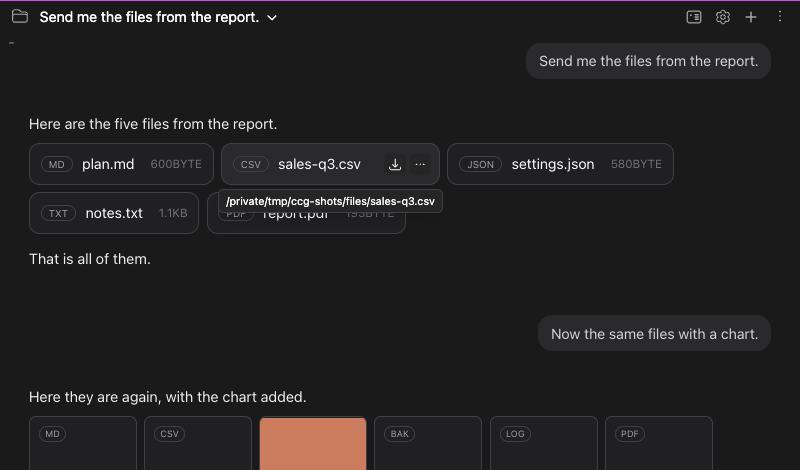
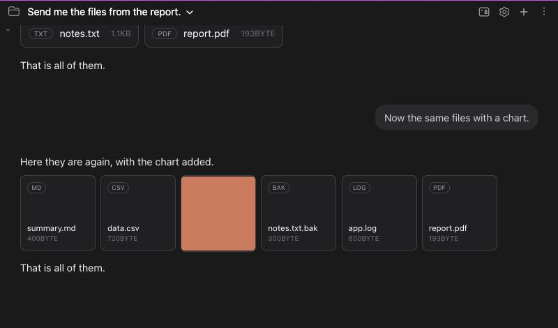
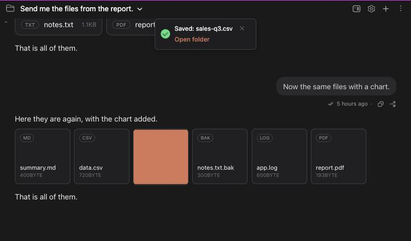
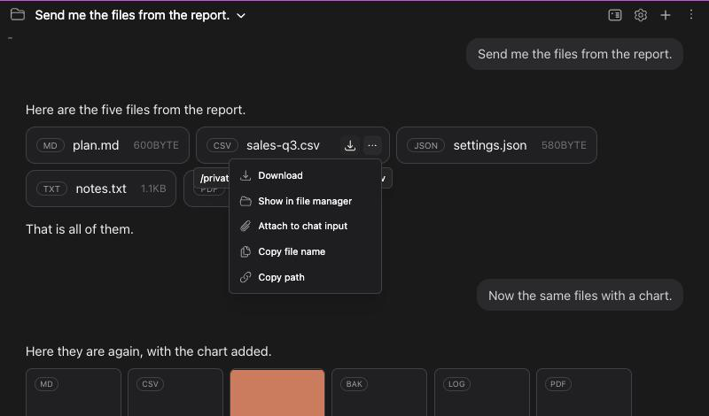
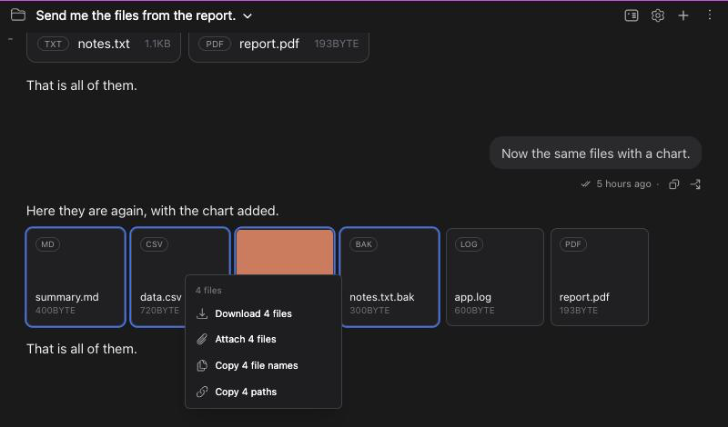

# Claude가 보낸 파일: 원하는 곳에 저장하고, 저장됐는지 바로 확인하기

> Languages: [English](./en.md) · **한국어**

Claude가 파일(계획서, 보고서, 그림, 스프레드시트)을 건네 주면 채팅에 **칩**이나 **카드**로 나타납니다. 이 문서는 그 파일로 할 수 있는 일을 모두 다룹니다. 고른 폴더에 저장하기, 저장됐다는 알림 받기, 폴더 열기, 이름이나 경로 복사하기, 다음 메시지에 첨부하기, 그리고 이 모든 것을 여러 파일에 한꺼번에 하기입니다.

관련 이슈는 [#675](https://github.com/Swttch/swttch/issues/675)입니다. 내려받기가 끝났다는 표시와 저장 폴더를 고르는 방법을 요청한 제보입니다. 채팅에서 파일을 그리는 방식은 [#593](https://github.com/Swttch/swttch/issues/593)에서 왔습니다.

## 채팅에서 보이는 모습

Claude는 `SendUserFile` 도구로 파일을 보냅니다. Swttch는 이것을 Claude 데스크탑과 같은 방식으로 그립니다.

- **칩**은 파일의 종류, 이름, 크기를 담은 한 줄입니다. 그림이 아닌 파일은 몇 개든 칩이고, 나란히 놓이다가 줄이 차면 다음 줄로 넘어갑니다.
- **카드**는 모서리에 종류, 아래쪽에 이름과 크기가 있는 정사각형입니다. 파일들 가운데 **그림**(png, jpg, gif, webp, bmp, avif)이 하나라도 있으면 나머지 파일도 카드로 바뀝니다. 그림의 미리보기와 줄을 맞추기 위해서입니다.
- 재생할 수 있는 **소리나 영상**은 나머지 위에 플레이어로 그려지고, 자기만의 메뉴나 버튼은 없습니다.
- **파일이 하나뿐이면** 언제나 칩입니다. 그림 하나는 제 크기로 보입니다.

칩이나 카드를 누르면 파일이 열립니다. 채팅 옆 미리보기 창이 보여 줄 수 있는 것(페이지, 그림, PDF, 영상, 텍스트와 코드 파일)은 거기서 열립니다. 그 밖의 것은 다른 프로그램이나 IDE 편집기로 넘겨지고, 열었다는 짧은 알림이 나옵니다.

## 파일 저장하기

칩이나 카드 위에 포인터를 올리면 모서리에 버튼 둘이 나타납니다.

- **내려받기 버튼**(아래를 가리키는 화살표)은 파일을 저장합니다.
- **"..." 버튼**은 할 수 있는 일이 더 담긴 메뉴를 엽니다(아래에 있습니다).

내려받기 버튼을 누르면 Swttch가 컴퓨터의 **저장 대화상자**를 엽니다. JetBrains IDE에서는 IDE의 대화상자, 브라우저에서 Swttch를 쓰면 운영체제의 대화상자입니다. 파일 이름이 이미 채워져 있습니다. 폴더를 고르고 저장을 누르면 됩니다.

파일이 써지는 동안 **칩이나 카드의 배경이 왼쪽부터 차오릅니다.** 일하고 있다는 것이 보이게 하려는 것입니다. 작은 파일은 너무 빨리 끝나서 잠깐 번쩍이는 것으로만 보일 수 있습니다.

저장이 끝나면 채팅 위쪽에 알림이 나타납니다.

- 전체 경로가 아니라 **파일 이름**만 적어서 짧게 유지합니다.
- **폴더 열기**를 누르면 파일을 저장한 폴더가 파일 관리자(Finder, 탐색기, 리눅스 데스크탑의 파일 관리자)에서 열리고 그 파일이 선택됩니다. 누르면 알림은 닫힙니다.
- 알림은 **5초** 동안 떠 있고, **x**를 누르면 더 일찍 닫힙니다.
- 저장하지 않고 대화상자를 닫으면 아무것도 저장되지 않고 알림도 없습니다.
- 파일을 읽을 수 없으면(옮겨지거나 지워졌고 복사본도 없을 때) 그렇다고 알려 줍니다.

## 메뉴

"..." 버튼을 누르거나 칩이나 카드를 **우클릭**합니다. 두 방법 모두 같은 메뉴가 열립니다.

| 항목 | 하는 일 |
|---|---|
| **다운로드** | 내려받기 버튼과 같습니다. 저장 대화상자가 열리고 알림이 나옵니다. |
| **파일 관리자에서 보기** | 지금 파일이 있는 곳(저장한 사본이 아니라 Claude가 만든 파일)을 Finder, 탐색기, 파일 관리자에서 보여 줍니다. |
| **채팅 입력에 첨부** | 메시지 입력창의 첨부 줄에 파일을 올립니다. 파일 선택창이 만드는 것과 같은 칩입니다. 경로로 첨부되므로 Claude는 파일이 있는 자리에서 읽습니다. |
| **파일명 복사** | `sales-q3.csv` 같은 이름을 복사합니다. |
| **경로 복사** | 파일의 전체 경로를 복사합니다. |

메뉴는 포인터가 "..." 버튼 위에 오자마자 열리고, 포인터가 메뉴 위에 있는 동안 열려 있습니다. 클릭이나 키보드로도 열 수 있습니다.

## 여러 파일을 한꺼번에

칩이나 카드를 여러 개 골라 한꺼번에 다룰 수 있습니다. 고르기는 **한 메시지에 담긴 파일들 안에서** 됩니다.

- **Shift+클릭**은 마지막으로 고른 파일부터 클릭한 파일까지를 고릅니다. 아직 아무것도 고르지 않았다면 그 파일 하나만 고릅니다.
- **Cmd+클릭**(Windows와 Linux는 **Ctrl+클릭**)은 파일 하나를 선택에 넣거나, 이미 들어 있으면 뺍니다. Shift를 같이 눌러도 같습니다.
- 고른 파일에는 **파란 테두리**가 생깁니다.
- 고르기를 풀려면 **Esc**를 누르거나, 창의 다른 곳을 누르거나, **Shift나 Cmd 없이 파일을 클릭**합니다(그 파일은 열립니다).

고른 파일 하나를 우클릭하거나 그 파일의 "..." 버튼을 누르면 메뉴가 고른 파일 모두에 대한 것이 됩니다.

- **N개의 파일 다운로드**는 **폴더를 하나** 묻고(IDE나 시스템의 폴더 대화상자), 모든 파일을 거기에 자기 이름으로 저장합니다. 그 폴더에 이미 있는 이름은 덮어쓰지 않고, 새 파일에 `plan (1).md`처럼 번호가 붙습니다. 각 칩이나 카드는 자기 파일이 써지는 만큼 자기 배경을 채우고, 알림 하나가 저장한 파일 수와 폴더 이름을 알려 주며 같은 **폴더 열기** 버튼이 붙습니다.
- **N개의 파일 첨부**는 모두 첨부 줄에 올립니다.
- **N개의 파일명 복사**와 **N개의 경로 복사**는 한 줄에 하나씩 복사합니다.
- **파일 관리자에서 보기**는 파일들이 서로 다른 폴더에 있을 수 있어서 빠집니다.

고르지 **않은** 파일을 우클릭하면 메뉴는 그 파일 하나에 대한 것이 되고, 고르기는 풀립니다.

## 한계

- **기본 폴더가 없습니다.** Claude 데스크탑처럼 Swttch는 저장할 때마다 어디에 저장할지 묻습니다. 폴더를 고정해 두는 설정은 없습니다.
- **파일 하나는 200MB까지**이고, 여러 파일을 한 번에 받을 때는 200개까지입니다.
- **Claude가 지우거나 옮긴 파일**도 작으면 저장할 수 있습니다. Swttch는 Claude가 보낸 모든 파일의 사본을 30MB까지 보관해서 카드가 계속 동작합니다. 더 큰 파일은 원본이 그 자리에 있어야 합니다.
- **고르기는 한 메시지 안에서만 됩니다.** 서로 다른 두 메시지의 파일을 같이 고를 수는 없습니다.
- **같은 파일이 두 번 보일 때.** 같은 파일이 여러 메시지에 나오면 하나를 저장할 때 모두의 배경이 한꺼번에 차오릅니다. 같은 파일이기 때문입니다.
- **플레이어에는 메뉴가 없습니다.** 채팅에서 재생되는 영상이나 소리에는 내려받기 버튼이 없으니 플레이어 자신의 메뉴를 쓰세요.
- **오래된 플러그인과 새 화면.** Swttch를 브라우저에서 쓰는데 IDE 쪽이 저장 대화상자를 모르는 오래된 플러그인이면, 파일은 브라우저의 자체 내려받기를 거칩니다. 브라우저의 다운로드 폴더에 저장되고, 어디에 저장할지 묻지 않으며, 알림에는 "Downloaded"만 적힙니다.

## 자주 묻는 것

**저장 대화상자가 생각지 못한 곳에서 열렸어요.** IDE와 시스템은 마지막으로 저장한 곳을 기억합니다. 원하는 폴더를 고르세요. 저장을 누르기 전까지는 아무것도 저장되지 않습니다.

**내려받기를 눌렀는데 아무 일도 없어요.** 대화상자가 화면에 보이지 않으면 IDE 뒤에 또 하나의 창이 있는지 찾아보세요. 대화상자를 닫았다면 일부러 아무것도 저장하지 않은 것입니다. 파일을 저장하지 못했다는 알림이 나왔다면, 파일이 사라졌고 사본을 보관하기에는 너무 컸던 것입니다.

**폴더를 한 번 골라 두고 계속 쓸 수 있나요?** 아직은 아닙니다. 매번 폴더를 고르는 것은 Claude 데스크탑도 같습니다.
