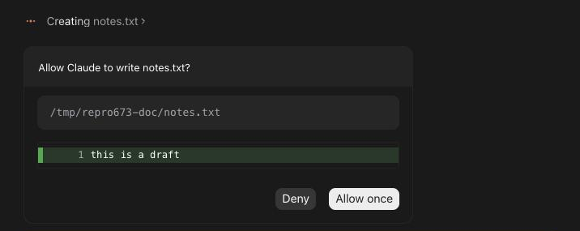
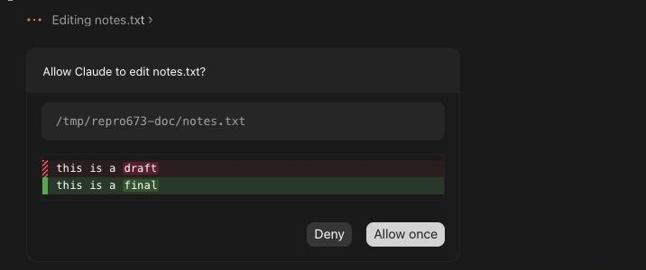
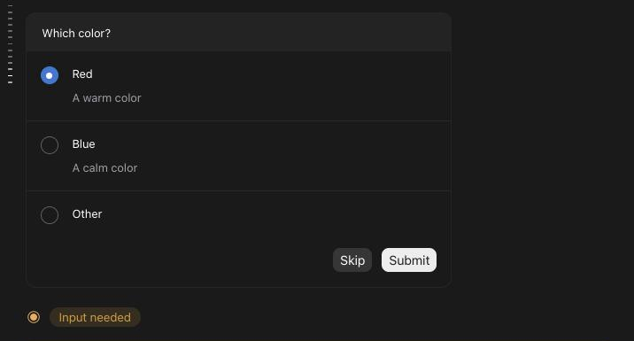
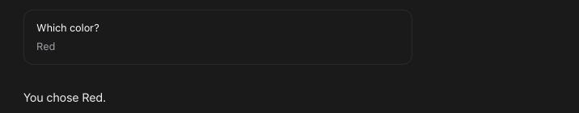
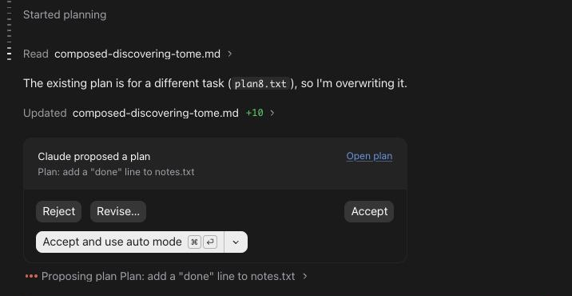
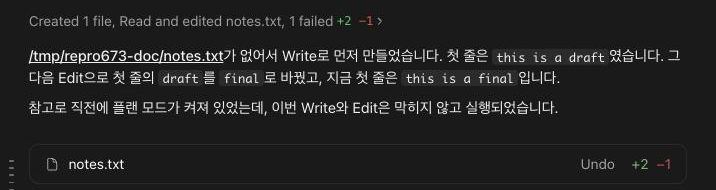

# Permission, question and plan cards that look like Claude Desktop's

> Languages: **English** · [한국어](./ko.md)
>
> Issue: [#673](https://github.com/Swttch/swttch/issues/673)

## What changed

When Claude needs an answer from you, the chat now asks with the same cards Claude Desktop draws. This applies to the **Normal, Thinking and Verbose** views of the chat ([chat views](../102-transcript_view_modes/en.md)). The **Classic** view is untouched and keeps the panels it always had.

The cards are part of the conversation. They sit at the end of the chat, right after Claude's last message, and **the message box stays under them**. What you type there is an ordinary message: it does not answer the card.

While a card waits, a small **Input needed** line appears under it (not under a plan card), and the "scroll to bottom" button says the same if you scrolled up.

## Permission cards

A permission card asks whether Claude may run a command, read a file, search the web, or change a file. The title names the file (`Allow Claude to write notes.txt?`), the box under it shows the path, the command or the search, and the buttons are **Deny** and **Allow once** (with a ▾ menu).

For **Edit** and **Write**, the card shows what would change right inside it. Removed lines are red with a hatched bar, added lines are green with a solid bar, and the words that differ inside a pair of lines are highlighted. A new file shows its lines numbered.

The **▾** menu next to **Allow once** has the other ways to say yes: **Always allow** (saved in the project's local settings, or, for a file change, "switch this session to accept edits") and **Allow and switch to Auto mode**. Whichever one you picked last becomes the first button of the next card, until you close the chat.

- **Several requests in a row.** The cards come one at a time. When you answer one, it disappears, and the next one fades in over about a third of a second.
- **Reloading with a card up.** The card comes back after the chat reloads.
- **Deny.** The change is not made. The line that described it says *stopped*, and when you open it, its box begins with *Interrupted*.

## Question cards

When Claude asks you something with a list of choices, the card shows the question at the top and one row for each option, with the option's name and what it means. A question with a single answer opens with its first option already picked. The last row, **Other**, opens a field for your own answer.

**Skip** answers nothing and the turn goes on. **Submit** (**Next** until the last question) sends the answer. With several questions, the top shows "1 of 3" with arrows to move between them.

After you answer, the card becomes a short summary, one block for each question with your answer under it, or *Skipped*.

## Plan cards

When Claude proposes a plan, the card says **Claude proposed a plan**, names the plan, and has **Open plan**, which opens the plan under the card.

- **Reject** turns the plan down.
- **Revise…** opens a field ("What should change? (optional)") with **Back** and **Revise**. Your note goes back to Claude with the rejection.
- **Accept** accepts the plan and keeps asking before edits. **Accept and use auto mode** (also `⌘↵`) accepts it and switches the session to auto mode.
- The **▾** next to it has **Accept and allow edits**, **Accept and use auto mode** and **Accept and bypass permissions**.

When the chat is narrow, the four buttons stack one under another and fill the width.

The plan itself is one quiet line, "Proposing plan …" while it waits and "Proposed plan …" afterwards, with *Not approved* or *Failed* when it did not go through. Starting to plan is the line "Started planning".

## File changes and the summary card

While Claude works on a file, one line says what it is doing (`Editing notes.txt`, `Creating notes.txt`). When it is done, the line says what happened, and the line opens to show the change. Under Claude's answer, a summary lists the files it changed with their line counts, and **Undo** asks Claude to undo the changes of that turn.

With more than three files, the summary shows three and a **Show all** row that lists the rest with the total; **Show less** folds it again.

**Undo** does not rewind files itself. It sends Claude a message that names every file of the turn and asks it to restore them. You can read that message in the chat, and it is Claude that makes the changes.

## Long messages

A message you sent that runs past about eight lines is folded, with its last line fading out and **Show more** under it. Click it to read the whole message, and **Show less** to fold it again.

## What it does not do

- **The Classic view keeps its own panels.** Nothing above applies there.
- **"Open plan" opens the plan under the card.** Claude Desktop opens it in a pane beside the chat, which this chat does not have.
- **After a reload, a card is active at once.** Claude Desktop shows the returning card dimmed and unclickable for about ten seconds first. Waiting without a reason would only get in your way, so this chat does not copy it.
- **Cards for web fetches, MCP tools and sub-agents** use the same frame as the others, but were not compared with Claude Desktop's own, because Claude Desktop did not ask about them in the recordings we measured from.
