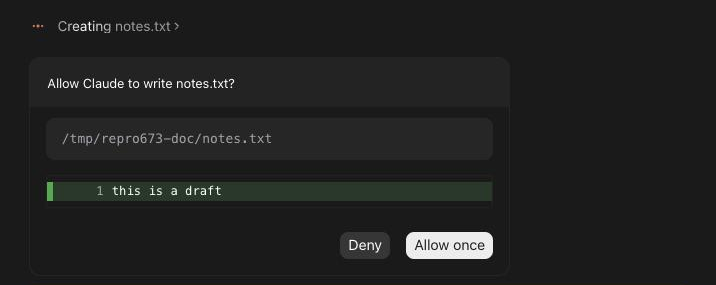
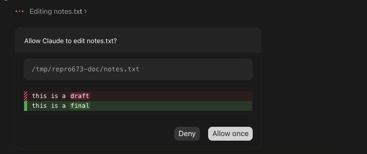
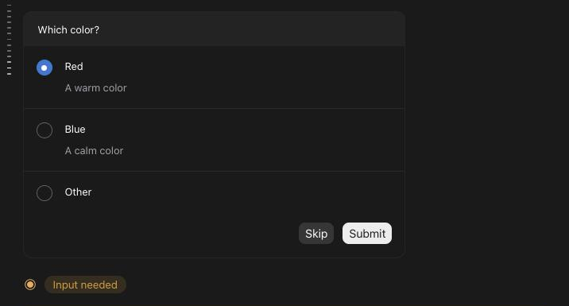
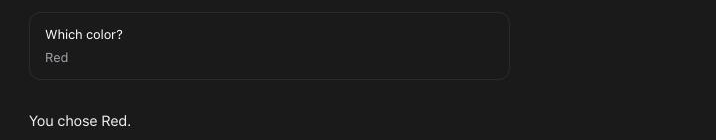
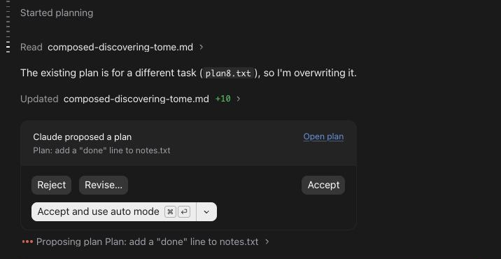
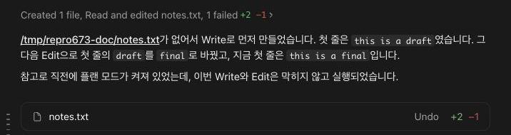

# 권한·질문·계획 카드를 Claude 데스크탑처럼

> Languages: [English](./en.md) · **한국어**
>
> Issue: [#673](https://github.com/Swttch/swttch/issues/673)

## 새로 달라진 것

Claude가 사용자의 답이 필요할 때, 채팅이 Claude 데스크탑 앱이 그리는 것과 같은 카드로 묻습니다. **일반, 생각, 자세히** 보기에 적용됩니다([대화 보기](../102-transcript_view_modes/ko.md)). **클래식** 보기는 손대지 않았고 지금까지의 패널 그대로입니다.

카드는 대화의 일부입니다. 채팅 맨 끝, Claude의 마지막 메시지 바로 뒤에 놓이고 **메시지 입력창은 카드 아래에 그대로 남습니다.** 입력창에 쓴 글은 평범한 메시지이고, 카드에 대한 답이 되지 않습니다.

카드가 답을 기다리는 동안 카드 아래에 **입력이 필요합니다** 줄이 뜹니다(계획 카드 아래에는 뜨지 않습니다). 위로 스크롤해 있으면 "맨 아래로" 버튼도 같은 말을 합니다.

## 권한 카드

권한 카드는 Claude가 명령을 실행하거나, 파일을 읽거나, 웹을 검색하거나, 파일을 바꿔도 되는지 묻습니다. 제목에 대상 파일이 나오고(`notes.txt 파일에 쓰도록 허용하시겠습니까?`), 아래 상자에 경로·명령·검색어가 나오고, 버튼은 **거부**와 **한 번만 허용**(▾ 메뉴 포함)입니다.

**Edit**과 **Write**는 바뀔 내용을 카드 안에 바로 보여 줍니다. 지워지는 줄은 빗금 막대가 있는 빨간색, 더해지는 줄은 막대가 꽉 찬 초록색이고, 짝이 된 두 줄에서 서로 다른 단어는 강조됩니다. 새 파일은 줄 번호가 붙습니다.

**한 번만 허용** 옆의 **▾** 메뉴에 다른 허용 방법이 있습니다. **항상 허용**(프로젝트의 로컬 설정에 저장되며, 파일 변경이면 "이 세션을 편집 수락 모드로 전환")과 **허용하고 Auto 모드로 전환**입니다. 마지막에 고른 항목이 다음 카드의 첫 버튼이 되고, 채팅을 닫을 때까지 기억합니다.

- **요청이 연달아 올 때.** 카드는 하나씩 뜹니다. 하나에 답하면 그 카드가 사라지고, 다음 카드가 약 0.3초에 걸쳐 나타납니다.
- **카드가 떠 있는 채로 새로고침.** 채팅이 다시 열리면 카드가 다시 뜹니다.
- **거부.** 변경은 일어나지 않습니다. 변경을 설명하던 줄에는 *중지됨*이 붙고, 줄을 열면 상자 맨 위에 *중단됨*이 나옵니다.

## 질문 카드

Claude가 선택지를 주고 물으면, 카드 맨 위에 질문이 나오고 선택지마다 한 줄씩 이름과 설명이 나옵니다. 답이 하나인 질문은 첫 선택지가 미리 골라진 채로 열립니다. 마지막 줄 **기타**는 직접 쓸 입력칸을 엽니다.

**건너뛰기**는 아무것도 답하지 않고 턴은 이어집니다. **제출**(마지막 질문 전까지는 **다음**)은 답을 보냅니다. 질문이 여럿이면 맨 위에 "3개 중 1번째"와 이동 화살표가 나옵니다.

답한 뒤 카드는 짧은 요약으로 바뀝니다. 질문마다 한 블록이고 그 아래에 사용자의 답이, 건너뛴 질문은 *건너뜀*이 나옵니다.

## 계획 카드

Claude가 계획을 제안하면 카드에 **Claude가 계획을 제안했습니다**와 계획의 이름이 나오고, **계획 열기**는 카드 아래에 계획을 펼칩니다.

- **거부**는 계획을 돌려보냅니다.
- **수정…**은 입력칸("무엇을 변경해야 하나요? (선택사항)")과 **뒤로**, **수정** 버튼을 엽니다. 쓴 글은 거부와 함께 Claude에게 돌아갑니다.
- **수락**은 계획을 받아들이고 편집 전에 계속 묻습니다. **수락 및 자동 모드 사용**(`⌘↵`도 같음)은 받아들이고 세션을 자동 모드로 바꿉니다.
- 그 옆 **▾**에는 **수락 및 편집 허용**, **수락 및 자동 모드 사용**, **수락 및 권한 우회**가 있습니다.

채팅이 좁으면 네 버튼이 세로로 쌓이고 폭을 꽉 채웁니다.

계획 자체는 한 줄입니다. 기다리는 동안은 "계획 제안 중 …", 끝난 뒤에는 "계획 제안됨 …"이고, 통과하지 못했으면 *승인되지 않음*이나 *실패*가 붙습니다. 계획을 시작하는 것은 "계획 시작됨" 줄입니다.

## 파일 변경과 요약 카드

Claude가 파일을 다루는 동안 한 줄이 하는 일을 말합니다(`notes.txt 편집 중`, `notes.txt 생성 중`). 끝나면 줄이 일어난 일을 말하고, 줄을 열면 변경이 보입니다. Claude의 답 아래에는 바뀐 파일과 줄 수를 담은 요약이 있고, **실행 취소**는 그 턴의 변경을 되돌려 달라고 Claude에게 요청합니다.

파일이 셋을 넘으면 요약은 셋만 보이고 나머지는 합계와 함께 **모두 보기**로 펼칩니다. **간략히 보기**로 다시 접습니다.

**실행 취소**는 파일을 직접 되감지 않습니다. 그 턴의 모든 파일 이름을 적어 복원해 달라고 Claude에게 메시지를 보냅니다. 그 메시지는 채팅에서 읽을 수 있고, 변경은 Claude가 합니다.

## 긴 메시지

보낸 메시지가 8줄쯤을 넘으면 접히고, 마지막 줄이 흐려지며 아래에 **더 보기**가 나옵니다. 누르면 전체가 보이고, **간략히 보기**로 다시 접습니다.

## 하지 않는 것

- **클래식 보기는 자기 패널을 그대로 씁니다.** 위 내용이 적용되지 않습니다.
- **"계획 열기"는 카드 아래에 계획을 펼칩니다.** Claude 데스크탑은 채팅 옆 창에 열지만, 이 채팅에는 그런 창이 없습니다.
- **새로고침 뒤 카드는 바로 눌립니다.** Claude 데스크탑은 돌아온 카드를 약 10초 동안 흐리게 두고 누를 수 없게 합니다. 이유 없이 기다리게 하면 불편하기만 해서 따라 하지 않았습니다.
- **웹 가져오기, MCP 도구, 서브에이전트 카드**는 다른 카드와 같은 틀을 쓰지만 Claude 데스크탑의 카드와 대조하지 않았습니다. 측정한 녹화에서 Claude 데스크탑이 그 요청들을 묻지 않았기 때문입니다.
