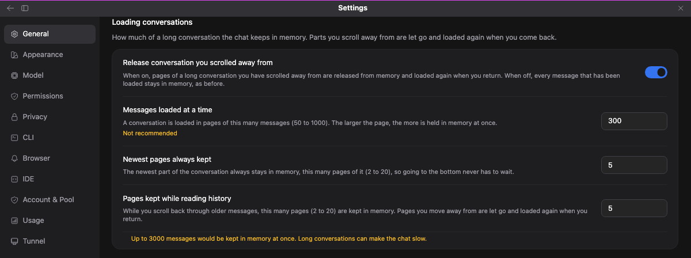
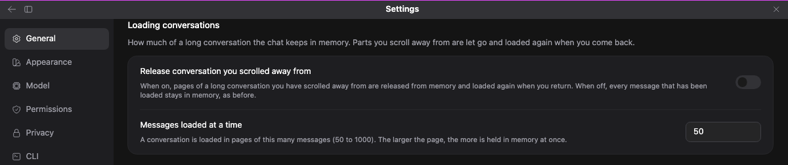

# Long conversations stay responsive: the chat lets go of the parts you scrolled away from

> Languages: **English** · [한국어](./ko.md)
>
> Issue: [#680](https://github.com/Swttch/swttch/issues/680)

## What changed

A conversation with thousands of messages used to freeze the chat for seconds at a time, and the panel's memory kept growing the longer you scrolled. The chat now holds only a window of the conversation in memory and lets go of the rest. Nothing is deleted: the conversation stays in Claude Code's session file, and what you scrolled away from is loaded again when you come back to it.

You do not have to do anything. It is on by default, and a long conversation looks and scrolls the way it did before. What you notice is that scrolling and typing stay smooth, and that the chat slows down much less while Claude is replying.

## What the chat keeps in memory

A conversation is read in **pages** of 50 messages. The chat keeps two groups of pages:

- **The newest pages (5 by default).** They are always kept, so going to the bottom of the conversation never has to wait.
- **The pages around where you are reading (5 by default).** When you scroll back through older messages, the pages you are reading and the ones next to them are kept. The pages are loaded one step before you reach them, so you do not wait at the edge.

With the defaults that is up to **500 messages** in memory at once, however long the conversation is. A page you move away from is let go of, and loaded again when you return to it.

Three things you may notice:

- **Your place does not move.** When pages are added above what you are reading, or pages at the top are let go of, the chat holds the first message in view where it was, so the text under your eyes does not jump.
- **Jumping far works.** Choosing a message in the send index (the rail of your sent messages) loads the part of the conversation around that message, even if it was let go of.
- **While Claude replies, only the new text is drawn.** Long conversations used to redraw every message held in memory for each piece of the reply. Now only the part that changed is redrawn.

## The settings

**Settings → General → Loading conversations** has four rows. They apply to the whole app, so on the Project tab they are dimmed and show the value in use ([how the Project tab shows inherited settings](../089-project_tab_shows_inherited_settings/en.md)).

| Row | Default | Range | What it does |
|-----|---------|-------|--------------|
| **Release conversation you scrolled away from** | On | On / Off | On: pages you are far from are let go of. Off: every message that has been loaded stays in memory. |
| **Messages loaded at a time** | 50 | 50 to 1000 | The size of one page. A bigger page means more in memory at once. |
| **Newest pages always kept** | 5 | 2 to 20 | How many of the newest pages are never let go of. |
| **Pages kept while reading history** | 5 | 2 to 20 | How many pages follow you while you read older messages. |

Type a number and press **Enter**, or click out of the field, to save it. A number outside the range is brought to the nearest allowed value. A change to the page counts applies at once to the conversation that is open. A new page size applies to the pages loaded from then on.

The line under the rows adds the three numbers up (page size × (newest pages + pages while reading history)), because that sum is what decides how heavy the chat is. It turns amber above 2000 messages:

A page size above 200 is accepted but marked **Not recommended**: the bigger the page, the more of the conversation is in memory and drawn at once.

### Turning the release off

If the pages coming and going bother you, turn **Release conversation you scrolled away from** off. Nothing is let go of any more: every message the chat has loaded stays in memory, and older pages are still loaded as you scroll up. The rows for the page counts and the total are hidden, because they only mean something while pages are let go of. **Messages loaded at a time** stays.

With the release off, a very long conversation gets heavy again the longer you read, which is what this change was made to fix. Use it for a reader who prefers that to the pages being let go of.

## The old "Paginate chat history" switch is gone

The switch **Paginate chat history** is no longer in Settings. Its job was to choose between loading the conversation a page at a time and loading all of it at once, and loading all of it at once is what made long conversations freeze. If you had it off and want that behavior, turn **Release conversation you scrolled away from** off and set **Messages loaded at a time** to 1000. The chat still opens at the bottom and loads older pages as you scroll up, 1000 messages at a time.

## What this does not do

- **It does not delete or shorten anything.** Only the chat's memory is trimmed. The session file, the session list and what Claude sees are unchanged.
- **Text you scrolled away from is not on the page, but the chat's own find still reaches it.** While a part of the conversation is let go of, a find built into the browser or the IDE does not see it. The chat's find (**Cmd+F** / **Ctrl+F**, [search the conversation](../095-find_in_chat/en.md)) searches the whole conversation and loads the part around the match you move to.
- **It does not change the session list.** How the session list loads is described in [the session list loads a page at a time](../055-session_list_loads_a_page_at_a_time/en.md).
- **A short conversation is not affected.** Below the size of the newest pages nothing is ever let go of.
- **The cost does not drop to zero while the release is off.** Redrawing while Claude replies is lighter in every mode, but with the release off the number of messages held, and with it the memory, keeps growing as you read.

## If the chat still feels slow

1. Open **Settings → General → Loading conversations** and check the line under the rows. If it is amber, lower **Messages loaded at a time** or the page counts.
2. Check that **Release conversation you scrolled away from** is on.
3. If it is still slow, report it with the length of the conversation (the number of messages), the chat view you use ([chat views](../102-transcript_view_modes/en.md)) and where you run the chat (a JetBrains IDE or the standalone chat). The IDE's name and version help as well.
