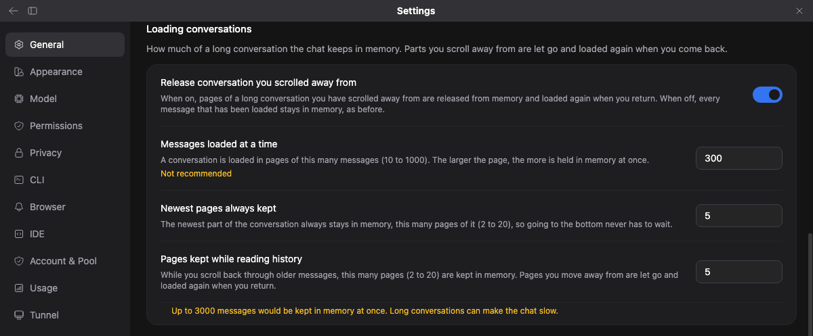
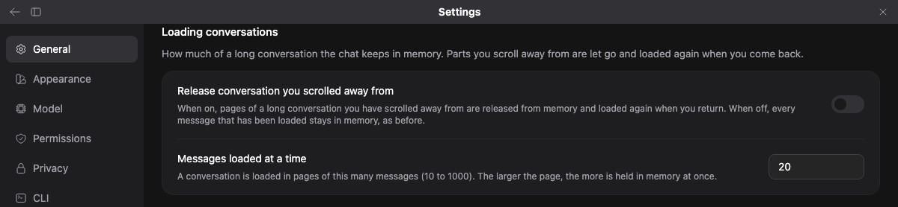

# 긴 대화에서도 채팅이 멈추지 않습니다: 스크롤해서 멀어진 부분은 비웁니다

> Languages: [English](./en.md) · **한국어**
>
> Issue: [#680](https://github.com/Swttch/swttch/issues/680)

## 새로 달라진 것

메시지가 수천 개 쌓인 대화에서는 채팅이 몇 초씩 멈추기도 했고, 위로 스크롤할수록 패널이 쓰는 메모리가 계속 늘었습니다. 이제 채팅은 대화의 일부(창)만 메모리에 두고 나머지는 비웁니다. 지워지는 것은 없습니다. 대화는 Claude Code의 세션 파일에 그대로 있고, 스크롤해서 멀어졌던 부분은 다시 돌아오면 새로 불러옵니다.

사용자가 할 일은 없습니다. 기본으로 켜져 있고, 긴 대화도 전과 같은 모습으로 같은 방식으로 스크롤됩니다. 달라지는 점은 스크롤과 입력이 부드럽게 유지되고, Claude가 답하는 동안 채팅이 느려지는 정도가 훨씬 줄었다는 것입니다.

## 채팅이 메모리에 두는 것

대화는 메시지 20개씩의 **페이지**로 읽어 옵니다. 여기서 메시지는 사용자가 보낸 말과 Claude의 답변, 도구 호출입니다. 도구 실행 결과와 Claude Code가 세션 파일에 함께 남기는 기록은 개수에 넣지 않고, 사이에 있는 그대로 페이지에 실려 옵니다. 채팅은 페이지를 두 묶음으로 둡니다.

- **가장 최근 페이지(기본 5개).** 항상 유지합니다. 그래서 대화의 맨 아래로 갈 때는 기다리지 않습니다.
- **지금 읽는 곳 둘레의 페이지(기본 5개).** 위로 스크롤해 지난 메시지를 읽는 동안, 읽고 있는 페이지와 그 이웃 페이지를 유지합니다. 페이지는 화면 끝에 닿기 한 걸음 전에 미리 불러오므로 끝에서 기다리지 않습니다.

기본값이면 대화가 아무리 길어도 메모리에는 최대 **메시지 200개**가 올라옵니다. 멀어진 페이지는 비우고, 다시 그곳으로 돌아오면 불러옵니다.

눈에 띄는 점이 세 가지 있습니다.

- **보던 자리가 움직이지 않습니다.** 읽는 곳 위쪽에 페이지가 붙거나 맨 위의 페이지가 비워질 때, 채팅은 화면에 처음 보이는 메시지를 있던 자리에 붙잡아 둡니다. 그래서 눈앞의 글이 튀지 않습니다.
- **멀리 건너뛰어도 됩니다.** 전송 목차(내가 보낸 메시지 줄)에서 메시지를 고르면, 비워졌던 곳이라도 그 메시지 둘레의 대화를 불러옵니다. 지금 읽는 곳 둘레에 두는 페이지(기본 5개)를 한 번에 불러오므로, 도착하자마자 위아래를 이어서 읽을 수 있습니다.
- **Claude가 답하는 동안 새 글만 그립니다.** 긴 대화에서는 답의 조각이 올 때마다 메모리에 있는 모든 메시지를 다시 그렸습니다. 이제 바뀐 부분만 다시 그립니다.

## 설정

**설정 → 일반 → 대화 불러오기**에 행이 네 개 있습니다. 앱 전체에 적용되는 설정이라 프로젝트 탭에서는 흐리게 잠기고 적용 중인 값을 보여줍니다([프로젝트 탭이 물려받은 설정을 보여주는 방식](../089-project_tab_shows_inherited_settings/ko.md)).

| 행 | 기본값 | 범위 | 하는 일 |
|----|--------|------|---------|
| **스크롤해 멀어진 대화 비우기** | 켜짐 | 켜짐 / 꺼짐 | 켜면 멀어진 페이지를 비웁니다. 끄면 불러온 메시지를 모두 메모리에 둡니다. |
| **한 번에 불러올 메시지 수** | 20 | 10~1000 | 페이지 하나의 크기입니다. 페이지가 클수록 한 번에 메모리에 올라오는 양이 늘어납니다. |
| **항상 유지할 최근 페이지 수** | 5 | 2~20 | 가장 최근 페이지 중 절대 비우지 않는 개수입니다. |
| **과거를 볼 때 유지할 페이지 수** | 5 | 2~20 | 지난 메시지를 읽는 동안 따라다니는 페이지 개수입니다. |

숫자를 입력하고 **Enter**를 누르거나 입력칸 밖을 누르면 저장됩니다. 범위를 벗어난 숫자는 가장 가까운 허용값으로 바뀝니다. 페이지 개수를 바꾸면 열려 있는 대화에 바로 적용됩니다. 새 페이지 크기는 그때부터 불러오는 페이지에 적용됩니다.

행 아래 줄은 세 숫자를 곱해 더한 값(페이지 크기 × (최근 페이지 수 + 과거를 볼 때 페이지 수))을 알려 줍니다. 채팅이 얼마나 무거워지는지는 이 합계가 정하기 때문입니다. 메시지가 2000개를 넘으면 호박색으로 바뀝니다.

페이지 크기가 50을 넘으면 받아들이되 **권장하지 않음**이라고 표시합니다. 페이지가 클수록 한 번에 메모리에 올라오고 그려지는 대화가 늘어나기 때문입니다.

### 비우기를 끄려면

페이지가 오가는 것이 거슬리면 **스크롤해 멀어진 대화 비우기**를 끄세요. 더는 아무것도 비우지 않습니다. 채팅이 불러온 메시지는 모두 메모리에 남고, 위로 스크롤하면 이전 페이지는 계속 불러옵니다. 페이지 개수와 합계 줄은 페이지를 비울 때만 뜻이 있으므로 감춰집니다. **한 번에 불러올 메시지 수**는 남습니다.

비우기를 끄면, 이 변경이 고치려던 문제처럼 아주 긴 대화에서 읽을수록 다시 무거워집니다. 페이지가 비워지는 것보다 그쪽을 선호하는 사용자를 위한 선택지입니다.

## 예전의 "Paginate chat history" 스위치는 없어졌습니다

설정에서 **Paginate chat history** 스위치가 사라졌습니다. 그 스위치는 대화를 페이지씩 불러올지 한 번에 전부 불러올지 고르는 것이었고, 한 번에 전부 불러오는 쪽이 긴 대화를 멈추게 하던 원인입니다. 그 스위치를 꺼 두었고 같은 동작을 원한다면 **스크롤해 멀어진 대화 비우기**를 끄고 **한 번에 불러올 메시지 수**를 1000으로 두세요. 채팅은 여전히 맨 아래에서 열리고, 위로 스크롤하면 1000개씩 이전 페이지를 불러옵니다.

## 하지 않는 것

- **아무것도 지우거나 줄이지 않습니다.** 줄이는 것은 채팅의 메모리뿐입니다. 세션 파일, 세션 목록, Claude가 보는 내용은 그대로입니다.
- **스크롤해 멀어진 글은 페이지에 없지만, 채팅의 찾기는 그곳까지 찾습니다.** 대화의 어떤 부분이 비워진 동안에는 브라우저나 IDE에 내장된 찾기가 그 부분을 찾지 못합니다. 채팅의 찾기(**Cmd+F** / **Ctrl+F**, [대화 검색](../095-find_in_chat/ko.md))는 대화 전체를 검색하고, 이동한 일치 항목 둘레의 대화를 불러옵니다.
- **세션 목록은 바꾸지 않습니다.** 세션 목록을 불러오는 방식은 [세션 목록은 한 번에 한 페이지씩 불러옵니다](../055-session_list_loads_a_page_at_a_time/ko.md)에 있습니다.
- **짧은 대화에는 영향이 없습니다.** 최근 페이지로 두는 크기보다 짧으면 아무것도 비우지 않습니다.
- **비우기를 끄면 비용이 0으로 내려가지는 않습니다.** Claude가 답하는 동안 다시 그리는 양은 어느 모드에서나 줄었지만, 비우기를 끄면 읽을수록 메모리에 올라온 메시지 수와 메모리가 계속 늘어납니다.

## 그래도 채팅이 느리다면

1. **설정 → 일반 → 대화 불러오기**를 열어 행 아래 줄을 확인하세요. 호박색이면 **한 번에 불러올 메시지 수**나 페이지 개수를 줄이세요.
2. **스크롤해 멀어진 대화 비우기**가 켜져 있는지 확인하세요.
3. 그래도 느리면 대화의 길이(메시지 수), 쓰는 채팅 보기([대화 보기](../102-transcript_view_modes/ko.md)), 채팅을 실행하는 곳(JetBrains IDE인지 독립 실행 채팅인지)을 적어 제보해 주세요. IDE의 이름과 버전도 도움이 됩니다.
