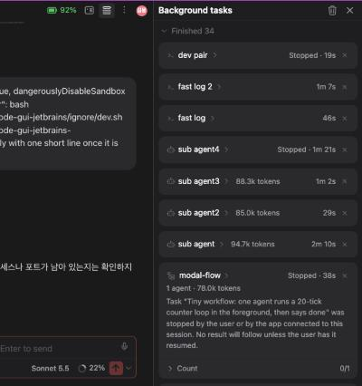
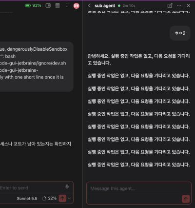
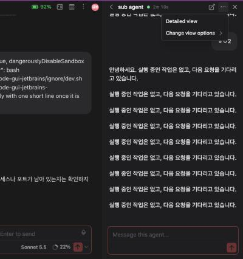
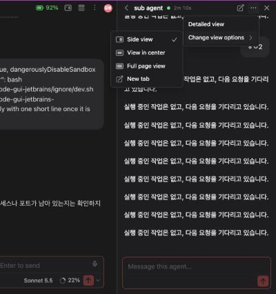
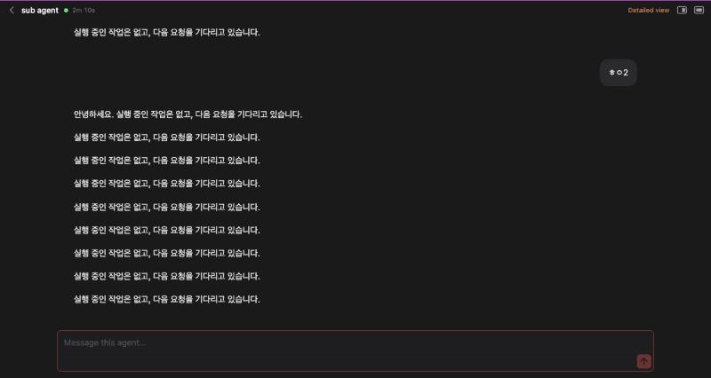
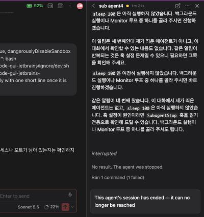

# Open a subagent's run in the side panel, in the center, on its own page or in a new tab

> Languages: **English** · [한국어](./ko.md)
>
> Issue: [#667](https://github.com/Swttch/swttch/issues/667)

## What changed

A subagent is a helper that Claude starts to do one piece of a job on its own (for example, "search the code for X"). A **background task** is the same idea for something that keeps running while you chat: a subagent, a workflow, or a command in the background. Until now, the only way to look inside one was a pop-up window in the middle of the chat.

Now you can look inside a run in four places, and you pick where it opens:

| Place | What it is |
|-------|------------|
| **Side view** | Inside the **Background tasks** panel, replacing its list, with a back arrow to return to the list |
| **View in center** | The pop-up window over the chat (what used to be the only choice) |
| **Full page view** | The run fills the whole tab, with an arrow to go back to the session |
| **New tab** | The run opens in a tab of its own (an editor tab in JetBrains, a browser tab in the browser) |

Everything below works the same for a subagent, a workflow and a background command, except where it says otherwise.

## The Background tasks panel

Open the panel from the **Background tasks** button in the top bar. It lists every task of the session: the ones still running first, then the finished ones.

When the window is wide enough, the panel takes a column of its own beside the chat, and the chat gives up that width instead of being covered. The rule is the same as for the file preview pane. When the window is too narrow for both, the panel floats over the chat, as it did before. The chat never shrinks below its minimum width, so a very wide panel stops where the chat would become too narrow.

You can **drag the panel's left edge** to make it wider or narrower (the narrowest is 250 px). **Double-click** the edge to go back to the default width. The width you chose is kept until you reload the page, and it is not saved between visits.

## Opening a run in the side panel

Click a task in the list, or click the subagent's line in the chat. By default the run opens **inside the panel**, in place of the list.

From left to right, the header has:

- a **back arrow** that returns to the list of tasks,
- the **name** of the run, and its **status**: a green dot and the elapsed time while it runs, and *Completed*, *Failed* or *Stopped* afterwards,
- a round **stop button** with a blue arc turning around it while a task is running, which stops the task,
- an **Open in new tab** icon,
- a **"..." (More)** button,
- a **close** button, which closes the whole panel.

Under the header you read the run itself: what Claude asked the agent to do, what the agent said and did, and its result. At the bottom there is a message box, so you can **send a message to the agent** while it works. The message appears in the run right away, and the agent reads it the way it would read a message from Claude.

## The "..." menu: simple view, detailed view and where runs open

The **"..." (More)** button has two entries.

- **Detailed view / Simple view.** The simple view shows the conversation and short lines for what the agent did. The detailed view shows the tool calls and their output in full. The row names the view you would switch **to**.
- **Change view options** opens a second menu with the four places a run can open.

Pick one and the run moves there at once. A check mark shows where it is open now. Point at an entry and a **Make default** action appears; it makes that place the default for **this project**, so every later run opens there. When a place is the default, the same action reads **Unpin**, and it puts things back to the normal behavior (Side view). The default is stored in the project's settings as `runViewPlacement`.

## View in center

**View in center** is the pop-up window over the chat. Its header has the **Detailed view / Simple view** button, an **Open in new tab** icon, an icon that moves the run to the **side panel**, and a close button.

## Full page view and New tab

**Full page view** and **New tab** show the run on a page of its own. The page has the run's name and status at the top, a **back arrow** (it goes back to the session you came from), the **Detailed view** button, an icon to move the run back to the side panel, the run itself, and the message box at the bottom.

- **Where the page comes from.** The page does not need the chat to be open. It reads the run's record straight from the session's saved files, and it keeps updating while the run is still working.
- **In the browser (standalone mode).** **New tab** opens a new browser tab. Where pop-up tabs are blocked (the built-in preview pane of a desktop app, for example), the run opens in the current tab instead, and the back arrow returns you to the session.
- **In JetBrains.** **New tab** opens an editor tab. Opening the same run again does not make a second tab: it switches to the one that is already open. The tab is named after the run.
- **A run that cannot be found.** If the session no longer has that run, the page says *This run could not be found in the session.* and offers **Back to the session**.
- **Narrow tabs.** When the tab is narrow, the title row folds some of its pieces away so that the buttons stay usable.

## When the agent is no longer there

A stopped or finished agent cannot take messages. Instead of an empty message box, a bar covers its place: **This agent's session has ended — it can no longer be reached.**

If the agent produced no result, the run says why: **No result. The agent failed.**, **No result. The agent was stopped.** or **No result. The agent ended.** A workflow that failed shows its error in a banner under the header.

## Messages sent to agents

When Claude sends a message to a subagent, the chat shows a line such as **Messaged agent** (and **Messaging agent** while it is going out). A message to another session reads **Messaging another session**. The agent's name in that line is a link that opens the run.

## Workflows and commands

A background **workflow** and a background **command** open in the same panel, window and page. A workflow lists its agents side by side and shows its result; a command shows its log with a simple and a detailed view, and the log keeps updating while the command writes to it.

## What this does not do

- **The side-panel width is not saved.** It is forgotten when you reload the page, and the drag handle cannot be moved with the keyboard.
- **"Ended" means the task's status says so.** There is no separate signal for "the session was closed", so an agent counts as ended when its task is stopped.
- **The Classic view of the chat** is unchanged. The new message lines and cards appear in the Normal, Thinking and Verbose views ([chat views](../102-transcript_view_modes/en.md)).
- **Messages to a stopped workflow's agents** follow the same rule as a single agent: the box is covered. We did not test whether such a message could still reach the agent.
- **Inside a JetBrains IDE** the editor tab, its reuse and its title are covered by unit tests, but nobody had checked them by hand inside the IDE when this page was written.
- Some of the new text in Arabic, Persian, Russian and Chinese (Simplified and Traditional) was written by us and has not been checked by a native speaker. The other languages use the wording of the Claude desktop app.
