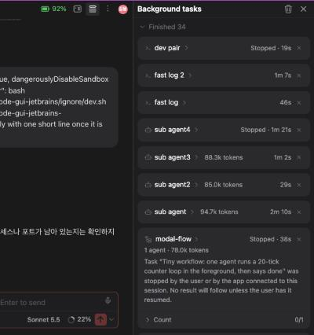
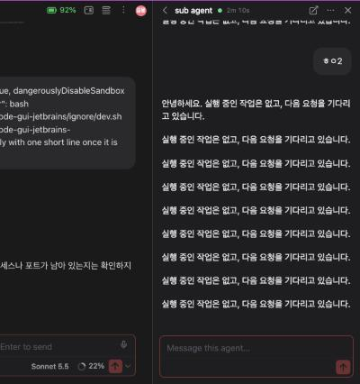
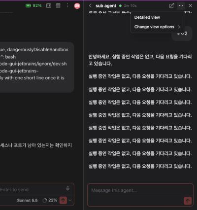
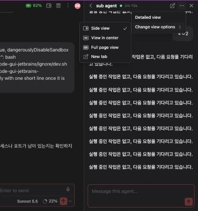
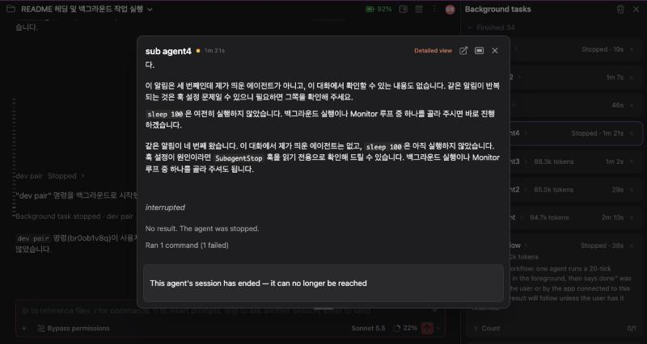
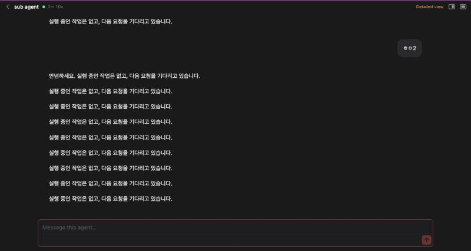
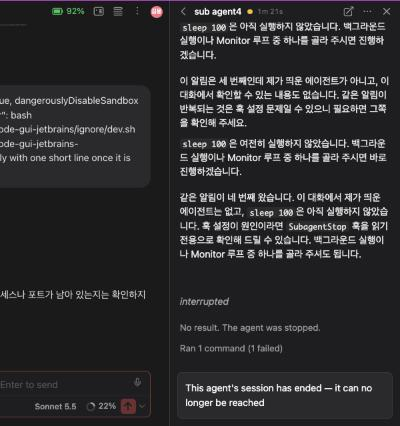

# 서브에이전트 실행을 옆 패널, 가운데 창, 전용 페이지, 새 탭에서 열기

> Languages: [English](./en.md) · **한국어**
>
> Issue: [#667](https://github.com/Swttch/swttch/issues/667)

## 무엇이 바뀌었나

서브에이전트는 Claude가 작업의 한 부분을 따로 맡기려고 띄우는 도우미입니다(예: "코드에서 X를 찾아 줘"). **백그라운드 작업**은 대화하는 동안 계속 도는 것을 가리키는 더 넓은 말이고, 서브에이전트, 워크플로, 백그라운드 명령이 여기에 들어갑니다. 지금까지 이것들의 속을 들여다보는 방법은 채팅 가운데에 뜨는 창 하나뿐이었습니다.

이제 실행 하나를 네 군데에서 열 수 있고, 어디에서 열지는 직접 고릅니다.

| 자리 | 무엇인가 |
|------|----------|
| **옆에서 보기** | **백그라운드 작업** 패널 안입니다. 목록 자리에 실행이 뜨고, 뒤로 가기 화살표로 목록에 돌아옵니다 |
| **가운데에서 보기** | 채팅 위에 뜨는 창입니다(전에는 이것 하나뿐이었습니다) |
| **전체 페이지로 보기** | 실행이 탭 전체를 차지하고, 화살표로 세션으로 돌아갑니다 |
| **새 탭** | 실행이 자기 탭에서 열립니다(JetBrains에서는 에디터 탭, 브라우저에서는 브라우저 탭) |

아래 내용은 따로 적은 곳을 빼고 서브에이전트, 워크플로, 백그라운드 명령에 똑같이 적용됩니다.

## 백그라운드 작업 패널

위쪽 막대의 **백그라운드 작업** 버튼으로 패널을 엽니다. 패널에는 세션의 작업이 모두 나옵니다. 아직 도는 것이 먼저, 끝난 것이 그 뒤입니다.

창이 충분히 넓으면 패널이 채팅 옆에 자기 열을 차지하고, 채팅이 패널에 덮이는 대신 그만큼 폭을 내줍니다. 기준은 파일 미리보기 창과 같습니다. 창이 좁아서 둘이 함께 들어가지 않으면 전처럼 패널이 채팅 위에 떠 있습니다. 채팅은 최소 폭 아래로 줄지 않으므로, 패널을 아주 넓히면 채팅이 너무 좁아지는 지점에서 멈춥니다.

패널의 **왼쪽 가장자리를 끌어서** 폭을 넓히거나 좁힐 수 있습니다(가장 좁게는 250px). 가장자리를 **더블클릭**하면 기본 폭으로 돌아갑니다. 정한 폭은 페이지를 새로 고치기 전까지 유지되고, 다음 방문까지 저장되지는 않습니다.

## 실행을 옆 패널에서 열기

목록에서 작업을 누르거나 채팅에 나온 서브에이전트 줄을 누릅니다. 기본으로는 실행이 **패널 안**에서 목록 자리에 열립니다.

머리 줄은 왼쪽부터 다음과 같습니다.

- 작업 목록으로 돌아가는 **뒤로 가기 화살표**
- 실행의 **이름**과 **상태**: 도는 동안은 초록 점과 지난 시간, 끝난 뒤에는 *Completed*, *Failed*, *Stopped*
- 작업이 도는 동안 파란 호가 둘레를 도는 동그란 **정지 버튼**(누르면 작업을 멈춥니다)
- **새 탭에서 열기** 아이콘
- **"..."(더보기)** 버튼
- 패널 전체를 닫는 **닫기** 버튼

머리 줄 아래에서는 실행 내용을 읽습니다. Claude가 에이전트에게 시킨 일, 에이전트가 말하고 한 일, 그 결과입니다. 맨 아래에는 입력창이 있어서 에이전트가 일하는 동안 **에이전트에게 메시지를 보낼** 수 있습니다. 보낸 메시지는 바로 실행 안에 나타나고, 에이전트는 Claude가 보낸 메시지처럼 읽습니다.

## "..." 메뉴: 간단히 보기, 자세히 보기, 열리는 자리

**"..."(더보기)** 버튼에는 항목이 두 개 있습니다.

- **Detailed view / Simple view.** 간단히 보기는 대화와, 에이전트가 한 일을 짧은 줄로 보여 줍니다. 자세히 보기는 도구 호출과 그 출력을 전부 보여 줍니다. 항목 이름은 지금 보는 쪽이 아니라 **바꿔서 갈 쪽**입니다.
- **Change view options**는 실행이 열릴 수 있는 네 자리가 있는 두 번째 메뉴를 엽니다.

하나를 고르면 실행이 바로 그 자리로 옮겨 갑니다. 지금 열려 있는 자리에는 체크 표시가 붙습니다. 항목에 마우스를 올리면 **Make default** 동작이 나타나고, 누르면 그 자리가 **이 프로젝트**의 기본이 되어 이후의 모든 실행이 거기서 열립니다. 기본으로 정해진 자리에서는 같은 동작이 **Unpin**으로 바뀌며, 누르면 보통 동작(옆에서 보기)으로 돌아갑니다. 기본값은 프로젝트 설정에 `runViewPlacement`로 저장됩니다.

## 가운데에서 보기

**가운데에서 보기**는 채팅 위에 뜨는 창입니다. 머리 줄에는 **Detailed view / Simple view** 버튼, **새 탭에서 열기** 아이콘, 실행을 **옆 패널**로 옮기는 아이콘, 닫기 버튼이 있습니다.

## 전체 페이지로 보기와 새 탭

**전체 페이지로 보기**와 **새 탭**은 실행을 자기 페이지에 보여 줍니다. 페이지 위쪽에는 실행의 이름과 상태, (왔던 세션으로 돌아가는) **뒤로 가기 화살표**, **Detailed view** 버튼, 실행을 옆 패널로 되돌리는 아이콘이 있고, 그 아래에 실행 내용이, 맨 아래에 입력창이 있습니다.

- **페이지가 내용을 가져오는 곳.** 이 페이지는 채팅이 열려 있을 필요가 없습니다. 세션이 디스크에 저장한 기록에서 실행 내용을 바로 읽고, 실행이 일하는 동안에는 계속 갱신합니다.
- **브라우저(독립 실행 모드).** **새 탭**은 새 브라우저 탭을 엽니다. 팝업 탭이 막힌 곳(예: 데스크탑 앱의 내장 미리보기 창)에서는 실행이 현재 탭에서 열리고, 뒤로 가기 화살표로 세션에 돌아갑니다.
- **JetBrains.** **새 탭**은 에디터 탭을 엽니다. 같은 실행을 다시 열면 탭이 또 생기지 않고 이미 열린 탭으로 이동합니다. 탭 제목은 실행의 이름입니다.
- **찾을 수 없는 실행.** 세션에 그 실행이 더 이상 없으면 페이지에 *This run could not be found in the session.*이 나오고 **Back to the session**이 함께 나옵니다.
- **좁은 탭.** 탭이 좁으면 머리 줄이 일부 요소를 접어서 버튼이 계속 쓸 만하게 남도록 합니다.

## 에이전트가 더 이상 없을 때

멈췄거나 끝난 에이전트는 메시지를 받을 수 없습니다. 빈 입력창 대신, 입력창 자리를 막대가 덮습니다. **This agent's session has ended — it can no longer be reached.**

에이전트가 결과를 내지 못했으면 실행이 이유를 적어 줍니다. **No result. The agent failed.**, **No result. The agent was stopped.**, **No result. The agent ended.** 중 하나입니다. 실패한 워크플로는 머리 줄 아래 배너에 오류를 보여 줍니다.

## 에이전트에게 보낸 메시지

Claude가 서브에이전트에게 메시지를 보내면 채팅에 **Messaged agent** 같은 줄이 나오고(나가는 동안은 **Messaging agent**), 다른 세션에 보낸 메시지는 **Messaging another session**으로 나옵니다. 그 줄의 에이전트 이름은 실행을 여는 링크입니다.

## 워크플로와 명령

백그라운드 **워크플로**와 백그라운드 **명령**도 같은 패널, 창, 페이지에서 열립니다. 워크플로는 에이전트들을 가로로 나란히 보여 주고 결과를 보여 줍니다. 명령은 로그를 간단히 보기와 자세히 보기로 보여 주며, 명령이 로그에 쓰는 동안 로그도 계속 갱신됩니다.

## 하지 않는 것

- **옆 패널의 폭은 저장되지 않습니다.** 페이지를 새로 고치면 잊고, 끄는 손잡이를 키보드로 움직일 수도 없습니다.
- **"끝났다"는 작업의 상태가 그렇다는 뜻입니다.** "세션이 닫혔다"는 별도 신호가 없어서, 작업이 stopped이면 끝난 에이전트로 칩니다.
- **채팅의 클래식 보기**는 바뀌지 않았습니다. 새 메시지 줄과 카드는 일반·생각·자세히 보기에 나옵니다([채팅 보기](../102-transcript_view_modes/ko.md)).
- **멈춘 워크플로의 에이전트에게 보내는 메시지**도 에이전트 하나와 같은 규칙(입력창을 덮음)을 따릅니다. 그런 메시지가 에이전트에게 닿을 수 있는지는 시험하지 못했습니다.
- **JetBrains IDE 안에서** 에디터 탭, 재사용, 제목은 단위 테스트로는 다뤘지만 이 문서를 쓸 때까지 IDE 안에서 직접 확인한 사람이 없습니다.
- 아랍어, 페르시아어, 러시아어, 중국어(간체·번체)의 새 문구 일부는 저희가 직접 썼고 원어민이 검수하지 않았습니다. 나머지 언어는 Claude 데스크탑 앱의 문구를 씁니다.
