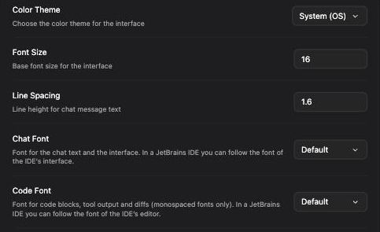
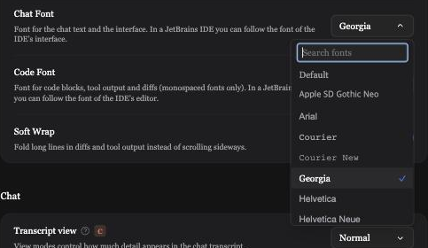
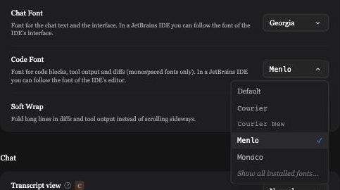

# Choose the font of the chat and the font of code

> Languages: **English** · [한국어](./ko.md)
>
> Issue: [#729](https://github.com/Swttch/swttch/issues/729) · Pull request: [#733](https://github.com/Swttch/swttch/pull/733)

## What changed

Settings → **Appearance** already let you choose the size of the text (**Font Size**) and how far apart the lines are (**Line Spacing**). It now also lets you choose the **typeface**, from two dropdowns:

| Setting | What it changes |
|---------|-----------------|
| **Chat Font** | The text of the chat, and the rest of the interface (settings pages, menus, buttons) |
| **Code Font** | Code blocks, the output of tools and commands, diffs, the file preview, and every other block that was drawn in a monospaced font |

Each dropdown offers **Default**, the fonts installed on your computer, and, in a JetBrains IDE, **Follow IDE**. Before this, the chat always used the system's default fonts, so it could look different from your editor if you read code for hours in a font you like. Now you can make the two match.

## Where to find it

Open **Settings** (the gear in the top bar) → **Appearance**. The two dropdowns sit under **Line Spacing**.

**Default** means "use the built-in font", which is exactly what the chat looked like before this setting existed. You never have to change them.

## Choosing a font

Open **Chat Font**. The list shows **Default**, then the fonts installed on your computer in alphabetical order, **each name written in its own font** so you can see what you are picking. Click one and the whole chat changes at once; the choice is saved.

When the list is long, a **search box** appears at the top: type a part of a name to narrow it. Arrow keys, Enter and Escape work as in any dropdown.

The **Code Font** dropdown lists only **monospaced** fonts (the ones where every letter is as wide as the others), because code lines up only in those.

To go back, choose **Default** in the same dropdown.

### The list in a browser: "Show all installed fonts…"

A web page cannot read the list of fonts on its own. In a JetBrains IDE the plugin gives the chat the list from the system. In a **browser** (standalone mode) the dropdown shows a short list of common fonts that are installed on your computer, and, in browsers that support it (Chrome and Edge), a last entry, **Show all installed fonts…**. Choosing it makes the browser ask your permission to read the font list; if you agree, the dropdown fills with every installed font. If you refuse, nothing changes and the short list stays.

## Follow IDE (JetBrains)

In a JetBrains IDE each dropdown has one more entry, **Follow IDE**:

| Dropdown | **Follow IDE** takes |
|----------|---------------------|
| **Chat Font** | The font of the IDE's own interface (menus, tool windows) |
| **Code Font** | The font of the IDE's **editor** (*Settings → Editor → Font*) |

The font is read when the chat opens, and again whenever the IDE changes its look (when you switch the IDE theme, or turn its custom interface font on or off). **If you only change the editor font, reopen the chat to make it follow.** If the IDE does not give a usable font name (on a Mac the IDE's default interface font is a system-internal one), the built-in font is used.

**Follow IDE does not appear in the browser** (standalone mode), because there is no IDE there to follow.

## Limits and good-to-know

- **The font has to be installed on your computer.** The chat is a web page, and a web page can only use fonts the system can see. A font that **ships inside the IDE** (JetBrains Mono, for example) is drawn by the IDE from its own copy, which the chat cannot see. **Follow IDE** therefore needs that font to be installed on the computer too; if it is not, the chat shows the built-in font instead. To fix it, install the font from its download page and reopen the chat.
- **The lists only offer fonts the chat can really draw.** A name that would change nothing (not installed, or only known to the IDE) is left out, so every entry in the dropdown does something.
- **Chat Font reaches the whole interface**, not only the messages, so the settings pages and menus use it too.
- **Font Size and Line Spacing are separate.** A different typeface can look larger or smaller at the same size; adjust **Font Size** if needed.
- **Project settings can override it.** In **Project Settings (Local)** you can set a different font for one project; the row then wears a badge with a link that returns it to your user setting.
- **Languages.** The font applies to text of every language, but a font that has no glyphs for a script (for example a Latin-only code font for Korean text) is skipped for those characters, and the built-in font draws them.
- **A font that is already in your settings file but is not in the list** (for example one you wrote there by hand) is still shown in the dropdown, so the box always says what is in effect.

## Questions

**I chose a font and nothing seems to have changed.**
Some fonts look alike at small sizes. Check the dropdown shows your choice. If the font was removed from the computer later, the chat quietly uses the built-in font.

**The font is not in the list.**
It is not installed on this computer, or the browser has not shared the full list yet (choose **Show all installed fonts…**). Install the font and reopen the chat.

**The font changed in the settings page but not in some block of code.**
Every block that was drawn in a monospaced font follows **Code Font**. If you find one that does not, please report it with a screenshot.

**Can I use a font file from the web?**
No. Only fonts installed on your computer are available.
