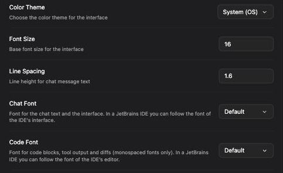
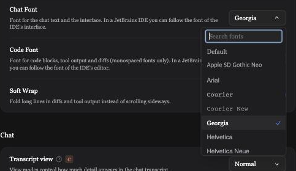
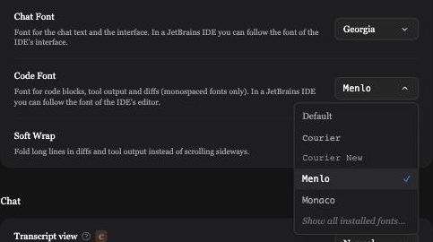

# 채팅 글꼴과 코드 글꼴을 고르기

> Languages: [English](./en.md) · **한국어**
>
> 이슈: [#729](https://github.com/Swttch/swttch/issues/729) · 풀 리퀘스트: [#733](https://github.com/Swttch/swttch/pull/733)

## 무엇이 바뀌었나

설정 → **모양(Appearance)**에는 이미 글자 크기(**Font Size**)와 줄 사이의 간격(**Line Spacing**)을 고르는 칸이 있었습니다. 이제 **글꼴 자체**도 두 개의 드롭다운으로 고를 수 있습니다.

| 설정 | 바꾸는 것 |
|------|-----------|
| **Chat Font** | 채팅 글, 그리고 나머지 화면(설정 화면, 메뉴, 버튼)의 글꼴 |
| **Code Font** | 코드 블록, 도구와 명령의 출력, diff, 파일 미리보기, 그 밖에 고정폭 글꼴로 그리던 모든 블록의 글꼴 |

각 드롭다운에는 **Default**(기본), 이 컴퓨터에 설치된 글꼴, 그리고 JetBrains IDE에서는 **Follow IDE**(IDE 설정 따르기)가 있습니다. 이 설정이 생기기 전에는 채팅이 항상 시스템의 기본 글꼴을 썼기 때문에, 코드를 오래 읽을 때 쓰는 글꼴이 따로 있는 분에게는 에디터와 모양이 달라 보였습니다. 이제 둘을 같게 맞출 수 있습니다.

## 어디에 있나

**설정**(상단바의 톱니바퀴) → **모양**을 엽니다. 두 드롭다운은 **줄 간격** 아래에 있습니다.

**Default**는 "기본 글꼴을 쓴다"는 뜻이고, 이 설정이 생기기 전의 모양 그대로입니다. 꼭 바꿔야 하는 것은 아닙니다.

## 글꼴 고르기

**Chat Font**를 엽니다. 목록에는 **Default**가 먼저 나오고, 이어서 이 컴퓨터에 설치된 글꼴이 가나다·ABC 순으로 나옵니다. **각 이름은 그 글꼴로 쓰여 있어서** 무엇을 고르는지 눈으로 볼 수 있습니다. 하나를 누르면 채팅 전체가 바로 바뀌고 저장됩니다.

목록이 길어지면 맨 위에 **검색 칸**이 나타납니다. 이름의 일부를 치면 목록이 줄어듭니다. 방향키, Enter, Escape는 다른 드롭다운과 같게 동작합니다.

**Code Font** 드롭다운에는 **고정폭** 글꼴만 나옵니다(모든 글자의 너비가 같은 글꼴). 코드는 그런 글꼴에서만 줄이 맞기 때문입니다.

되돌리려면 같은 드롭다운에서 **Default**를 고릅니다.

### 브라우저의 목록: "Show all installed fonts…"

웹 페이지는 컴퓨터의 글꼴 목록을 스스로 읽을 수 없습니다. JetBrains IDE에서는 플러그인이 시스템의 목록을 채팅에 알려 줍니다. **브라우저**(독립 실행)에서는 이 컴퓨터에 설치된 흔한 글꼴의 짧은 목록이 나오고, 지원하는 브라우저(Chrome, Edge)에서는 마지막에 **Show all installed fonts…**가 하나 더 있습니다. 이것을 고르면 브라우저가 글꼴 목록을 읽어도 되는지 허락을 묻고, 허락하면 설치된 모든 글꼴이 드롭다운에 채워집니다. 거절하면 아무것도 바뀌지 않고 짧은 목록이 그대로 남습니다.

## IDE 설정 따르기 (JetBrains)

JetBrains IDE에서는 드롭다운마다 항목이 하나 더 있습니다: **Follow IDE**.

| 드롭다운 | **Follow IDE**가 가져오는 것 |
|----------|------------------------------|
| **Chat Font** | IDE 자신의 인터페이스 글꼴(메뉴, 도구 창) |
| **Code Font** | IDE **에디터**의 글꼴(*설정 → 에디터 → 글꼴*) |

글꼴은 채팅이 열릴 때 읽고, IDE가 모양을 바꿀 때(IDE 테마를 바꾸거나, IDE의 사용자 지정 인터페이스 글꼴을 켜고 끌 때) 다시 읽습니다. **에디터 글꼴만 바꾸었다면 채팅을 다시 열어야 따라옵니다.** IDE가 쓸 만한 글꼴 이름을 주지 않으면(Mac에서 IDE의 기본 인터페이스 글꼴은 시스템 내부 이름입니다) 기본 글꼴을 씁니다.

**브라우저(독립 실행)에서는 Follow IDE가 나오지 않습니다.** 따라갈 IDE가 없기 때문입니다.

## 한계와 알아 둘 것

- **글꼴은 이 컴퓨터에 설치되어 있어야 합니다.** 채팅은 웹 페이지이고, 웹 페이지는 시스템이 보여 주는 글꼴만 쓸 수 있습니다. **IDE 안에 들어 있는 글꼴**(예: JetBrains Mono)은 IDE가 자기 복사본으로 그리는 것이라 채팅이 볼 수 없습니다. 그래서 **Follow IDE**도 그 글꼴이 컴퓨터에 설치되어 있어야 하고, 설치되어 있지 않으면 채팅은 기본 글꼴을 보여 줍니다. 글꼴 배포 페이지에서 설치한 뒤 채팅을 다시 여세요.
- **목록에는 채팅이 실제로 그릴 수 있는 글꼴만 나옵니다.** 고르나 마나인 이름(설치되지 않았거나 IDE만 아는 글꼴)은 빠지므로, 드롭다운의 모든 항목이 실제로 무언가를 바꿉니다.
- **Chat Font는 메시지뿐 아니라 화면 전체**에 쓰입니다. 설정 화면과 메뉴도 같은 글꼴로 바뀝니다.
- **글자 크기와 줄 간격은 별개입니다.** 글꼴이 달라지면 같은 크기에서도 더 크거나 작아 보일 수 있습니다. 필요하면 **Font Size**를 조절하세요.
- **프로젝트 설정이 덮어쓸 수 있습니다.** **Project Settings (Local)**에서 한 프로젝트만 다른 글꼴을 정할 수 있고, 그때 행에 사용자 설정으로 되돌리는 링크가 있는 배지가 붙습니다.
- **언어.** 글꼴은 모든 언어의 글에 적용됩니다. 다만 어떤 문자의 글리프가 없는 글꼴(예: 한글이 없는 라틴 전용 코드 글꼴)은 그 문자에서 건너뛰고 기본 글꼴이 그립니다.
- **설정 파일에 이미 있는데 목록에 없는 글꼴**(예: 손으로 적어 둔 것)도 드롭다운에 그대로 보입니다. 그래서 칸은 항상 지금 적용된 것을 말해 줍니다.

## 자주 묻는 질문

**글꼴을 골랐는데 달라진 게 없어 보입니다.**
작은 글자에서는 비슷해 보이는 글꼴이 있습니다. 드롭다운에 고른 글꼴이 표시되는지 확인하세요. 나중에 컴퓨터에서 글꼴을 지웠다면 채팅은 조용히 기본 글꼴을 씁니다.

**원하는 글꼴이 목록에 없습니다.**
이 컴퓨터에 설치되어 있지 않거나, 브라우저가 전체 목록을 아직 알려 주지 않은 것입니다(**Show all installed fonts…**를 고르세요). 글꼴을 설치하고 채팅을 다시 여세요.

**설정 화면은 바뀌었는데 어떤 코드 블록은 그대로입니다.**
고정폭 글꼴로 그리던 블록은 모두 **Code Font**를 따릅니다. 따르지 않는 블록을 찾으셨다면 스크린샷과 함께 알려 주세요.

**웹에 있는 글꼴 파일을 쓸 수 있나요?**
아니요. 컴퓨터에 설치된 글꼴만 쓸 수 있습니다.
