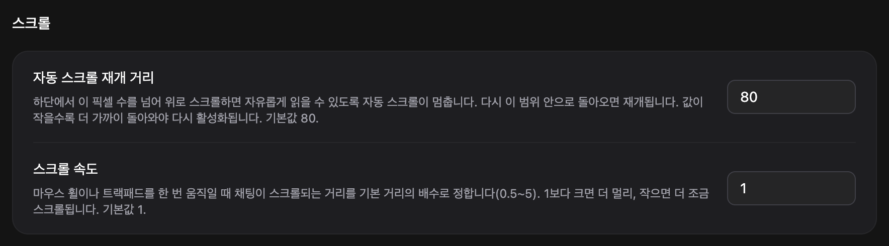

# Choose how far the chat scrolls

> Languages: **English** · [한국어](./ko.md)
>
> Issue: [#717](https://github.com/Swttch/swttch/issues/717)

## What was reported

A user on Linux wrote that scrolling the chat with the mouse wheel felt too slow. One notch of the wheel moved only a few lines, so reading back through a long answer or a long session took many turns of the wheel. The code editor next to the chat felt fine. The only workaround they had found was to zoom the panel out with `Ctrl` + `-`, which puts more lines in each notch but also makes the text smaller than they wanted.

There is now a **Scroll speed** setting. It multiplies the distance one movement of the mouse wheel or the trackpad scrolls the chat. At 1 the chat scrolls the way it always did. At 3 every movement goes three times as far. At 0.5 every movement goes half as far.

## Where it is

Open **Settings** (the gear in the top bar) → **Appearance**. The **Scrolling** section at the bottom has two rows: **Auto-scroll resume distance** and **Scroll speed**.

*The Scrolling section with the default value. The screenshot was taken with the interface in Korean; the two rows are the same in every language.*

Type a number in the box. The setting accepts values from **0.5** to **5**, and the box steps by 0.25 when you use its arrows. A value outside that range is pulled to the nearest edge, so typing 9 gives 5. The change applies at once; there is nothing to restart.

## What it changes

- **The chat transcript.** The long scrolling area that holds the conversation. Both a mouse wheel (one notch is one movement) and a trackpad (a stream of many small movements) are scaled by the same factor. A mouse wheel notch keeps a short smooth glide.
- **Nothing else.** The session list, menus, the settings pages and the boxes inside the chat keep their normal speed.

Some details worth knowing:

- **A scrollable box inside the chat keeps its own speed.** A tall code block, a long tool output or an expanded message scrolls at the normal speed while the pointer is over it and it can still move in the direction you are scrolling. Once it reaches its end, the next movement scrolls the chat itself at your chosen speed.
- **`Ctrl` / `Cmd` + wheel is untouched.** That gesture belongs to the browser's zoom, so the setting ignores it.
- **Sideways movements are untouched.** A wheel or trackpad movement that is mostly horizontal does not change.
- **At 1 the chat is left completely alone.** Nothing is added to the page at the default value, so a chat at speed 1 scrolls exactly as before this setting existed.

## It follows the chat's other scrolling rules

Auto-scroll still works the way the **Auto-scroll resume distance** row describes. Scrolling up at a higher speed leaves the bottom sooner, because each movement goes farther, and scrolling back within the resume distance picks the stream up again.

## Per project

Like the other appearance settings, the value can be set for a single project from the **Project** tab of the settings. A project that does not set its own value inherits the global one, shown dimmed, and the reset arrow next to the row puts a project back on the global value.

## If it does not feel different

- Check the value: the box must show something other than 1.
- A scrollable box under the pointer takes the movement first. Move the pointer onto plain text of the chat, away from a code block, and try again.

## Where it was checked

The distance of one wheel movement was measured in the installed plugin on Windows (IntelliJ IDEA 2024.2 and 2026.3) and on Linux (Wayland, IntelliJ IDEA 2026.3): 100 pixels of wheel movement scrolled 100 pixels at speed 1, 300 at speed 3 and 50 at speed 0.5, for both a single wheel notch and a stream of small trackpad-style movements. It was also tried by hand with a mouse and a trackpad in the browser.
