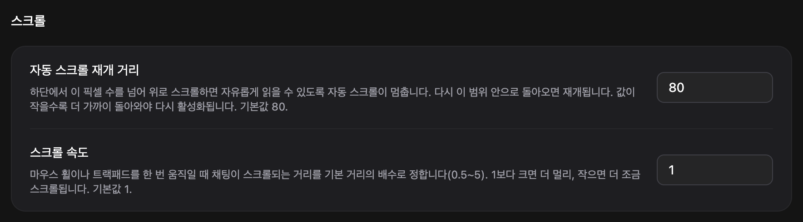

# 채팅이 한 번에 스크롤되는 거리를 고르기

> Languages: [English](./en.md) · **한국어**
>
> 이슈: [#717](https://github.com/Swttch/swttch/issues/717)

## 무엇이 바뀌었나

리눅스를 쓰는 사용자가 채팅을 마우스 휠로 스크롤할 때 너무 느리다고 적어 주셨습니다. 휠을 한 칸 돌려도 몇 줄밖에 움직이지 않아서, 긴 답변이나 긴 세션을 거슬러 읽으려면 휠을 많이 돌려야 했습니다. 바로 옆의 코드 에디터는 괜찮았습니다. 그분이 찾은 유일한 우회책은 `Ctrl` + `-`로 패널을 줄이는 것이었는데, 휠 한 칸에 더 많은 줄이 들어가는 대신 글자가 원하는 것보다 작아졌습니다.

이제 **스크롤 속도(Scroll speed)** 설정이 있습니다. 마우스 휠이나 트랙패드를 한 번 움직일 때 채팅이 스크롤되는 거리에 곱해지는 배수입니다. 1이면 채팅은 지금까지와 똑같이 스크롤됩니다. 3이면 한 번 움직일 때마다 세 배 멀리, 0.5이면 절반만큼 움직입니다.

## 어디에 있나

**설정**(상단바의 톱니바퀴) → **모양(Appearance)**을 엽니다. 맨 아래 **스크롤(Scrolling)** 구역에 두 줄이 있습니다. **자동 스크롤 재개 거리**와 **스크롤 속도**입니다.

*기본값 그대로의 스크롤 구역입니다.*

칸에 숫자를 입력합니다. **0.5**부터 **5**까지 받고, 칸의 화살표를 누르면 0.25씩 움직입니다. 이 범위를 벗어난 값은 가장 가까운 끝으로 맞춰지므로 9를 입력하면 5가 됩니다. 바꾸는 즉시 적용되고, 다시 시작할 것은 없습니다.

## 무엇이 바뀌나

- **채팅 대화 본문.** 대화가 담긴 긴 스크롤 영역입니다. 마우스 휠(한 칸이 한 번의 움직임)과 트랙패드(작은 움직임이 이어지는 입력)가 같은 배수로 바뀝니다. 마우스 휠 한 칸은 짧게 부드럽게 미끄러지는 느낌을 유지합니다.
- **그 밖의 것은 바뀌지 않습니다.** 세션 목록, 메뉴, 설정 화면, 채팅 안의 상자들은 원래 속도 그대로입니다.

알아 두면 좋은 점입니다.

- **채팅 안의 스크롤되는 상자는 자기 속도를 지킵니다.** 길게 늘어난 코드 블록, 긴 도구 출력, 펼친 메시지 위에 포인터가 있고 그 상자가 스크롤하는 방향으로 더 움직일 수 있으면 원래 속도로 움직입니다. 상자의 끝에 닿으면 그다음 움직임부터는 채팅 자체가 고른 속도로 스크롤됩니다.
- **`Ctrl` / `Cmd` + 휠은 건드리지 않습니다.** 그 조작은 브라우저의 확대·축소라서 이 설정이 무시합니다.
- **가로로 움직이는 입력은 건드리지 않습니다.** 대부분 가로인 휠·트랙패드 움직임은 그대로입니다.
- **1이면 채팅을 완전히 그대로 둡니다.** 기본값에서는 화면에 아무것도 더해지지 않으므로, 속도 1의 채팅은 이 설정이 생기기 전과 똑같이 스크롤됩니다.

## 채팅의 다른 스크롤 규칙과 함께 동작합니다

자동 스크롤은 **자동 스크롤 재개 거리** 줄이 설명하는 대로 동작합니다. 높은 속도로 위로 스크롤하면 한 번에 더 멀리 가므로 맨 아래를 더 빨리 벗어나고, 재개 거리 안으로 돌아오면 스트림을 다시 따라갑니다.

## 프로젝트별로

다른 모양 설정과 같이, 설정의 **프로젝트** 탭에서 한 프로젝트에만 값을 정할 수 있습니다. 자기 값을 정하지 않은 프로젝트는 전역 값을 물려받아 흐리게 보이고, 줄 옆의 되돌리기 화살표를 누르면 그 프로젝트가 전역 값으로 돌아갑니다.

## 달라진 느낌이 없다면

- 칸의 값이 1이 아닌지 확인합니다.
- 포인터 아래의 스크롤되는 상자가 움직임을 먼저 받습니다. 코드 블록에서 떨어진 채팅의 일반 글 위로 포인터를 옮겨서 다시 해 봅니다.

## 확인한 곳

설치한 플러그인에서 휠 한 번의 이동 거리를 윈도우(IntelliJ IDEA 2024.2, 2026.3)와 리눅스(Wayland, IntelliJ IDEA 2026.3)에서 쟀습니다. 휠 100픽셀 이동이 속도 1에서 100픽셀, 속도 3에서 300픽셀, 속도 0.5에서 50픽셀 스크롤됐고, 휠 한 칸과 트랙패드처럼 작은 이동이 이어지는 입력 모두 같았습니다. 브라우저에서는 마우스와 트랙패드로 직접 써 보기도 했습니다.
