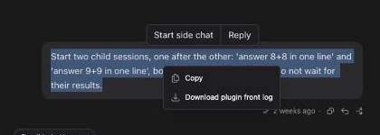
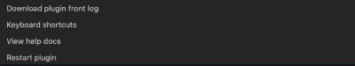

# Selecting text no longer freezes the chat, and the plugin's log can be saved as a file

> Languages: **English** · [한국어](./ko.md)
>
> Issue: [#714](https://github.com/Swttch/swttch/issues/714)

## What was reported

A user wrote that selecting text in the chat froze the whole panel for a minute or more, with one processor core fully busy. It happened with long conversations.

Selecting text with the mouse also counts as a click on the message. The plugin writes every such click to its own log, together with the messages loaded in the chat, so that a bug report can show exactly what the chat was holding. In a long conversation that one log entry was several million characters long. The log keeps a limited amount of text, and making room for such an entry, one old line at a time, could hold the screen for minutes.

## What changed when you click or select

Clicking a message and selecting its text now return at once. The log still records the click, with limits on how long one value may be.

| Size of one value in the log | What is written |
|---|---|
| Up to 32,768 characters | All of it |
| Over 32,768 and up to 1,048,576 characters | The beginning, followed by `… [truncated]` |
| Over 1,048,576 characters | `[omitted: over 1048576 characters]`, and a warning that says how to get the whole of it |

Other values of the same entry, such as the message you clicked, are written as before. When the log is full, the oldest lines are removed many at a time. In a browser, the developer console still receives the complete objects.

## Saving the log as a file

When you need the whole of it, for example to attach to a bug report, save it as a file. There are three ways, and they do the same thing.

1. **Right-click in the message area** and choose **Download plugin front log**.

   

2. **Type `/`** in the message box and choose **Download plugin front log** under **Support**.

   

3. **Press** `Cmd` + `Option` + `Shift` + `G` on macOS, or `Ctrl` + `Alt` + `Shift` + `G` on Windows and Linux. The shortcut is listed in the keyboard shortcut help (`Cmd`/`Ctrl` + `/`).

A save dialog opens: the IDE's own dialog inside a JetBrains IDE, and the operating system's dialog when you use the plugin in a browser. Choose a place and save. A message at the top of the chat shows where the file went. Cancelling the dialog saves nothing.

The file is named `swttch-front-log-<date and time>.log`.

## What the file contains

- The time it was saved and the number of the session.
- When you started from the right-click menu on a message, which message that was.
- The front-end log of this tab.
- Every message loaded in this tab, in full, one per line, as Claude Code wrote it.

**The file contains your conversation.** Read it, or remove what you do not want to share, before you attach it anywhere public.

## The right-click menu

The message area has its own menu with **Copy** and **Download plugin front log**. **Copy** is available when some text is selected.

Your browser's or IDE's usual menu still appears where it has something this menu does not offer: on a link, on a picture or a video, and in a box you can type in. A long press by finger or pen also keeps the usual behaviour, so selecting text on a phone or a tablet works as before.

## Limits

- **Only loaded messages are saved.** A very long conversation is loaded a part at a time. Messages that are not loaded in the tab are not in the file.
- **Shortened log lines stay shortened.** A line that was cut or left out earlier cannot be recovered from the log. The messages themselves are in the file in full.
- **From another device, the dialog opens on the computer that runs the plugin.** If you reach the plugin from a phone over a remote connection, the file is saved on that computer.
- **Large files.** A normal tab gives a file of a few megabytes. A tab that has been open for a very long time can give one larger than the 25 MB that GitHub accepts as an attachment. Compress the file (zip) before attaching it.
