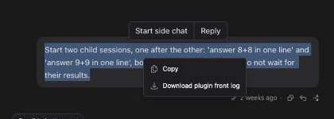
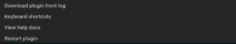

# 글자를 선택해도 채팅이 멈추지 않고, 플러그인 로그를 파일로 저장합니다

> 언어: [English](./en.md) · **한국어**
>
> 이슈: [#714](https://github.com/Swttch/swttch/issues/714)

## 제보 내용

채팅에서 글자를 선택하면 화면 전체가 1분 넘게 멈추고 프로세서 코어 하나가 계속 바쁘게 돈다는 제보였습니다. 긴 대화에서 일어났습니다.

마우스로 글자를 선택하는 동작은 메시지를 클릭한 것으로도 처리됩니다. 플러그인은 메시지를 클릭할 때마다 채팅에 불러온 메시지를 함께 로그에 적습니다. 오류 제보에서 채팅이 무엇을 들고 있었는지 그대로 보여 주기 위해서입니다. 긴 대화에서는 로그 한 건이 수백만 글자였습니다. 로그가 담을 수 있는 양에는 한도가 있고, 긴 한 건의 자리를 만들려고 오래된 줄을 하나씩 지우는 동안 화면이 몇 분씩 멈출 수 있었습니다.

## 클릭하거나 선택할 때 달라진 점

메시지를 클릭하거나 글자를 선택하면 이제 바로 반응합니다. 클릭은 계속 로그에 남고, 값 하나의 길이에만 제한이 생겼습니다.

| 로그에 적을 값 하나의 크기 | 적는 내용 |
|---|---|
| 32,768자 이하 | 전부 |
| 32,768자 초과, 1,048,576자 이하 | 앞부분과 `… [truncated]` |
| 1,048,576자 초과 | `[omitted: over 1048576 characters]`와, 전체를 얻는 방법을 알리는 경고 |

같은 로그의 다른 값, 예를 들어 클릭한 메시지는 전처럼 적습니다. 로그가 가득 차면 오래된 줄을 한 번에 여러 줄씩 지웁니다. 브라우저의 개발자 콘솔에는 지금처럼 값 전체가 전달됩니다.

## 로그를 파일로 저장하기

오류 제보에 첨부할 때처럼 전체 내용이 필요하면 파일로 저장합니다. 방법은 세 가지이고 하는 일은 같습니다.

1. **메시지 영역에서 마우스 오른쪽 버튼**을 누르고 **플러그인 프론트 로그 다운로드**를 고릅니다.

   

2. 입력창에 **`/`를 입력**하고 **지원** 아래의 **Download plugin front log**를 고릅니다. 커맨드 패널의 항목 이름은 영어로 표시됩니다.

   

3. macOS는 `Cmd` + `Option` + `Shift` + `G`, 윈도우와 리눅스는 `Ctrl` + `Alt` + `Shift` + `G`를 누릅니다. 단축키는 단축키 도움말(`Cmd`/`Ctrl` + `/`)에도 나옵니다.

저장 창이 열립니다. JetBrains IDE 안에서는 IDE의 저장 창이, 브라우저에서 플러그인을 쓸 때는 운영체제의 저장 창이 뜹니다. 위치를 골라 저장하면 채팅 위쪽에 저장한 경로가 표시됩니다. 창을 취소하면 아무것도 저장하지 않습니다.

파일 이름은 `swttch-front-log-<날짜와 시각>.log`입니다.

## 파일에 담기는 것

- 저장한 시각과 세션 번호
- 메시지 위에서 우클릭 메뉴로 시작했다면 어느 메시지였는지
- 이 탭의 프론트 로그
- 이 탭에 불러온 모든 메시지 전체. Claude Code가 기록한 그대로 한 줄에 하나씩 담깁니다.

**파일에는 대화 내용이 들어 있습니다.** 공개된 곳에 첨부하기 전에 읽어 보고, 공유하고 싶지 않은 내용은 지우세요.

## 우클릭 메뉴

메시지 영역에는 **복사**와 **플러그인 프론트 로그 다운로드**가 있는 메뉴가 뜹니다. **복사**는 선택한 글자가 있을 때 누를 수 있습니다.

이 메뉴에 없는 기능이 필요한 곳에서는 브라우저나 IDE의 원래 메뉴가 그대로 뜹니다. 링크, 그림, 동영상, 글자를 입력하는 칸이 그렇습니다. 손가락이나 펜으로 길게 누르는 동작도 원래대로라서, 휴대폰과 태블릿에서 글자를 선택하는 방법은 달라지지 않습니다.

## 한계

- **불러온 메시지만 저장합니다.** 아주 긴 대화는 나눠서 불러옵니다. 탭에 불러오지 않은 메시지는 파일에 없습니다.
- **줄여 적은 로그는 되살리지 못합니다.** 앞서 잘렸거나 생략된 로그 줄은 로그에서 복구할 수 없습니다. 메시지 자체는 파일에 전부 담깁니다.
- **다른 기기에서 접속하면 저장 창은 플러그인이 실행 중인 컴퓨터에 뜹니다.** 휴대폰에서 원격으로 접속해 쓰는 경우 파일은 그 컴퓨터에 저장됩니다.
- **큰 파일.** 보통의 탭은 몇 메가바이트짜리 파일이 나옵니다. 아주 오래 열어 둔 탭은 GitHub가 첨부로 받는 25MB를 넘을 수 있습니다. 첨부하기 전에 압축(zip)하세요.
